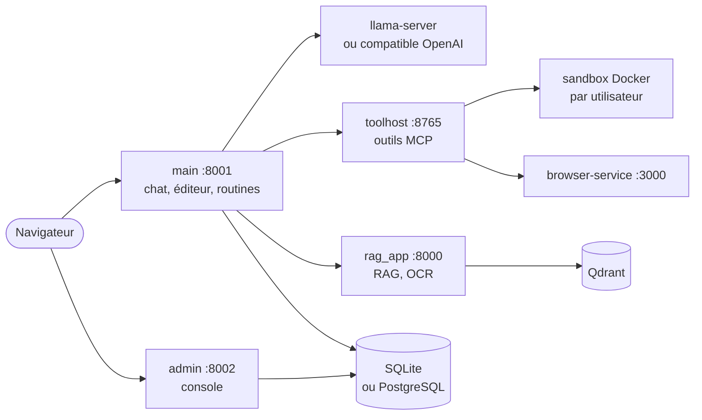

# Elpis

> **Elpis is a self-hosted agentic engineering workspace for teams sharing
> local LLM infrastructure.** It combines an agentic chat
> (tools, sub-agents, long-term memory, skills), a code editor with a per-user
> Docker sandbox and terminal, scheduled routines, a RAG service and an admin
> console. Its core is written in TypeScript and runs on Node.js 24. It talks
> to `llama-server` (llama.cpp) or any OpenAI-compatible
> endpoint. Install on Debian 12/13 or Ubuntu 24.04 with two commands: clone,
> then `./install.sh`, which asks its questions and configures everything (below).
> The documentation is written in French. Licensed under the MIT License.

---

Elpis est un **atelier d'ingénierie agentique auto-hébergé**, pour les équipes
qui partagent une infrastructure LLM locale. Tout tourne sur votre serveur.

- **Chat agentique** : outils (fichiers, shell, Git, navigateur, graphiques),
  sous-agents, mémoire long terme, skills, serveurs MCP externes.
- **Éditeur de code** : Monaco, sandbox Docker par utilisateur, terminal,
  Git intégré, aperçus (HTML, PDF, Office).
- **Routines** : tâches planifiées ou déclenchées par webhook.
- **RAG** : indexation de documents (Qdrant), OCR.
- **Administration** : utilisateurs et groupes, connecteurs LLM, métriques.

## Pourquoi Elpis

- **Une sandbox Docker par utilisateur**, avec quotas : l'agent édite, lance
  les tests et versionne dans un vrai environnement, isolé des autres.
- **Un runtime agentique durable** : verrous entre process, annulation,
  reprise d'une exécution détachée, enregistrement sans écrasement.
- **Une inférence locale partagée** : ordonnanceur llama.cpp (exclusivité de
  modèle, créneaux, disjoncteur) pour plusieurs utilisateurs sur les mêmes
  GPU.
- **Éditeur, Git et terminal dans la même sandbox** que l'agent : ce qu'il
  fait se relit, se teste et se corrige au même endroit.
- **Une console d'administration** : comptes, connecteurs, sandbox, base,
  sauvegardes, métriques.

Là où une interface de chat LLM généraliste s'arrête à la conversation,
Elpis vise le travail sur du code, avec un environnement d'exécution par
utilisateur et une inférence partagée. Suite prévue :
[ROADMAP.md](ROADMAP.md).

## Architecture



main et admin sont deux process du même core TypeScript (Node.js 24,
Fastify) ; `toolhost` est l'hôte d'outils, en TypeScript lui aussi. Restent en
Python : le service RAG, elpis-tools (la famille d'outils Office, servie à
l'hôte d'outils sur `127.0.0.1:8767`), l'agent qui tourne dans chaque sandbox
et l'assistant d'installation. Détail : [ARCHITECTURE.md](ARCHITECTURE.md).

## Sécurité

Le conteneur de chaque utilisateur est la frontière de sécurité. Le serveur
ne lit ni n'écrit le contenu d'une sandbox : fichiers, éditeur, archives et
Git passent par un agent qui tourne dans le conteneur, sous l'utilisateur de
la sandbox (le réseau de Git passe par un relais de l'hôte qui y ajoute les
identifiants). Le compte de service pilote Docker : réservez à Elpis une
machine ou une VM dédiée. Modèle de menace et signalement :
[SECURITY.md](SECURITY.md).

Par défaut, un compte non administrateur ne peut brancher aucun fournisseur
cloud (Anthropic, OpenAI, Mistral…) avec sa propre clé : il utilise le moteur
de l'instance et les connecteurs partagés par l'administrateur. L'administrateur
ouvre les fournisseurs voulus dans Console › Modèles › Accès utilisateurs
(`llm.allowed_provider_types`, [docs/configuration.md](docs/configuration.md)).

## Prérequis

- Debian 12/13 ou Ubuntu 24.04 (amd64), avec `sudo`.
- **Node.js 24** : rien à installer, `install.sh` pose sa propre copie dans
  `node/` (voir ci-dessous) ; Python 3.11 ou plus récent, celui de l'OS.
- **Docker** (sandbox des utilisateurs).
- Un moteur d'inférence : `llama-server` (llama.cpp) ou tout serveur
  **compatible OpenAI** (vLLM, Ollama, LM Studio…), ou un fournisseur distant.
- Les **paquets système** de [deploy/prerequis-apt.txt](deploy/prerequis-apt.txt),
  installés avant `install.sh` : il les vérifie, s'arrête s'il en manque et
  n'installe rien de lui-même. Le socle, plus le groupe de chaque composant
  voulu (Debian 13 ; hors ligne, apt passe par le miroir du LAN ou le support
  de l'OS) :

```bash
# socle : Python et son venv (RAG, elpis-tools, configuration), téléchargements, certificats, mises à jour par git
sudo apt install --no-install-recommends python3 python3-venv git curl \
    ca-certificates openssl
# sandbox : Docker pour la sandbox des utilisateurs (terminal, exécution de code)
sudo apt install --no-install-recommends docker.io docker-cli xz-utils
# apercus-office : LibreOffice dans une prison bubblewrap (aperçus Word, Excel, PowerPoint)
sudo apt install --no-install-recommends bubblewrap \
    libreoffice-writer-nogui libreoffice-calc-nogui libreoffice-impress-nogui \
    fonts-dejavu fonts-liberation fonts-crosextra-carlito \
    fonts-crosextra-caladea
# navigateur : bibliothèques de Chromium pour le service navigateur (liste de Playwright 1.58)
sudo apt install --no-install-recommends xvfb fonts-noto-color-emoji \
    fonts-unifont libfontconfig1 libfreetype6 xfonts-scalable fonts-liberation \
    fonts-ipafont-gothic fonts-wqy-zenhei fonts-tlwg-loma-otf \
    fonts-freefont-ttf libasound2t64 libatk-bridge2.0-0t64 libatk1.0-0t64 \
    libatspi2.0-0t64 libcairo2 libcups2t64 libdbus-1-3 libdrm2 libgbm1 \
    libglib2.0-0t64 libnspr4 libnss3 libpango-1.0-0 libx11-6 libxcb1 \
    libxcomposite1 libxdamage1 libxext6 libxfixes3 libxkbcommon0 libxrandr2
# https : frontal Caddy (certificat local ou Let's Encrypt)
sudo apt install --no-install-recommends caddy
# postgresql-local : serveur PostgreSQL sur cette machine (--db postgres-local)
sudo apt install --no-install-recommends postgresql
# sauvegarde-distante : envoi des sauvegardes par scp ou rsync au-dessus de SSH
sudo apt install --no-install-recommends openssh-client rsync
# construction-hote : compilation de node-pty quand l'hôte d'outils est construit depuis les sources (sans paquet hors ligne)
sudo apt install --no-install-recommends build-essential python3
```

## Installation

```bash
git clone https://github.com/toto-fou/Elpis.git elpis && cd elpis    # 1
./install.sh                                   # 2
```

`install.sh` demande sudo tout de suite (une fois, gardé actif pendant
l'installation), puis ouvre un **assistant par pages** dans le terminal :
toutes les questions d'abord, un résumé, et l'installation se déroule ensuite
sans autre question.

Ce qu'il installe, dans le dossier du dépôt et sous le compte de
l'application :

- `node/` : Node.js 24.21, l'archive officielle de nodejs.org vérifiée par sa
  somme SHA-256 (figée dans `deploy/node/node.env`) et gardée sans npm, npx ni
  corepack ;
- les bundles du core (`apps/core/dist`), de l'hôte d'outils
  (`apps/toolhost/dist`) et de l'interface (`frontend/dist`), construits par
  `npm ci` puis `npm run build` avec le npm de l'archive, retiré ensuite ;
- `venv/` : l'environnement Python du RAG, d'elpis-tools et de la
  configuration (`requirements-rag.txt`) ;
- le service navigateur (`browser-service/`, `npm ci` et Chromium par
  Playwright), Qdrant (binaire officiel, somme vérifiée), l'image Docker de la
  sandbox, puis la base de données et la configuration.

Une installation **en ligne** a besoin d'accéder à : nodejs.org (Node.js), au
registre npm (dépendances du core, de l'interface et du navigateur), à PyPI
(venv), à GitHub (Qdrant), au CDN de Playwright (Chromium). La construction
de l'image de la sandbox tire en plus l'image `debian:bookworm-slim` de Docker
Hub, des paquets des miroirs Debian et de PyPI, et des outils publiés sur
GitHub et download.mozilla.org (Firefox ESR). Un serveur **sans accès à
internet** s'installe depuis un paquet préparé sur une machine connectée :
[docs/exploitation.md](docs/exploitation.md), « Installer un serveur hors
ligne ».

| Page | Contenu |
|---|---|
| Composants | navigateur piloté, LibreOffice, Caddy (HTTPS), moteur vocal local, extras AGPL (cases) ; image sandbox (construite, tirée d'un registre, aucune) |
| Base | SQLite, PostgreSQL préparé sur la machine, ou serveur PostgreSQL existant (hôte, port, identifiants, TLS) |
| LLM | type de serveur, adresse (sondée), modèle choisi parmi ceux annoncés, fournisseur cloud facultatif |
| Accès | HTTP direct, HTTPS certificat local ou Let's Encrypt ; écoute (ce serveur seulement, par défaut, ou réseau local) ; nom d'hôte |
| RAG · Voix · Admin | embeddings (sondés), reranker, OCR ; voix ; compte administrateur |
| Résumé | tout ce qui sera fait ; démarrage (services systemd, maintenant, plus tard) |

Clavier : ↑↓ pour se déplacer, Espace coche, Entrée valide et avance, Tab
change de page, Échap quitte sans rien modifier. Une réponse désactive ce
qu'elle rend inutile : sans Caddy, pas de HTTPS ; base locale, rien à saisir ;
moteur vocal local, adresses fixées ; sans droits administrateur, rien qui
en demande. La base de données est préparée et **testée** juste après
l'environnement Python : un échec arrête l'installation (ou propose
réessayer, modifier, SQLite). `sudo ./install.sh` fonctionne aussi :
l'application tourne alors sous le compte qui a lancé sudo, jamais en root.

Puis ouvrez `http://<serveur>:8001` (ou `https://<serveur>/` en HTTPS) et
connectez-vous avec le compte admin. Sans HTTPS, une installation neuve
n'écoute que sur `127.0.0.1` : `http://127.0.0.1:8001` depuis le serveur, ou
`./elpis configure --listen lan` pour ouvrir au réseau local (HTTP en clair).

Chaque étape reste disponible seule :

```bash
./elpis configure              # revoir la configuration (valeurs actuelles proposées)
sudo ./elpis service install   # services systemd
./elpis start | stop | status | logs [service] | doctor
./elpis backup | upgrade       # sauvegarde, mise à jour (docs/exploitation.md)
./elpis db info | check | transfer | use       # base de données
```

**Sans question** (automatisation, CI) : chaque question a son option.

```bash
./install.sh --yes --with-office --service -- \
    --llm-url http://gpu.example.lan:8080 --admin-user admin --embed-url http://gpu.example.lan:8081
# mot de passe admin : ELPIS_CFG_ADMIN_PASSWORD=… (sinon généré et affiché une fois)
```

| Option de `install.sh` | Effet |
|---|---|
| `--yes` | aucune question (réponses par défaut + options) |
| `--plain` | questions en lignes, sans l'assistant par pages |
| `--dry-run` | affiche le plan sans rien modifier |
| `--with-office` / `--no-office` | aperçus docx/xlsx/pptx (LibreOffice et bubblewrap : prérequis apt) |
| `--with-caddy` / `--no-caddy` | frontal HTTPS Caddy (paquet `caddy` : prérequis apt ; install.sh le configure) |
| `--with-agpl` / `--no-agpl` | PyMuPDF et pdf2docx (licence AGPL, non installés par défaut) |
| `--no-browser` | sans le service navigateur |
| `--sandbox build\|pull\|none`, `--pull IMAGE` | image sandbox construite, tirée, ou aucune |
| `--db sqlite\|postgres-local\|external` | base de données : fichier SQLite (défaut), PostgreSQL préparé sur la machine (paquet `postgresql` : prérequis apt), ou serveur PostgreSQL existant |
| `--offline <dir>` | sans réseau, depuis un paquet produit par `make_release.sh` |
| `--service` / `--start` / `--no-start` | démarrage après installation |
| `-- <options>` | transmises à `./elpis configure` (`./elpis configure --help`) |

## Documentation

- [ARCHITECTURE.md](ARCHITECTURE.md) — carte du code : process, paquets,
  invariants.
- [PRODUCT.md](PRODUCT.md) · [DESIGN.md](DESIGN.md) — public, principes,
  système visuel.
- [AGENTS.md](AGENTS.md) — consignes pour les agents de code (commandes,
  conventions, pièges).
- [CHANGELOG.md](CHANGELOG.md) — journal des modifications.
- [Guide utilisateur](docs/guide-utilisateur.md)
- [Installation et configuration](docs/configuration.md)
- [Exploitation](docs/exploitation.md) — installation hors ligne, mise à
  jour, retour à la version Python (tag `python-final`), sauvegardes,
  supervision.
- [Feuille de route](ROADMAP.md)
- [Architecture, API, sous-systèmes](docs/architecture.md)
- [Passerelle sandbox](docs/sandbox-gateway.md) ·
  [Compteurs de tokens](docs/token-counters.md)
- [Écarts voulus avec la version Python](docs/ecarts-python.md)

## Contribuer, sécurité, licence

- [CONTRIBUTING.md](CONTRIBUTING.md)
- Faille de sécurité : signalement privé, voir [SECURITY.md](SECURITY.md).
- Licence **MIT** ([LICENSE](LICENSE), [NOTICE](NOTICE)). Composants
  tiers : [THIRD_PARTY_NOTICES.md](THIRD_PARTY_NOTICES.md).
