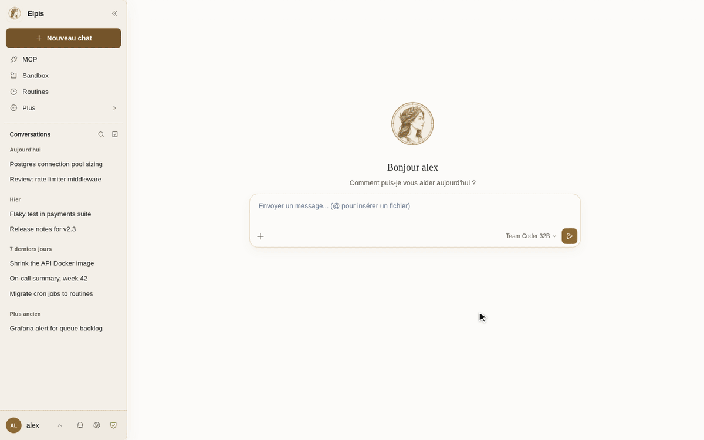
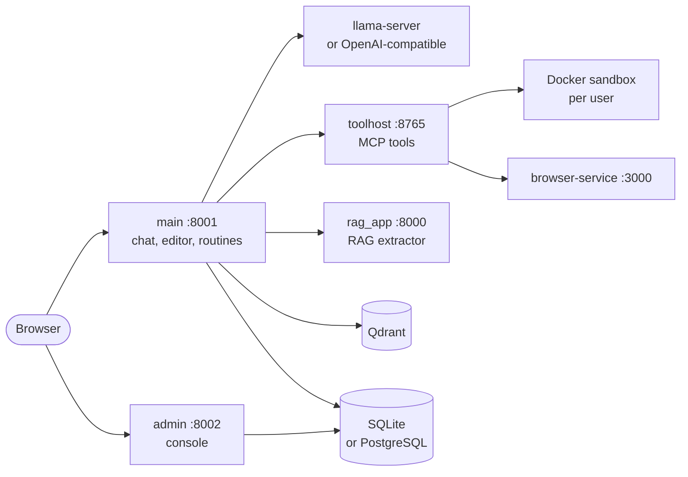

<p align="center">
  
</p>

<h1 align="center">Elpis</h1>

<p align="center">
  <strong>A self-hosted agentic engineering workspace for teams sharing local LLM infrastructure.</strong>
</p>

<p align="center">
  <a href="LICENSE"></a>
  <a href="https://github.com/toto-fou/Elpis/releases"></a>
  
  
  
</p>

<p align="center">
  <b>English</b> · <a href="README_FR.md">Français</a>
</p>

<p align="center">
  
</p>

Elpis brings everything you need to work on code with an agent onto your own
server:

- **Agentic chat**: tools (files, shell, Git, browser, charts), sub-agents,
  long-term memory, skills, external MCP servers.
- **Code editor**: Monaco, a Docker sandbox per user, terminal, built-in Git,
  previews (HTML, PDF, Office).
- **Routines**: scheduled or webhook-triggered tasks.
- **RAG**: per-account document collections, shared with groups, searched by
  the chat with cited sources and a viewer; OCR.
- **Administration**: users and groups, LLM connectors, metrics.

The core is written in TypeScript and runs on Node.js 24. It talks to
`llama-server` (llama.cpp) or any OpenAI-compatible endpoint. The interface
and most of the documentation are still in French; the move to English has
started with this README.

## Why Elpis

- **One Docker sandbox per user**, with quotas: the agent edits, runs the
  tests and commits in a real environment, isolated from everyone else's.
- **A durable agent runtime**: cross-process locks, cancellation, resuming a
  detached run, saving without overwriting.
- **Shared local inference**: a llama.cpp scheduler (model exclusivity, slots,
  circuit breaker) for several users on the same GPUs.
- **Editor, Git and terminal in the same sandbox** as the agent: what it does
  can be reviewed, tested and fixed in one place.
- **An admin console**: accounts, connectors, sandboxes, database, backups,
  metrics.

Where a general-purpose LLM chat stops at the conversation, Elpis targets
work on code, with an execution environment per user and shared inference.
What comes next: [ROADMAP.md](ROADMAP.md).

## Architecture



main and admin are two processes of the same TypeScript core (Node.js 24,
Fastify); `toolhost` is the tool host, also in TypeScript. Still in Python:
the RAG extractor (document parsing), the Office engine (`office/`, a worker
started by the tool host), the agent running inside each sandbox and the
installation wizard. Details: [ARCHITECTURE.md](ARCHITECTURE.md).

## Security

Each user's container is the security boundary. The server never reads or
writes a sandbox's content directly: files, editor, archives and Git go
through an agent running inside the container, as the sandbox user (Git
network traffic goes through a relay on the host, which adds the
credentials). The service account controls Docker: give Elpis a dedicated
machine or VM. Threat model and reporting: [SECURITY.md](SECURITY.md).

By default, a non-admin account cannot connect any cloud provider
(Anthropic, OpenAI, Mistral…) with its own key: it uses the instance's
engine and the connectors shared by the administrator. The administrator
opens the chosen providers in the console, under Modèles › Accès
utilisateurs (`llm.allowed_provider_types`,
[docs/configuration.md](docs/configuration.md)).

## Requirements

- Debian 12/13 or Ubuntu 24.04 (amd64), with `sudo` (or run as root).
- `git` to clone the repository (`sudo apt install git`), or the archive of
  the release you want.
- An inference engine: `llama-server` (llama.cpp) or any
  **OpenAI-compatible** server (vLLM, Ollama, LM Studio…), or a remote
  provider.

`install.sh` takes care of the rest: the OS packages through apt (Python,
Docker, LibreOffice, Chromium libraries, Caddy, PostgreSQL depending on the
components you pick), Node.js 24 in `node/`, and what follows.

## Installation

```bash
git clone https://github.com/toto-fou/Elpis.git elpis && cd elpis    # 1
./install.sh                                   # 2
```

`install.sh` asks for sudo right away (once, kept alive during the
installation), installs the system base if it is missing, then opens a
**paged wizard** in the terminal: all the questions first, a summary, then
the installation runs with no further questions.

On the system side, it installs with `apt-get` (no questions, `apt-get update`
first) the packages from [deploy/prerequis-apt.txt](deploy/prerequis-apt.txt)
that are missing:

- the **base**, before the wizard, which runs in Python: `python3`,
  `python3-venv`, `git`, `curl`, `ca-certificates`, `openssl`;
- after the summary, which lists them, the **groups for the chosen
  components**: Docker (`docker.io`) for the sandbox, LibreOffice and
  bubblewrap for Office previews, the Chromium libraries for the browser,
  Caddy for HTTPS, PostgreSQL for a local database, `build-essential` to
  build the tool host (without an offline package). With the sandbox, the
  application account joins the `docker` group.

Offline, apt goes through the LAN mirror or the OS media. Without admin
rights, or if apt fails, `install.sh` stops with the list of missing
packages and the apt command to run. `--no-apt` checks the packages without
installing them (same stop if any is missing); `--skip-system` neither
checks nor installs them (other systems: install the equivalent of the
file). `./install.sh --dry-run` shows everything it would do, with no
questions, no sudo and nothing written.

It then installs, in the repository folder and under the application
account:

- `node/`: Node.js 24.21, the official nodejs.org archive checked against
  its SHA-256 (pinned in `deploy/node/node.env`) and kept without npm, npx or
  corepack;
- the bundles of the core (`apps/core/dist`), the tool host
  (`apps/toolhost/dist`) and the interface (`frontend/dist`), built with
  `npm ci` then `npm run build` using the archive's npm, removed afterwards;
- `venv/`: the Python environment for the RAG, the Office engine and the
  configuration (`requirements-rag.txt`);
- the browser service (`browser-service/`, `npm ci` and Chromium through
  Playwright), Qdrant (official binary, checksum verified), the sandbox
  Docker image, then the database and the configuration.

An **online** installation needs access to: nodejs.org (Node.js), the npm
registry (dependencies of the core, the interface and the browser), PyPI
(venv), GitHub (Qdrant) and the Playwright CDN (Chromium). Building the
sandbox image also pulls the `debian:bookworm-slim` image from Docker Hub,
packages from the Debian mirrors and PyPI, and tools published on GitHub and
download.mozilla.org (Firefox ESR). A server **without internet access** is
installed from a package prepared on a connected machine:
[docs/exploitation.md](docs/exploitation.md), « Installer un serveur hors
ligne ».

| Page | Content |
|---|---|
| Components | driven browser, LibreOffice, Caddy (HTTPS), local voice engine, AGPL extras (checkboxes); sandbox image (built, pulled from a registry, none) |
| Database | SQLite, PostgreSQL set up on the machine, or an existing PostgreSQL server (host, port, credentials, TLS) |
| LLM | server type, address (probed), model picked among the advertised ones, optional cloud provider |
| Access | plain HTTP, HTTPS with a local certificate or Let's Encrypt; listening (this server only, the default, or the local network); host name |
| RAG · Voice · Admin | embeddings (probed), reranker, OCR; voice; admin account |
| Summary | everything that will be done; startup (systemd services, now, later) |

Keyboard: ↑↓ to move, Space toggles, Enter confirms and moves on, Tab
switches pages, Esc quits without changing anything. An answer disables what
it makes useless: no Caddy, no HTTPS; local database, nothing to type; local
voice engine, fixed addresses; no admin rights, nothing that needs them. The
database is set up and **tested** right after the Python environment: a
failure stops the installation (or offers to retry, edit, or use SQLite).
`sudo ./install.sh` works too: the application then runs under the account
that ran sudo, never as root. As root without sudo (minimal Debian), it runs
under the owner of the repository: clone it with that account, or name it
(`ELPIS_USER=name ./install.sh`).

Then open `http://<server>:8001` (or `https://<server>/` with HTTPS) and sign
in with the admin account. Without HTTPS, a fresh installation only listens
on `127.0.0.1`: `http://127.0.0.1:8001` from the server, or
`./elpis configure --listen lan` to open it to the local network (plain
HTTP).

Each step is also available on its own:

```bash
./elpis configure              # review the configuration (current values offered)
sudo ./elpis service install   # systemd services
./elpis start | stop | status | logs [service] | doctor
./elpis backup | upgrade       # backup, upgrade (docs/exploitation.md)
./elpis db info | check | transfer | use       # database
```

**Without questions** (automation, CI): every question has its option.

```bash
./install.sh --yes --with-office --service -- \
    --llm-url http://gpu.example.lan:8080 --admin-user admin --embed-url http://gpu.example.lan:8081
# admin password: ELPIS_CFG_ADMIN_PASSWORD=… (otherwise generated and shown once)
```

| `install.sh` option | Effect |
|---|---|
| `--yes` | no questions (defaults + options) |
| `--plain` | line-by-line questions, without the paged wizard |
| `--dry-run` | prints, in order, what would be done, with no questions, no sudo and nothing written; non-zero exit code if the installation would stop |
| `--with-office` / `--no-office` | docx/xlsx/pptx previews (LibreOffice and bubblewrap, installed by apt) |
| `--with-caddy` / `--no-caddy` | Caddy HTTPS front end (`caddy` package installed by apt, then configured) |
| `--with-agpl` / `--no-agpl` | PyMuPDF and pdf2docx (AGPL license, not installed by default) |
| `--no-browser` | without the browser service |
| `--sandbox build\|pull\|none`, `--pull IMAGE` | sandbox image built, pulled, or none |
| `--db sqlite\|postgres-local\|external` | database: SQLite file (default), PostgreSQL set up on the machine (`postgresql` package installed by apt), or an existing PostgreSQL server |
| `--offline <dir>` | no network, from a package built by `make_release.sh` (apt: LAN mirror or OS media) |
| `--no-apt` | apt packages checked, never installed: if any is missing, the apt command to run, then stop |
| `--skip-system` | apt packages neither checked nor installed (other systems) |
| `--service` / `--start` / `--no-start` | startup after installation |
| `-- <options>` | passed to `./elpis configure` (`./elpis configure --help`) |

## Documentation

Most of these documents are still in French.

- [ARCHITECTURE.md](ARCHITECTURE.md): map of the code (processes, packages,
  invariants).
- [PRODUCT.md](PRODUCT.md) · [DESIGN.md](DESIGN.md): audience, principles,
  visual system.
- [AGENTS.md](AGENTS.md): instructions for coding agents (commands,
  conventions, pitfalls).
- [CHANGELOG.md](CHANGELOG.md): change log.
- [User guide](docs/guide-utilisateur.md)
- [Installation and configuration](docs/configuration.md)
- [Operations](docs/exploitation.md): offline installation, upgrades,
  rolling back to the Python version (tag `python-final`), backups,
  monitoring.
- [Roadmap](ROADMAP.md)
- [Architecture, API, subsystems](docs/architecture.md)
- [Sandbox gateway](docs/sandbox-gateway.md) ·
  [Token counters](docs/token-counters.md)
- [Intended differences from the Python version](docs/ecarts-python.md)

## Contributing, security, license

- [CONTRIBUTING.md](CONTRIBUTING.md) (DCO sign-off, AI-assisted code) ·
  [CODE_OF_CONDUCT.md](CODE_OF_CONDUCT.md)
- Security issue: report it privately, see [SECURITY.md](SECURITY.md).
- **MIT** license ([LICENSE](LICENSE), [NOTICE](NOTICE)). Third-party
  components: [THIRD_PARTY_NOTICES.md](THIRD_PARTY_NOTICES.md). Name and
  logo: [TRADEMARKS.md](TRADEMARKS.md).
- Maintainer and copyright holder: [toto-fou](https://github.com/toto-fou)
  ([AUTHORS](AUTHORS)).
