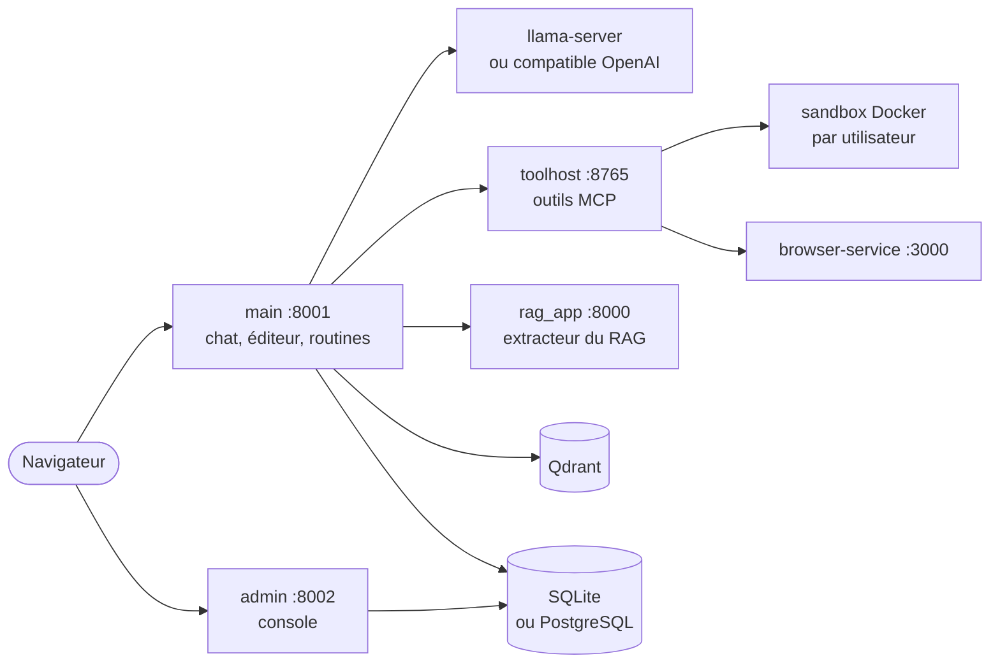

<p align="center">
  
</p>

<h1 align="center">Elpis</h1>

<p align="center">
  <strong>Atelier d'ingénierie agentique auto-hébergé, pour les équipes qui partagent une infrastructure LLM locale.</strong>
</p>

<p align="center">
  <a href="LICENSE"></a>
  <a href="https://github.com/toto-fou/Elpis/releases"></a>
  
  
  
</p>

<p align="center">
  <a href="README.md">English</a> · <b>Français</b>
</p>

<p align="center">
  
</p>

Elpis réunit, sur votre serveur, tout ce qu'il faut pour travailler sur du code
avec un agent :

- **Chat agentique** : outils (fichiers, shell, Git, navigateur, graphiques),
  sous-agents, mémoire long terme, skills, serveurs MCP externes.
- **Éditeur de code** : Monaco, sandbox Docker par utilisateur, terminal,
  Git intégré, aperçus (HTML, PDF, Office).
- **Routines** : tâches planifiées ou déclenchées par webhook.
- **RAG** : collections de documents par compte, publiées aux groupes,
  interrogées par le chat avec sources citées et visionneuse ; OCR.
- **Administration** : utilisateurs et groupes, connecteurs LLM, métriques.

## Pourquoi Elpis

- **Une sandbox Docker par utilisateur**, avec quotas : l'agent édite, lance
  les tests et versionne dans un vrai environnement, isolé des autres.
- **Un runtime agentique durable** : verrous entre process, annulation,
  reprise d'une exécution détachée, enregistrement sans écrasement.
- **Une inférence locale partagée** : ordonnanceur llama.cpp (exclusivité de
  modèle, créneaux, disjoncteur) pour plusieurs utilisateurs sur les mêmes
  GPU.
- **Éditeur, Git et terminal dans la même sandbox** que l'agent : ce qu'il
  fait se relit, se teste et se corrige au même endroit.
- **Une console d'administration** : comptes, connecteurs, sandbox, base,
  sauvegardes, métriques.

Là où une interface de chat LLM généraliste s'arrête à la conversation,
Elpis vise le travail sur du code, avec un environnement d'exécution par
utilisateur et une inférence partagée. Suite prévue :
[ROADMAP.md](ROADMAP.md).

## Architecture



main et admin sont deux process du même core TypeScript (Node.js 24,
Fastify) ; `toolhost` est l'hôte d'outils, en TypeScript lui aussi. Restent en
Python : l'extracteur du RAG (lecture des documents), le moteur Office
(`office/`, un worker que lance l'hôte d'outils), l'agent qui tourne dans chaque
sandbox et l'assistant d'installation. Détail : [ARCHITECTURE.md](ARCHITECTURE.md).

## Sécurité

Le conteneur de chaque utilisateur est la frontière de sécurité. Le serveur
ne lit ni n'écrit le contenu d'une sandbox : fichiers, éditeur, archives et
Git passent par un agent qui tourne dans le conteneur, sous l'utilisateur de
la sandbox (le réseau de Git passe par un relais de l'hôte qui y ajoute les
identifiants). Le compte de service pilote Docker : réservez à Elpis une
machine ou une VM dédiée. Modèle de menace et signalement :
[SECURITY.md](SECURITY.md).

Par défaut, un compte non administrateur ne peut brancher aucun fournisseur
cloud (Anthropic, OpenAI, Mistral…) avec sa propre clé : il utilise le moteur
de l'instance et les connecteurs partagés par l'administrateur. L'administrateur
ouvre les fournisseurs voulus dans Console › Modèles › Accès utilisateurs
(`llm.allowed_provider_types`, [docs/configuration.md](docs/configuration.md)).

## Prérequis

- Debian 12/13 ou Ubuntu 24.04 (amd64), avec `sudo` (ou lancé en root).
- `git` pour cloner le dépôt (`sudo apt install git`), ou l'archive de la
  version voulue.
- Un moteur d'inférence : `llama-server` (llama.cpp) ou tout serveur
  **compatible OpenAI** (vLLM, Ollama, LM Studio…), ou un fournisseur distant.

Le reste vient d'`install.sh` : les paquets de l'OS par apt (Python, Docker,
LibreOffice, bibliothèques de Chromium, Caddy, PostgreSQL selon les
composants choisis), Node.js 24 dans `node/`, et ce qui suit.

## Installation

```bash
git clone https://github.com/toto-fou/Elpis.git elpis && cd elpis    # 1
./install.sh                                   # 2
```

`install.sh` demande sudo tout de suite (une fois, gardé actif pendant
l'installation), installe le socle système s'il manque, puis ouvre un
**assistant par pages** dans le terminal : toutes les questions d'abord, un
résumé, et l'installation se déroule ensuite sans autre question.

Côté système, il installe par `apt-get` (sans question, `apt-get update`
d'abord) les paquets de [deploy/prerequis-apt.txt](deploy/prerequis-apt.txt)
qui manquent :

- le **socle**, avant l'assistant, qui tourne en Python : `python3`,
  `python3-venv`, `git`, `curl`, `ca-certificates`, `openssl` ;
- après le résumé, qui les liste, les **groupes des composants choisis** :
  Docker (`docker.io`) pour la sandbox, LibreOffice et bubblewrap pour les
  aperçus Office, les bibliothèques de Chromium pour le navigateur, Caddy pour
  le HTTPS, PostgreSQL pour une base locale, `build-essential` pour construire
  l'hôte d'outils (sans paquet hors ligne). Avec la sandbox, le compte de
  l'application entre dans le groupe `docker`.

Hors ligne, apt passe par le miroir du LAN ou le support de l'OS. Sans droits
administrateur, ou si apt échoue, `install.sh` s'arrête sur la liste des
paquets manquants et la commande apt à lancer. `--no-apt` vérifie les paquets
sans les installer (même arrêt s'il en manque) ; `--skip-system` ne les
vérifie ni ne les installe (autre système : installez l'équivalent du
fichier). `./install.sh --dry-run` montre tout ce qui serait fait, sans
question, sans sudo et sans rien écrire.

Ce qu'il installe ensuite, dans le dossier du dépôt et sous le compte de
l'application :

- `node/` : Node.js 24.21, l'archive officielle de nodejs.org vérifiée par sa
  somme SHA-256 (figée dans `deploy/node/node.env`) et gardée sans npm, npx ni
  corepack ;
- les bundles du core (`apps/core/dist`), de l'hôte d'outils
  (`apps/toolhost/dist`) et de l'interface (`frontend/dist`), construits par
  `npm ci` puis `npm run build` avec le npm de l'archive, retiré ensuite ;
- `venv/` : l'environnement Python du RAG, du moteur Office et de la
  configuration (`requirements-rag.txt`) ;
- le service navigateur (`browser-service/`, `npm ci` et Chromium par
  Playwright), Qdrant (binaire officiel, somme vérifiée), l'image Docker de la
  sandbox, puis la base de données et la configuration.

Une installation **en ligne** a besoin d'accéder à : nodejs.org (Node.js), au
registre npm (dépendances du core, de l'interface et du navigateur), à PyPI
(venv), à GitHub (Qdrant), au CDN de Playwright (Chromium). La construction
de l'image de la sandbox tire en plus l'image `debian:bookworm-slim` de Docker
Hub, des paquets des miroirs Debian et de PyPI, et des outils publiés sur
GitHub et download.mozilla.org (Firefox ESR). Un serveur **sans accès à
internet** s'installe depuis un paquet préparé sur une machine connectée :
[docs/exploitation.md](docs/exploitation.md), « Installer un serveur hors
ligne ».

| Page | Contenu |
|---|---|
| Composants | navigateur piloté, LibreOffice, Caddy (HTTPS), moteur vocal local, extras AGPL (cases) ; image sandbox (construite, tirée d'un registre, aucune) |
| Base | SQLite, PostgreSQL préparé sur la machine, ou serveur PostgreSQL existant (hôte, port, identifiants, TLS) |
| LLM | type de serveur, adresse (sondée), modèle choisi parmi ceux annoncés, fournisseur cloud facultatif |
| Accès | HTTP direct, HTTPS certificat local ou Let's Encrypt ; écoute (ce serveur seulement, par défaut, ou réseau local) ; nom d'hôte |
| RAG · Voix · Admin | embeddings (sondés), reranker, OCR ; voix ; compte administrateur |
| Résumé | tout ce qui sera fait ; démarrage (services systemd, maintenant, plus tard) |

Clavier : ↑↓ pour se déplacer, Espace coche, Entrée valide et avance, Tab
change de page, Échap quitte sans rien modifier. Une réponse désactive ce
qu'elle rend inutile : sans Caddy, pas de HTTPS ; base locale, rien à saisir ;
moteur vocal local, adresses fixées ; sans droits administrateur, rien qui
en demande. La base de données est préparée et **testée** juste après
l'environnement Python : un échec arrête l'installation (ou propose
réessayer, modifier, SQLite). `sudo ./install.sh` fonctionne aussi :
l'application tourne alors sous le compte qui a lancé sudo, jamais en root.
En root sans sudo (Debian minimale), elle tourne sous le propriétaire du
dépôt : clonez-le avec ce compte, ou indiquez-le (`ELPIS_USER=nom ./install.sh`).

Puis ouvrez `http://<serveur>:8001` (ou `https://<serveur>/` en HTTPS) et
connectez-vous avec le compte admin. Sans HTTPS, une installation neuve
n'écoute que sur `127.0.0.1` : `http://127.0.0.1:8001` depuis le serveur, ou
`./elpis configure --listen lan` pour ouvrir au réseau local (HTTP en clair).

Chaque étape reste disponible seule :

```bash
./elpis configure              # revoir la configuration (valeurs actuelles proposées)
sudo ./elpis service install   # services systemd
./elpis start | stop | status | logs [service] | doctor
./elpis backup | upgrade       # sauvegarde, mise à jour (docs/exploitation.md)
./elpis db info | check | transfer | use       # base de données
```

**Sans question** (automatisation, CI) : chaque question a son option.

```bash
./install.sh --yes --with-office --service -- \
    --llm-url http://gpu.example.lan:8080 --admin-user admin --embed-url http://gpu.example.lan:8081
# mot de passe admin : ELPIS_CFG_ADMIN_PASSWORD=… (sinon généré et affiché une fois)
```

| Option de `install.sh` | Effet |
|---|---|
| `--yes` | aucune question (réponses par défaut + options) |
| `--plain` | questions en lignes, sans l'assistant par pages |
| `--dry-run` | affiche dans l'ordre ce qui serait fait, sans question, sans sudo et sans rien écrire ; code non nul si l'installation s'arrêterait |
| `--with-office` / `--no-office` | aperçus docx/xlsx/pptx (LibreOffice et bubblewrap, installés par apt) |
| `--with-caddy` / `--no-caddy` | frontal HTTPS Caddy (paquet `caddy` installé par apt, puis configuré) |
| `--with-agpl` / `--no-agpl` | PyMuPDF et pdf2docx (licence AGPL, non installés par défaut) |
| `--no-browser` | sans le service navigateur |
| `--sandbox build\|pull\|none`, `--pull IMAGE` | image sandbox construite, tirée, ou aucune |
| `--db sqlite\|postgres-local\|external` | base de données : fichier SQLite (défaut), PostgreSQL préparé sur la machine (paquet `postgresql` installé par apt), ou serveur PostgreSQL existant |
| `--offline <dir>` | sans réseau, depuis un paquet produit par `make_release.sh` (apt : miroir du LAN ou support de l'OS) |
| `--no-apt` | paquets apt vérifiés, jamais installés : s'il en manque, la commande apt à lancer, puis arrêt |
| `--skip-system` | paquets apt ni vérifiés ni installés (autre système) |
| `--service` / `--start` / `--no-start` | démarrage après installation |
| `-- <options>` | transmises à `./elpis configure` (`./elpis configure --help`) |

## Documentation

- [ARCHITECTURE.md](ARCHITECTURE.md) — carte du code : process, paquets,
  invariants.
- [PRODUCT.md](PRODUCT.md) · [DESIGN.md](DESIGN.md) — public, principes,
  système visuel.
- [AGENTS.md](AGENTS.md) — consignes pour les agents de code (commandes,
  conventions, pièges).
- [CHANGELOG.md](CHANGELOG.md) — journal des modifications.
- [Guide utilisateur](docs/guide-utilisateur.md)
- [Installation et configuration](docs/configuration.md)
- [Exploitation](docs/exploitation.md) — installation hors ligne, mise à
  jour, retour à la version Python (tag `python-final`), sauvegardes,
  supervision.
- [Feuille de route](ROADMAP.md)
- [Architecture, API, sous-systèmes](docs/architecture.md)
- [Passerelle sandbox](docs/sandbox-gateway.md) ·
  [Compteurs de tokens](docs/token-counters.md)
- [Écarts voulus avec la version Python](docs/ecarts-python.md)

## Contribuer, sécurité, licence

- [CONTRIBUTING.md](CONTRIBUTING.md) (sign-off DCO, code assisté par IA) ·
  [CODE_OF_CONDUCT.md](CODE_OF_CONDUCT.md)
- Faille de sécurité : signalement privé, voir [SECURITY.md](SECURITY.md).
- Licence **MIT** ([LICENSE](LICENSE), [NOTICE](NOTICE)). Composants
  tiers : [THIRD_PARTY_NOTICES.md](THIRD_PARTY_NOTICES.md). Nom et logo :
  [TRADEMARKS.md](TRADEMARKS.md).
- Mainteneur et titulaire des droits : [toto-fou](https://github.com/toto-fou)
  ([AUTHORS](AUTHORS)).
