# Elpis — Documentation développeur

> Architecture, modules, API, extension.
> Installation et configuration : [configuration.md](configuration.md).
> Guide utilisateur : [guide-utilisateur.md](guide-utilisateur.md).

Les diagrammes sont en **Mermaid** (rendus inline par GitHub, GitLab, VS Code —
et par la modale d'aide de l'application, onglet *Développeur*).

---

## Sommaire

### Vue d'ensemble
- [Présentation technique](#présentation-technique)
- [Stack technique](#stack-technique)
- [Architecture globale](#architecture-globale)
- [Topologie de déploiement](#topologie-de-déploiement)
- [Arborescence du projet](#arborescence-du-projet)

### Installation et configuration
- Voir [configuration.md](configuration.md)

### Architecture interne
- [Organisation modulaire du backend](#organisation-modulaire-du-backend)
- [Base de données](#base-de-données)
- [État partagé entre process](#état-partagé-entre-process)
- [Le harnais de contexte](#le-harnais-de-contexte)
- [La boucle agentique](#la-boucle-agentique)
- [Le flux d'un tour de chat](#le-flux-dun-tour-de-chat)
- [Scheduling LLM et résilience](#scheduling-llm-et-résilience)
- [Cibles d'inférence et fournisseurs](#cibles-dinférence-et-fournisseurs)
- [Cascade de paramètres de sampling](#cascade-de-paramètres-de-sampling)
- [Moteur de métriques](#moteur-de-métriques)
- [Frontend](#frontend)

### Diagrammes de séquence
- [Chat simple avec streaming](#chat-simple-avec-streaming)
- [Chat avec outils (boucle agentique)](#chat-avec-outils-boucle-agentique)
- [Sous-agents (outil `task`)](#sous-agents-outil-task)
- [Mode RAG](#mode-rag)
- [Reprise de génération (Continue)](#reprise-de-génération-continue)
- [Authentification cross-process](#authentification-cross-process)
- [Exécution d'une routine](#exécution-dune-routine)

### Référence API
- [Conventions](#conventions-api)
- [Authentification](#authentification)
- [Conversations](#conversations)
- [Chat LLM streaming](#chat-llm-streaming)
- [Modèles et connecteurs LLM](#modèles-et-connecteurs-llm)
- [Configuration utilisateur](#configuration-utilisateur)
- [Prompts](#prompts)
- [Sandbox : fichiers, exécution, aperçu](#sandbox--fichiers-exécution-aperçu)
- [Sandbox Git et connecteurs Git](#sandbox-git-et-connecteurs-git)
- [Snapshots](#snapshots)
- [Terminal PTY](#terminal-pty)
- [Serveurs MCP](#serveurs-mcp-api)
- [Skills](#skills-api)
- [Mémoire](#mémoire-api)
- [Routines et webhooks](#routines-et-webhooks-api)
- [Studio et desktop](#studio-et-desktop-api)
- [Distribution CLI — OpenCode (LAN)](#distribution-cli--opencode-lan)
- [Page Remote code (`/api/code/*`)](#page-remote-code-apicode)
- [Moteur vocal](#moteur-vocal)
- [Notifications, usage, événements](#notifications-usage-événements)
- [RAG](#rag-api)
- [Administration](#administration-api)

### Sous-systèmes
- [Outils MCP locaux](#outils-mcp-locaux)
  - [Fichiers (`fs_tools`)](#fichiers-fs_tools)
  - [Terminal (`shell_tools`)](#terminal-shell_tools)
  - [Git (`git_tools`)](#git-git_tools)
  - [Navigateur (`firefox_tools`)](#navigateur-firefox_tools)
  - [Contrôle d'écran (`desktop_tools`)](#contrôle-décran-desktop_tools)
  - [Graphiques, mémoire, skills, todo, RAG](#graphiques-mémoire-skills-todo-rag)
  - [Ajouter un module d'outils](#ajouter-un-module-doutils)
- [Sandbox Docker et profils réseau](#sandbox-docker-et-profils-réseau)
- [Sous-agents](#sous-agents)
- [Skills : le loader](#skills--le-loader)
- [Mémoire long terme](#mémoire-long-terme)
- [Routines : le scheduler](#routines--le-scheduler)
- [Studio et agent desktop](#studio-et-agent-desktop)
- [RAG intégré : collections, indexation, extracteur](#rag-intégré--collections-indexation-extracteur)
- [Maintenance périodique](#maintenance-périodique)
- [Sécurité transverse](#sécurité-transverse)

### Annexes
- [Tests](#tests)
- [Problèmes connus](#problèmes-connus)
- [Codes d'erreur HTTP](#codes-derreur-http)
- [Licences](#licences)

---

# Vue d'ensemble

## Présentation technique

Application multi-process :

| Process | Port | Rôle |
|---|---|---|
| **main** | 8001 | Chat, sandbox, éditeur, routines, Studio, Remote code, statiques. Core TypeScript (`apps/core/dist/main.mjs`), un process, compte non privilégié |
| **admin** | 8002 | Uniquement `/api/admin/*` + la console. Même core, un process, **même compte non privilégié** que main (jamais root) |
| **toolhost** | 8765 | Hôte des outils MCP locaux (`apps/toolhost`, bundle Node) : HTTP streamable `/mcp[/<famille>]` et SSE, API sandbox et terminal ; famille Office par un worker Python (`office/`) |
| **llama-server** | 8080 | Moteur d'inférence local, autonome |
| **browser-service** | 3000 | Node + Playwright (outils `pw_*`) — optionnel |
| **rag_app** | 8000 (loopback) | Extracteur du RAG (Python, FastAPI, sans état) : texte structuré, pages rendues, localisation, OCR par un modèle de vision ; appelé par le core seul |
| **qdrant** | 6333 (loopback) | Base vectorielle du RAG (binaire officiel) |
| **Caddy** | 443/8443/80 | Frontal TLS local — optionnel |
| **desktop-agent** | 8765 (sur la machine pilotée) | Contrôle d'écran Windows/Linux — optionnel |

Les process main et admin partagent le **même secret de session** (injecté par
`./elpis` ou l'unité systemd), ce qui rend un cookie valide indifféremment sur les deux ports.

Le core est en TypeScript (`apps/core/`, paquets partagés dans `packages/`).
Les outils liés au compte (mémoire, tâches, skills, graphiques) sont servis
par main lui-même. Le Python restant sert le moteur Office (**`office/`**, un worker de
l'hôte d'outils), l'agent des sandboxes, l'assistant de configuration et l'extracteur du
RAG : **`shared_infra/`** (infrastructure rangée par famille).

---

## Stack technique

| Composant | Technologie |
|---|---|
| Backend | Core et hôte d'outils : Node 24, TypeScript, Fastify ; moteur Office, extracteur du RAG, configuration : Python 3.11+ |
| Base de données | SQLite 3 (WAL) par défaut ; PostgreSQL au choix (core : better-sqlite3, pg ; Python : pg8000) |
| Client HTTP | undici (core, appels LLM) ; httpx (Python) |
| Protocole outils | `@modelcontextprotocol/sdk` (TS) : stdio + SSE + HTTP |
| Chiffrement au repos | `cryptography` / Fernet (clés API, secrets MCP) |
| Frontend | Vue 3.5 + TypeScript strict, SFC compilés par Vite (`@elpis/web`, `frontend/dist`), contrats Zod (`@elpis/contracts`), tests Vitest ; racines SFC `App.vue` / `AppConsole.vue` |
| Styles | Tailwind précompilé (`style.tailwind.css`, généré par `tools/generate_tailwind_css.mjs`) + `style.css` (tokens, skins) |
| Éditeur | Monaco (paquet npm, ESM et workers, chargé à l'ouverture) |
| Terminal | xterm.js (paquet npm, chargé à l'ouverture) |
| Graphiques | Apache ECharts (chat), Chart.js (tableau de bord admin) — paquets npm, chargés à la demande |
| Markdown | Marked + Highlight.js, purifié par DOMPurify |
| Icônes | Phosphor |
| Navigateur | Node 18+, Playwright/Firefox (`browser-service`) |
| Contrôle d'écran | `desktop-agent` (pywinauto / AT-SPI) |
| RAG | Core TS (collections, droits, découpage, BM25, embeddings, Qdrant, recherche, outils du chat) ; extracteur Python (pdfplumber, pypdfium2, LibreOffice, OCR par modèle de vision) dans une prison bubblewrap |
| Frontal TLS | Caddy + PKI openssl locale (10 ans) |

**Build du frontend** : Vite construit `frontend/dist/` à la préparation de la
release (`make_release.sh`) ; le core sert les entrées par leur manifeste (noms
hachés, cache long). Les autres statiques (CSS, skins, assets) gardent le
cache-busting par `BUILD_ID`.

---

## Architecture globale

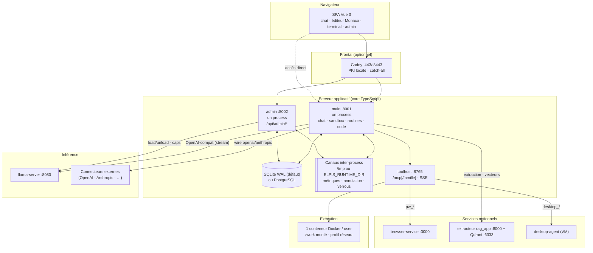

Quatre rôles distincts coexistent :

1. **Serveur applicatif** — sert l'UI, orchestre les outils, persiste en base.
2. **Moteur d'inférence** — `llama-server` local (idéalement en mode routeur),
   et/ou des connecteurs externes résolus par requête.
3. **Exécution** — un conteneur Docker par utilisateur ; c'est la frontière de
   sécurité du shell.
4. **Services satellites** — navigateur, extracteur du RAG et Qdrant, contrôle
   d'écran : découplés par HTTP (le RAG reste éteint sans serveur d'embeddings).

---

## Topologie de déploiement

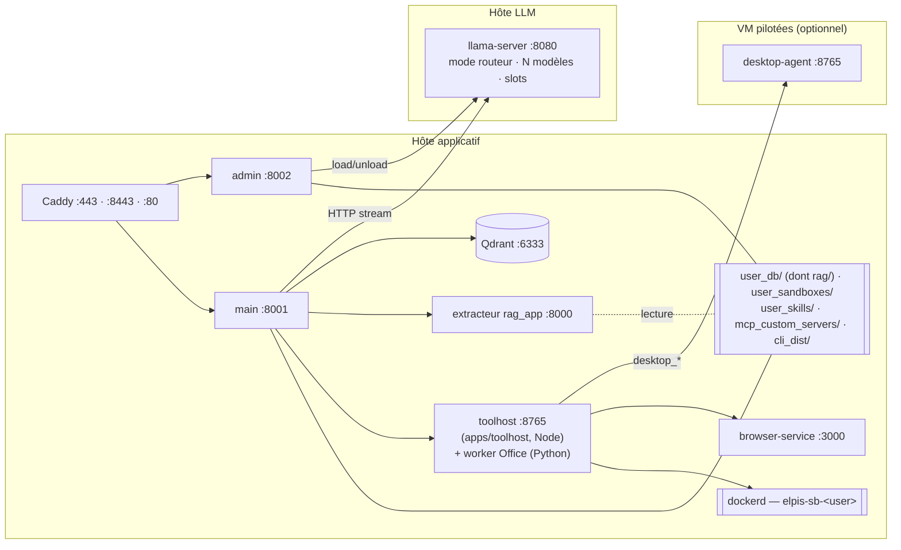

**Rôle de chaque process :**

- **main** (`apps/core/dist/main.mjs`, `APP_MODE=main`) — cœur applicatif ;
  sert aussi les statiques. Un process, sans workers.
- **admin** (même bundle, `APP_MODE=admin`) — isolation des endpoints sensibles,
  sous le même compte non privilégié que main (aucune opération admin n'exige
  root). Les routes d'administration ne sont montées **qu'**en `APP_MODE=admin` :
  en mode `main`, elles sont physiquement absentes de la table de routage, ce
  n'est pas un contrôle d'autorisation runtime.
- **toolhost** (`apps/toolhost`, bundle `apps/toolhost/dist/main.mjs`) — sert
  une fois pour main et admin les outils MCP en HTTP streamable
  (`/mcp[/<famille>]`) et SSE, plus l'API sandbox et terminal ; les familles
  portées en TypeScript de `families` sont servies par lui ;
  évite N cold-starts et N jeux de subprocess ; l'app ne le lance jamais en
  sous-process : c'est un service requis, comme la base. Le même service sert les clients **opencode** des utilisateurs
  (jeton elpis-remote en Bearer, familles fs/shell cachées pour eux).
- **llama-server** — `--jinja` **requis** pour le tool-calling natif.
- **Caddy** — catch-all, PKI locale stable ; le basculement HTTPS ↔ HTTP direct
  se pilote depuis la console admin (le core redémarre et relit son bind).

---

## Arborescence du projet

La carte détaillée du code (un paragraphe par paquet, une ligne par famille de
`shared_infra/`) est dans
[ARCHITECTURE.md › Carte du code](../ARCHITECTURE.md#carte-du-code). Vue
d'ensemble :

```
elpis/
├── apps/            # core/ (core TS, main et admin), toolhost/ (hôte d'outils TS)
├── packages/        # paquets TS partagés : contracts, db, outils-mcp, navigateur…
├── office/          # moteur Office (Python, elpis_office/) : worker de l'hôte d'outils
├── shared_infra/    # infra Python par famille : accounts, db, llm, memory, ops,
│                    #   observability, runtime, sandbox (agent du conteneur), security
├── frontend/        # interface (@elpis/web, Vite) : src/ (TS, SFC), css/, assets/, coquilles index.html et admin.html
├── browser-service/ # Node + Playwright (:3000)
├── desktop-agent/   # agent de contrôle d'écran (Windows/Linux)
├── rag_app/         # extracteur du RAG (Python) : texte, pages, localisation, OCR
├── system_prompts/  # socle, FRAGMENT_*, AGENT_TASK_*…
├── skills/          # skills globaux livrés
├── deploy/          # caddy/, voice/, docker/sandbox/, node/, qdrant/, toolhost/, assistant d'installation
├── user_db/         # données d'instance (base SQLite, secrets, logs) — hors git
├── user_sandboxes/  # un dossier par utilisateur, monté sur /work — hors git
└── install.sh · elpis · make_release.sh · config.example.json
```

[↑ Sommaire](#sommaire)

---

# Architecture interne

## Organisation modulaire du backend

Un espace de travail npm à la racine (Node 24, TypeScript strict, ESM) :

1. **`apps/core/`** — le core, un bundle (`dist/main.mjs`) lancé deux fois :
   `APP_MODE=main` (chat, éditeur, sandbox, routines, statiques) et
   `APP_MODE=admin` (console, `/api/admin/*`). `src/main.ts` (process,
   signaux), `composition.ts` (assemblage des dépendances), `familles/`
   (routes HTTP par famille, montées selon `APP_MODE`, liste dans
   `familles.ts`) ; chat : `tour/` (admission, préparation, exécution, pompe
   NDJSON, persistance) et `boucle/` (boucle agentique) ; LLM : `llm/`
   (fournisseurs, ordonnanceur, santé) et `contexte/` (budget, élagage,
   compression, tokens) ; outils : `outils/`, `relais/` (vers l'hôte d'outils),
   `memoire/`, `skills/`, `graphiques/`, `images/`, `rag/`, `voix/` ;
   exploitation : `admin/`, `administration/`, `ops/`, `observabilite/`,
   `evenements/`, `routines/`, `executions/`, `notifications/`, `interface/`
   (pages, statiques, manifeste Vite).
2. **`apps/toolhost/`** — l'hôte d'outils (`dist/main.mjs`) : familles MCP
   natives, API sandbox (`bac/`, `fichiers/`, `git/`, `office/`, aperçus),
   terminal (`terminal/`, node-pty), worker Python du moteur Office
   (`mcp/office/`).
3. **`packages/`** — paquets partagés par les deux applications :
   `contracts` (schémas Zod du flux NDJSON, des routes REST, du SSE système et
   du WS terminal, consommés aussi par le frontend), `db` (schéma, dialectes
   SQLite/PostgreSQL, migrations), `http` (socle Fastify), `auth` (session,
   gardes de rôle), `securite` (confinement, chiffrement, jetons internes),
   `config` (configuration et réglages vifs), `mcp` et `outils-mcp` (clients,
   serveurs et catalogue d'outils), `bac` et `fichiers` (agent du bac, accès à
   `/work`), `navigateur`, `bureau`, `images`, `skills`, `verrous`, `commun`
   (JSON compatible Python, erreurs).
4. **Python restant** — `office/` (moteur Office, worker de l'hôte d'outils),
   `shared_infra/` (agent du bac, accès à la base pour la configuration),
   `rag_app/`, `desktop-agent/`, `deploy/`.

---

## Base de données

SQLite 3 en WAL (`user_db/app.db`) par défaut ; PostgreSQL au choix
(section `database`, cf. [configuration](configuration.md#base-de-données)).
Pas d'ORM : le code écrit du SQL avec des `?` et lit les lignes par nom ou par
position.

| Module (`packages/db/src/`) | Rôle |
|---|---|
| `base.ts`, `ouvrir.ts` | contrat commun (exécution, transactions réentrantes par contexte async, points de sauvegarde) ; ouverture selon les réglages |
| `sqlite.ts` | better-sqlite3 : lectures libres, écritures et transactions sérialisées, verrou des autres processus attendu sans bloquer |
| `postgres.ts`, `sql.ts` | pg : pool borné, `?` → `$n`, valeurs et erreurs relues comme en SQLite |
| `schema.ts`, `schema.gen.ts` | schéma de référence déclaratif (tables, index, clés étrangères), rendu pour chaque moteur ; plein texte |
| `dialecte.ts` | ce qui diffère d'un moteur à l'autre : début d'écriture, identifiant inséré, `LIKE` sans casse, dates locales, JSON… |
| `init.ts`, `demarrage.ts` | pose du schéma et migrations sous verrou (table `schema_migrations`, `MIGRATIONS_TS`), droits, nettoyage au démarrage |
| `erreurs.ts` | erreurs classées comme celles de `sqlite3` (intégrité, opération, données…) |

Copie entre moteurs : `apps/core/src/ops/transfert.ts` (`./elpis db transfer`).
Le Python restant (assistant de configuration) lit la même base
par `shared_infra/db/`, qui garde le même dialecte.

Une base vide reçoit le schéma de référence d'un coup, et les migrations qu'il
couvre sont tamponnées ; une base existante reçoit ses tables et colonnes
manquantes, puis ses migrations en attente. Plein texte : FTS5 (SQLite),
`tsvector` + GIN avec `unaccent` (PostgreSQL).
Les tests des mainteneurs tournent sur chaque moteur.

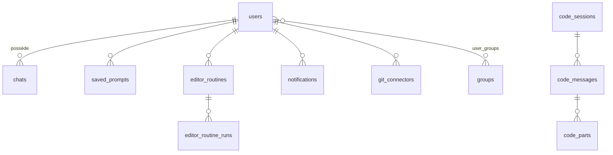

### Tables

| Domaine | Tables |
|---|---|
| **Comptes** | `users` (`settings_json`, `is_admin`, `must_change_pwd`, avatar), `groups`, `user_groups`, `revoked_sessions` |
| **Conversations** | `chats` (`messages_json`, `meta_json` = toggles d'outils, `archived`), `saved_prompts`, `shared_prompts`, `prompt_templates` |
| **Télémétrie** | `usage_events` (registre de conso, 1 ligne/tour), `metric_events` (compteurs), `tool_call_metrics`, `llm_calls`, `daily_usage_reports` |
| **Mémoire** | `session_messages` + `session_messages_fts*` (FTS5) |
| **Routines** | `editor_routines`, `editor_routine_runs`, `editor_webhook_deliveries` |
| **Studio** | `editor_action_cache` (mémoire des ancres du ciblage live) — les scripts d'automatisation sont des fichiers de la sandbox (`automations/`), pas des lignes en base |
| **Remote code** | `code_sessions`, `code_messages`, `code_parts`, `code_clients`, `code_commands`, `code_notes`, `code_permissions`, `code_questions`, `code_meta`, `code_remote_tokens`, `code_pairings` |
| **Connecteurs** | `git_connectors`, `llm_connectors`, `llm_engine_policies`, `mcp_shared_servers` |
| **RAG** | `rag_collections` (propriétaire, visibilité, modèle d'embedding, compteurs), `rag_grants` (groupes d'une publication), `rag_documents`, `rag_jobs` (file d'indexation), `rag_hidden` (« Masquer de ma liste ») ; collections actives d'un chat dans `chats.meta_json.rag` |
| **Images** | `generated_images` (une ligne par image : compte, conversation, modèle, chemin relatif du fichier et de sa vignette, mesures de durée) |
| **Divers** | `notifications`, `terminal_sessions`, `sandbox_placements`, `ax_nodes` / `ax_selectors` / `ax_transitions` / `ax_credentials` |

Schémas de référence :

#### `users`

| Colonne | Type | Description |
|---|---|---|
| `id` | INTEGER PK | |
| `username` | TEXT UNIQUE | |
| `pass_salt` / `pass_hash` | TEXT | PBKDF2-HMAC-SHA256, 150 000 itérations, sel 16 o |
| `created_at` | REAL | Timestamp Unix |
| `is_admin` | INTEGER | |
| `must_change_pwd` | INTEGER | Posé par une réinitialisation admin |
| `avatar` | TEXT | |
| `settings_json` | TEXT | Réglages per-user (clés permises : `apps/core/src/comptes/reglages.ts`) |

#### `chats`

| Colonne | Type | Description |
|---|---|---|
| `id` | TEXT PK | Token hex |
| `user_id` | INTEGER | Propriétaire |
| `title` | TEXT | |
| `messages_json` | TEXT | Historique complet (thinking **strippé** — live only) |
| `meta_json` | TEXT | Toggles d'outils du chat (catégories + `ext:<id>` + `shared:<n>`) |
| `updated_at` | REAL | Sert aussi de jeton de concurrence optimiste |
| `archived` / `archived_at` | INTEGER / REAL | |

#### `editor_routines` / `editor_routine_runs`

`editor_routines` : `cron_expr`, `model`, `connector_id` (serveur d'inférence,
NULL = intégré), `system_prompt`, `task_prompt`, `mcp_snapshot`,
`skills`, `thinking_mode`, `agents_enabled`, `enabled`, `last_fire_minute`,
`webhook_enabled`/`webhook_secret`/`webhook_filter`,
`trigger_after_id`/`trigger_after_on`.

`editor_routine_runs` : `status` (`running`/`ok`/`error`/`skipped`/`cancelled`),
`trigger`, tokens, `summary`, `error`, `tool_limit_reached`, `files`,
`worker_boot_id`, `heartbeat_at`.

### Conventions

- Timestamps en **secondes Unix** (REAL).
- Données structurées en **JSON sérialisé** dans des colonnes TEXT.
- Isolation tenant **applicative** : chaque requête porte `user_id`.
  Pas de filtrage côté base : une requête qui oublie `user_id` lit les données de tous les comptes.
  Les clés étrangères du schéma de référence sont actives (PRAGMA
  `foreign_keys=ON` sur le pool SQLite, natives en PostgreSQL).
- SQL **portable** : identifiants cités dans le DDL (`"groups"`,
  `"key"`, `"trigger"`), dans un upsert les colonnes de la ligne existante
  qualifiées (`table.col`), identifiant d'insertion par `insert_id()`.
- Suppression d'un utilisateur = **cascade applicative** : chats, prompts,
  partages, sandbox, conteneur, connecteurs, routines, notifications, mémoire,
  images générées (lignes et fichiers).
- **Secrets chiffrés au repos** (Fernet, `@elpis/securite`, format partagé avec `shared_infra/security/encryption.py`) pour les
  clés API de connecteurs LLM, du moteur d'images et les secrets d'auth MCP partagés. Les fonctions
  exposées aux routes ne rendent jamais le secret — seulement `has_key` /
  `has_auth`. Seuls les résolveurs host-side lisent la valeur déchiffrée.

---

## État partagé entre process

main est **un seul process** : les tours en cours, les verrous de présence des
conversations, les annulations, le bus d'événements système et celui de la page
Code vivent en mémoire (`apps/core/src/tour/etat.ts`,
`apps/core/src/evenements/`). Entre process (main, admin, hôte d'outils),
un état partagé passe par l'un de ces canaux, jamais par une
variable de module :

| Canal | Module | Ce qu'il résout |
|---|---|---|
| **Base de données** | `packages/db` | Tout état devant survivre au process (chats, routines, sessions révoquées, reprise des sous-agents) |
| **Canal interne main → admin** | `apps/core/src/evenements/canal.ts` (`/api/internal/events`) | Métriques en direct, journaux du staff, « Redémarrage nécessaire » : SSE à tampon circulaire, reprise par `Last-Event-ID` |
| **Verrou `elpis.verrou.v1.1`** | `@elpis/verrous` (`packages/verrous/src/verrou.ts`), `shared_infra/runtime/verrou_fichier.py` côté Python | Un seul planificateur actif (`apps/core/src/routines/meneur.ts`) ; côté Python, nettoyage de démarrage de la base, création du schéma et de la clé de chiffrement |
| **Fichiers d'exécution** | `ELPIS_RUNTIME_DIR` : journal des runs (`tour/journal-run.ts`), journal JSONL commun (`evenements/journal-commun.ts`), cache des catégories d'outils (`outils/categories.ts`) | Se rattacher à un run après un redémarrage ; journal lu par la console ; outils découverts par un autre process |

Une annulation ne passe jamais par les événements système : un Stop arrête le
tour par son AbortSignal ; le ✕ d'un sous-agent vise l'enfant, jamais le tour
parent.

Verrou `elpis.verrou.v1.1` (`@elpis/verrous`, commun avec le Python restant ;
disque local seulement, vérifié par `./elpis doctor`) : la prise crée le
fichier `R.lock` en `O_EXCL` (0600) avec une ligne JSON
`{"v":1,"pid","hote","debut" (ms),"proc","boot","nspid","peremption" (ms)}`.
Un verrou est périmé si, sur la même machine, le même démarrage et le même
espace de PID, son PID n'existe plus (ou est le nôtre sans que ce processus
l'ait pris), si la machine a redémarré depuis, si son fichier n'a pas été
modifié depuis plus que sa péremption (la plus longue du lecteur et du
détenteur), ou si son contenu reste illisible plus de 5 s. Toute suppression
de `R.lock` (reprise d'un périmé comme rendu par son détenteur) se fait sous
`R.lock.reprise`, après relecture : un verrou vivant n'est jamais effacé, et
`R.lock` n'est jamais renommé. Une opération longue déclare un battement : le
détenteur rafraîchit le mtime toutes les péremption / 3. Une erreur d'E/S à la
lecture est remontée, jamais prise pour un verrou illisible. Attente de 10 ms
doublée jusqu'à 200 ms, dans la limite du délai de la ressource ; une attente
de plus de 30 s est journalisée avec le détenteur.

| Ressource | Verrou | Délai | Péremption | Battement |
|---|---|---|---|---|
| Mémoire `USER.md`, `MEMORY.md` | `<fichier>.lock` | 5 s, puis erreur « occupé » | 120 s | non |
| Journal de la mémoire | `.journal.jsonl.lock` | aucun | 120 s | non |
| Skills | `<skills>/.skills_write.lock` | 5 s, puis sans verrou | 120 s | non |
| Historique des fichiers | `file_history/<uid>/.lock` | 5 s, puis sans verrou | 120 s | non |
| Cycle de vie du conteneur | `<sandboxes>/.lifecycle_locks/u<uid>.lock` | 120 s, puis sans verrou | 120 s | oui |
| Migration `P` → `P/work` | `P/.work-migrating.lock` | aucun | 120 s | oui |
| Pose du schéma | `<dossier de la base>/.init_db.lock` | aucun | 120 s | oui |
| Nettoyage au démarrage | `<dossier de la base>/.startup_cleanup.lock` | un essai (pris : on passe) | 120 s | oui |
| Secret de session, clé de chiffrement | `<dossier de la base>/.session_secret.lock`, `.encryption_key.lock` | aucun | 120 s | non |

---

## Le harnais de contexte

Le dossier `apps/core/src/contexte/` répond à « combien pèse ce prompt et que
doit-il contenir ? » par un seul chemin de code. Une responsabilité par
module :

| Module | Responsabilité |
|---|---|
| `tokens.ts` | **L'autorité de comptage.** Exact d'abord (`/tokenize` + `/apply-template` du serveur de la cible, cache), repli estimé **unique**. Personne d'autre ne compte des tokens |
| `budget.ts` | **Tous** les ratios et planchers (réserve de sortie, tiers de compaction, queue protégée), lus dans `context_config.json › budgets` |
| `elagage.ts` | Réduction ordonnée : élagage des sorties d'outils → élagage vision → budget dur |
| `assemblage.ts` | Assemblage **byte-stable** de la tête système (invariant du cache de préfixe) |
| `compresseur.ts`, `porte-compaction.ts`, `etat-compression.ts`, `compression/` | Porte, sérialiseur, résumeur et état persisté de la compaction |

### La tête système, byte-stable

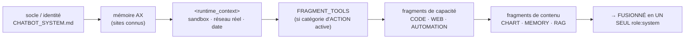

Règles à respecter absolument :

- **Un seul `role:system`.** Certains templates Jinja renvoient 400 au deuxième.
  `foldOperationalBlock` (`contexte/assemblage.ts`) fusionne ;
  `coalesceSystemMessages` (`boucle/chat-commun.ts`) coalesce à l'envoi.
- **Ordre figé** — un golden test vérifie que la tête système est byte-identique
  entre itérations. Un ordre variable détruit le prefix-cache KV.
- **Exception structurelle** : les messages portant un résumé de compression
  (`[COMPRESSED_SUMMARY_V1]`) ne sont **jamais** fusionnés dans le socle — un
  porteur avalé faisait perdre le socle entier à la recompression suivante.
- **Deux étages de fragments** : les catégories d'**action** (fs, shell, git,
  browser, desktop) tirent `FRAGMENT_TOOLS` + `<runtime_context>` + leur fragment
  de capacité ; les catégories de **contenu** (chart, memory, rag) tirent leur
  fragment seul, sans `FRAGMENT_TOOLS`.
- Le `<runtime_context>` est **véridique** : il porte l'état **réel** du réseau
  de la sandbox résolu à l'assemblage, pas une prose figée. Un littéral
  `<runtime_context>` écrit dans une persona **supprime** l'injection.

### Le pipeline de réduction

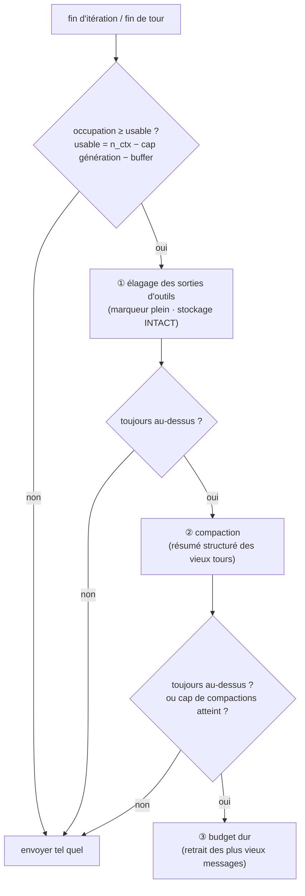

- L'élagage tourne aussi **pendant** un run (`PRUNE_EVERY_ITERS`, défaut 10) :
  un run de plusieurs centaines d'itérations n'élaguait rien auparavant et
  n'avait plus que le budget dur, qui **jette** des messages entiers au lieu
  d'effacer des sorties récupérables.
- Le **stockage reste complet** : le marqueur ne concerne que l'envoi. L'outil
  `session_search` retrouve le contenu.
- `COMPACTIONS_PER_RUN_MAX` (défaut 2) — l'historique n'en autorisait qu'une,
  tenable pour un tour court, absurde pour 200 itérations.
- Le résumé est produit par le modèle courant, un modèle dédié
  (`external_model`), ou un **endpoint dédié** (`endpoint_url`) — la meilleure
  configuration : le serveur principal garde ses slots libres pour les
  conversations.

---

## La boucle agentique

`runChatMultiMcp` (`apps/core/src/boucle/orchestrateur.ts`) enchaîne LLM ↔
outils jusqu'au budget d'itérations ; c'est la seule fonction de chat (un
tour sans outil passe par le même chemin). Le mode `optimized` rend le créneau
LLM pendant les outils. L'**orchestrateur** tient : prélude (vision, catalogue
d'outils, assemblage de la tête système, rappel todo), boucle et compteurs,
aiguillage de chaque tour, point d'étape budget (`<harness_status>`, message
éphémère en queue). Même sur annulation, il purge la dernière capture d'écran
et enregistre l'usage consommé.

**Jalon du budget et réflexion rendue.** Quand la réflexion du tour est rendue au
moteur (SGLang avec « Raisonnement conservé », décidé une fois par run dans
`RunContext.reflexionRendue`) et que le lot vient du canal natif, le jalon est
ajouté à la fin du dernier résultat d'outil du lot, séparé par une ligne vide
(`jalonDansDernierResultat`), et non posé en message `user` : un nouveau `user`
au milieu d'un tour d'outils fait retirer par les gabarits de type Qwen3
(`last_query_index`) la réflexion des assistants précédents, ce qui cassait le
préfixe du cache à chaque jalon. La ligne n'existe que dans les messages de
travail : ni dans la `tool_history` enregistrée, ni dans le `tool_result`
affiché ; l'élagage et le résumé lisent le résultat sans elle
(`sansJalonHarnais`), et la reprise d'un sous-agent la stocke telle qu'envoyée.
Un résultat qui n'est pas du texte, un lot sans résultat ou le canal texte
gardent le message `user`, comme llama.cpp, vLLM et SGLang sans réflexion rendue.

Le reste vit dans des modules de `apps/core/src/boucle/`. Aucun n'importe
l'orchestrateur : c'est lui qui les importe.

| Module (`apps/core/src/boucle/`) | Rôle | Interface |
|---|---|---|
| `run.ts` | état d'un run | `RunContext` (constantes du run), `RunRecord` (trace : événements, delta de l'historique d'outils, raisonnement, usage, lot en cours, fenêtre de contexte, marques d'élagage), `LoopDeps` (dépendances injectées) |
| `apps/core/src/outils/catalogue.ts` | outils du tour | `collectMcpTools` : outils MCP et intégrés en une charge utile `tools[]`, puis filtres (refus, catégories cochées, mode plan, mémoire) |
| `tour-llm.ts` | un tour LLM | `callLlm(…) → LLMTurn` (mesure du contexte, compactions, séries de récupération) |
| `flux-llm.ts` | transport d'un appel | flux SSE → réponse au format OpenAI, replis (sans flux, puis analyse du texte), reprise d'un flux coupé, arrêt côté moteur, disjoncteur |
| `texte-direct.ts` | émission directe | `LiveText` : fenêtre de retenue et portail anti-balisage |
| `reprise.ts`, `reprise-raisonnement.ts` | reprises automatiques | `ResumeState` (`take`, `restore`, `resetChain`, `plan`) |
| `dispatch-outils.ts` | exécution des appels d'outils | `openNativeRound`, `classifyTextReply`, `relaunchUnparsedCall`, `openTextRound`, `runToolBatch → BatchOutcome`, `ChannelSpec` (`NATIF`, `TEXTE`), `CycleGuard`, `TruncationGuard`, un appel isolé (`executeSingleToolCall`) |
| `execution-outils.ts` | ordonnancement d'un lot | `executeToolBatch` : série pour les outils mutants, parallèle borné sinon, ordre du modèle préservé |
| `sortie.ts` | sorties du run | `finishOk`, `finishOnLimit`, `finishOnError` |
| `travail.ts` | messages de travail du run | `travailCanonique` : forme rejouable des messages courants (`OptionsRun.exposerTravail`) |
| `contrat-resultat.ts` | échecs d'outil | `resultIsError`, `resultIsToolFailure` |
| `@elpis/contracts` (`stream-events.gen.ts`) | registre du flux NDJSON | `STREAM_EVENTS`, `LOOP_EVENTS`, `NOT_DISPLAYED` |

Les appels écrits en texte se lisent dans `boucle/analyse-appels.ts`
(`extractToolCalls`, `stripToolCallMarkup`).

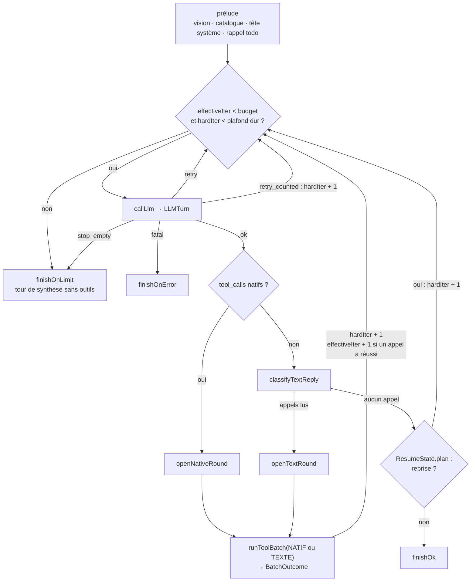

Deux détours ne figurent pas sur le schéma : un appel d'outil coupé par la
limite de génération (`finish=length`) n'est pas exécuté
(`TruncationGuard`, `hardIter + 1`) ; une tentative d'appel illisible ou
perdue dans le raisonnement est relancée, en nombre borné
(`relaunchUnparsedCall`, `hardIter + 1`).

**Interfaces principales**

- **`callLlm` → `LLMTurn`.** Tout ce qui sépare la tête d'itération de la
  réponse décodée : porte de compaction, élagage intra-run, ajustement au
  budget (`fitContext`), consommation de la reprise en attente, créneau LLM,
  appel, récupération des échecs, usage et jauge (`kv_cache`), décodage.
  L'issue est explicite, et `LLMTurn.messages` est TOUJOURS la liste de
  travail à reprendre (la compaction et l'aplatissement la réaffectent) :

  | Issue | Cas | Ce que fait la boucle |
  |---|---|---|
  | `ok` | réponse décodée | appels natifs, appels écrits en texte, reprise ou réponse finale |
  | `retry` | contexte dépassé puis compacté, historique refusé puis aplati, hoquet du moteur | relance l'itération sans rien compter |
  | `retry_counted` | réponse sans `choices` (série bornée) | `hardIter + 1`, puis relance |
  | `stop_empty` | réponses vides en série | sortie par `finishOnLimit` avec cette cause |
  | `fatal` | échec après les récupérations (`error`, `err_kind`) | `finishOnError` |

- **`runToolBatch` → `BatchOutcome`.** Le noyau commun aux deux canaux :
  annulation, événements `tool_call`, exécution du lot (`executeToolBatch`,
  série ou parallèle), post-traitement dans l'ordre du modèle, anti-boucle
  (`CycleGuard`). Il complète la liste de travail en place et dit si au moins
  un appel a réussi et si une boucle d'action persistante a été arrêtée.
- **`ChannelSpec` : `NATIF` et `TEXTE`.** Ce qui diffère volontairement entre
  les `tool_calls` de l'API et les appels écrits dans la prose : la vision
  (natif seulement : suivi des captures, injection différée de la capture
  après le dernier résultat du lot, élagage des vieilles trames), le gabarit
  `result_formatting.fallback_wrapper` (texte seulement), la consigne
  anti-boucle et les libellés de journal. La préparation du lot diffère
  aussi : `openNativeRound` (prose nettoyée, arguments invalides non
  exécutés) et `openTextRound` (`tool_calls` synthétiques, identifiants
  `legacy_*` rendus uniques).
- **`ResumeState`.** Les reprises automatiques d'une génération coupée,
  raisonnement ou rédaction. `take` consomme la demande en attente juste
  avant l'appel, `restore` la rend si l'appel est relancé (sinon la partie
  déjà écrite serait perdue), `resetChain` remet la série à zéro dès qu'un
  lot d'appels est lu, `plan` décide en fin de tour sans appel d'outil.
- **`finishOk`, `finishOnLimit`, `finishOnError`.** Les trois sorties
  d'un run. Chacune rend le texte, les événements et les métriques, dépose le
  delta de l'historique d'outils dans les métriques et enregistre l'usage du
  tour, une ligne par tour, ici et nulle part ailleurs. `finishOnLimit`
  rédige la synthèse par un dernier appel sans outils, avec une consigne
  propre à la cause réelle de l'arrêt.

**Compteurs tenus par l'orchestrateur.** Ce sont des entiers de la boucle,
jamais d'un objet partagé : les sous-routines rendent une décision, la boucle
l'applique.

| Compteur | Avance quand | Rôle |
|---|---|---|
| `effectiveIter` | un lot compte au moins un appel réussi | comparé au budget (`LLAMA_MAX_TOOL_ITERATIONS`, ou `sampling_override.max_tool_iterations`) ; affiché « tour n/max » |
| `hardIter` | chaque lot exécuté, appel coupé, relance d'un appel illisible, reprise automatique, issue `retry_counted` | plafond dur `hardIterCap` (le plus grand de 2 × budget et budget + 10) : arrête une cascade d'échecs |
| `malformedRetry` | chaque relance d'un appel illisible ou perdu | budget de relances, réarmé par une itération productive ou un appel texte lisible |

Les arrêts volontaires (mur d'horloge `LLAMA_TOOL_LOOP_MAX_S`, appels coupés
en série — cause `ctx_saturated` ou `gen_cap` —, boucle d'action, réponses
vides) sortent de la boucle sans toucher à `effectiveIter` : le compteur
affiché reste vrai, et `finishOnLimit` reçoit la cause réelle.

**Dépendances injectées.** La fonction de flux et la métrique d'appel d'outil
(`recordToolCallMetricSafe`) passent par `LoopDeps`, posé au démarrage
(`boucle/branchements.ts`) ; les ports encore ouverts sont dans
`boucle/ports.ts`.

---

## Le flux d'un tour de chat

`POST /api/chat-saved-stream3` (`apps/core/src/familles/chat.ts`) n'enchaîne
que des étapes. Le tour lui-même vit dans `apps/core/src/tour/`, qui n'importe
jamais les routes ; ses invariants et l'ordre de ses événements sont écrits
dans [apps/core/src/tour/README.md](../apps/core/src/tour/README.md).

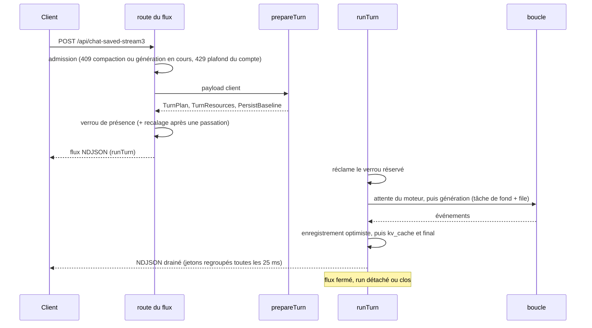

| Module (`apps/core/src/`) | Rôle |
|---|---|
| `familles/chat.ts` | la route du flux, ouverture commune au tour « Images » et au réveilleur des tâches de fond |
| `familles/chat-controle.ts` | « Répondre maintenant », Stop, Stop d'un sous-agent, état d'une génération, exécutions actives, rattachement (`/run/events`) |
| `familles/chat-compression.ts` | compression manuelle et son état |
| `tour/ouverture.ts`, `tour/admission.ts` | admission ; verrou de présence (`acquireGenPresence`, réservation jusqu'à `runTurn`), compactions manuelles en vol |
| `tour/preparation.ts` | `prepareTurn` |
| `tour/execution.ts` | `runTurn` (générateur NDJSON) : attente du moteur, boucle, titre, enregistrement, `final`, détachement |
| `tour/evenements.ts` | pompe NDJSON (`drainCoalesced`), filtre des événements après un Stop, suivi du chargement d'un modèle (`queue_status`) |
| `tour/persistance.ts` | message du tour ou partiel (`messageAssistant`, `messagePartiel`), écriture optimiste, écritures `meta_json` de fin de tour |
| `tour/historique.ts` | historique client ↔ base ↔ modèle (`normalizeClientMessages`, `expandHistoryForLlm`), « Continuer » (`splitForContinue`) |
| `tour/journal-run.ts`, `tour/suivi-run.ts` | journal des événements d'un run, relisible pour s'y rattacher, y compris après un redémarrage |
| `tour/image.ts` | tour « Images » (corps avec `image_gen`) : après les mêmes gardes que le tour du modèle, confié au moteur d'images (`apps/core/src/images/`) ; même verrou de présence, même journal reprenable, exécution `kind=image` ; événements `image_progress`, `image`, `image_prompt`, `image_error` |

**Interfaces principales**

- **`prepareTurn`** rend `(TurnPlan, TurnResources, PersistBaseline)`. Elle
  résout la cible et les serveurs MCP côté serveur, lit le chat, applique les
  interrupteurs du compte (outils, mémoire, sous-agents, compaction, mode
  plan), développe l'historique, branche le RAG et calcule le titre. Elle peut
  encore refuser (400, 409) : rien n'est parti vers le client.
- **`TurnPlan`** : tout ce que la préparation a décidé — identité, cible et
  modèle, outils et refus, compaction et marques d'élagage, historique, titre.
- **`TurnResources`** : fonction de persistance (vide en session éphémère),
  gestionnaire de mémoire, outils RAG intégrés.
- **`PersistBaseline`** : base de l'enregistrement optimiste (`updated_at`,
  `messages`, `title`) et état de compression précédent. La route la recale
  après une passation (Stop puis régénération).
- **`runTurn`** : réclame le verrou de présence avant tout `await`, lance la
  génération, draine sa file vers le client ; à la fermeture du flux, détache
  le run ou le clôt (`shouldDetachRun`, `cloturerRun`).

Invariants : une génération à la fois par conversation ; aucune instruction ne
peut lever entre la prise du verrou et l'ouverture du flux ; adresses MCP
résolues côté serveur ; annulation par l'AbortSignal du tour, partiel
enregistré ; enregistrement optimiste, qui précède `kv_cache` et `final`.
L'ordre des événements est recopié dans la
[référence API](#ordre-des-événements-dun-tour).

---

## Scheduling LLM et résilience

Tout appel de génération passe par l'ordonnanceur du process
(`apps/core/src/llm/ordonnanceur/`, `LLMQueue` et `withLLM`), une file par
serveur d'inférence :

| Niveau | Rôle |
|---|---|
| Modèle (niveau 1) | Empêche un changement de modèle côté serveur pendant une génération : le modèle tenu accueille toute demande, un changement attend la fin des tours. Priorité `high` (chats) avant `low` (compaction, routines), avec une grâce de 8 s et un rang rendu à une demande `low` qui attend depuis plus de 30 s |
| Créneaux (niveau 2) | Limite la concurrence par modèle (`/props.total_slots`, repli `LLAMA_MAX_CONCURRENCY`, ou réglages du connecteur) |
| Disjoncteur (`disjoncteur.ts`) | ≥ `LLM_BREAKER_FAILS` échecs **transport** consécutifs → circuit ouvert `LLM_BREAKER_COOLDOWN_S` → échec immédiat sans occuper de créneau |

Détail : [apps/core/src/llm/ordonnanceur/README.md](../apps/core/src/llm/ordonnanceur/README.md).

**Modes de scheduling** (`llm.scheduling_mode`) :

- `classic` — créneau tenu pendant **toute** la boucle outillée. Pendant un
  `execute_shell` de 30 s, le slot est réservé côté backend même s'il est
  physiquement libre.
- `optimized` — créneau pris puis rendu autour de chaque appel LLM, le modèle
  restant tenu pendant les outils ; au retour, le serveur restaure le cache KV
  (`--cache-ram`). Requiert `/slots`.
- `auto` — sonde `/props` et `/slots` au démarrage et résout vers l'un des deux.

**Taxonomie d'erreur** (`llmErrorKind`, `apps/core/src/llm/reprises.ts`) : chaque échec est classé en
`context_overflow`, `invalid_request`, `rate_limited`, `loading`, `unreachable`,
`timeout`, `unknown`. Chaque genre a un message utilisateur dédié et une
politique de retry propre (backoff exponentiel full-jitter plafonné à
`LLAMA_RETRY_BACKOFF_CAP_S`). Un 503 « modèle en chargement » sur un serveur
local ne brûle pas les retries : on sonde `/health` jusqu'à
`LLAMA_LOADING_WAIT_S`.

> ⚠ En streaming, lire le corps d'une réponse en erreur AVANT de lever,
> sinon le diagnostic du fournisseur disparaît.

---

## Cibles d'inférence et fournisseurs

`LlmTarget` (`apps/core/src/llm/cible.ts`) décrit le backend à utiliser
**pour la requête courante** : format wire, base_url, clé, modèle. Il est porté
par un `AsyncLocalStorage` posé en tête du tour et lu par le transport — il se
propage aux tâches asynchrones, pas besoin de le passer à N signatures.

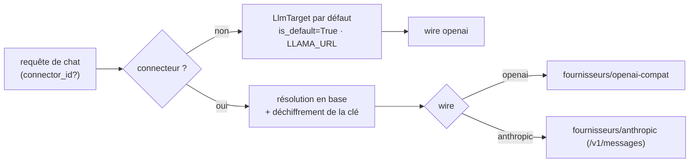

- **`isDefault`** = moteur local (`LLAMA_URL`), quel que soit son type.
- **Profil du moteur** (`apps/core/src/llm/profils.ts`) : le type déclaré
  (`llama.engine` du moteur local, `provider_type` d'un connecteur) donne
  `EngineRef.profil` / `LlmTarget.profil` — adresses (`/props`, `/slots`,
  `/tokenize`, `/v1/tokenize`, `/version`, `/server_info`, `/metrics`…),
  capacités (fenêtre lue sur `/props` ou `max_model_len`, tokenisation exacte,
  file d'Elpis ou lots continus du moteur, chargement à la demande, slots),
  métriques et dialecte (champs étendus de vLLM et SGLang, champs de réflexion lus). Le code LLM lit ces capacités au lieu de tester `llamacpp` ; aucun
  type n'est deviné. `isLlamacpp` / `isLocalLlamacpp` restent des raccourcis.
  Une sonde (`llm/sonde-moteur.ts`) vérifie au démarrage et sur « Tester » les
  adresses du profil et conseille l'option de lancement qui manque. Voir
  [configuration.md](configuration.md#moteur-dinférence-déclaré-llamaengine).
- **Connecteurs** (`apps/core/src/llm/connecteurs.ts`) : portée `user`
  (clé perso) ou `shared` (publié par l'admin). Types : `llamacpp`, `vllm`,
  `sglang`, `openai`, `anthropic`, `mistral`, `groq`, `openrouter`, `deepseek`,
  `moonshot`, `opencode`, `generic`. Les types locaux (`llamacpp`, `vllm`,
  `sglang`, `generic`) sont réservés aux connecteurs partagés. Un compte non
  administrateur ne branche que les types cloud de
  `llm.allowed_provider_types` : absente ou vide, **aucun** ; un compte
  administrateur n'est pas concerné. La liste est revérifiée à chaque
  résolution : un connecteur personnel d'un type fermé n'est plus utilisé. La
  `base_url` d'un connecteur utilisateur vient du preset (anti-SSRF) ; seul
  l'admin en saisit une libre.
- **OpenCode Zen** (`opencode`) : passerelle du projet opencode,
  compatible OpenAI, `https://opencode.ai/zen/v1`. `llm/fournisseurs/decouverte.ts`
  repère les modèles gratuits (suffixe `-free`, convention du fournisseur —
  `GET /v1/models` ne porte aucun prix), les remonte en tête de liste et les
  renvoie dans `free`, que le sélecteur marque d'une pastille « gratuit ».
  ⚠ **Son offre gratuite est réservée au client opencode.** Vérifié avec une
  clé réelle : appelée depuis l'application, elle répond `400 MissingSessionID`
  — « OpenCode's free tier can only be used in OpenCode » — ou `500` sur les
  modèles « contributor » ; la même clé et le même modèle fonctionnent dans
  opencode lui-même. Une clé de palier gratuit ne liste d'ailleurs que ces 6
  modèles. **Aucun traitement particulier dans l'app** : c'est le message
  d'erreur du fournisseur, remonté tel quel, qui dit à l'utilisateur qu'il lui
  faut une clé ouvrant le modèle.
  La fenêtre de contexte de ces modèles ne correspondant à aucune famille connue,
  `PROVIDER_DEFAULT_WINDOWS` (`llm/fenetre-contexte.ts`) donne un défaut conservateur
  (131 072) : sans lui la fenêtre resterait « inconnue » et compaction, élagage
  et budget dur seraient inactifs sur ces modèles.
- **Refus du fournisseur ≠ requête invalide** (`llm/reprises.ts`) :
  `KIND_FORBIDDEN` couvre 401/403 et tout 4xx dont le corps parle d'accès.
  Et `llmErrorUserMessage` fait suivre son conseil du message DU FOURNISSEUR
  quand il en donne un (`providerMessage` : JSON
  `error.message`, une ligne, 220 caractères, jamais une page HTML). Sans ça,
  un refus précis arrivait en « la génération a échoué pour une raison
  inattendue ».
- **Console admin › Connexions › Moteur d'inférence** : les moteurs sont une
  LISTE de lignes (intégré + connecteurs partagés), pas un menu déroulant —
  chaque ligne montre l'adresse, l'état de la clé et porte ses actions
  (tester, supprimer). Même grammaire que la liste des archives de la modale
  Paramètres.
- Le couple **(connecteur, modèle) est atomique** — impossible de router par
  erreur un modèle Anthropic vers un endpoint OpenAI.

---

## Cascade de paramètres de sampling

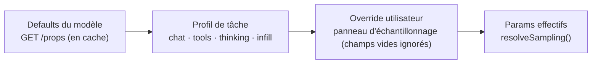

`resolveSampling` (`apps/core/src/llm/parametres.ts`) rend les paramètres
effectifs ; `getModelContextSize` et `getModelTotalSlots` donnent la fenêtre et
les créneaux d'un modèle.

1. **Defaults du modèle** — `GET /props?model=xxx`, mis en cache. Accessibles
   via `default_generation_settings.params.*` (mode routeur) ou
   `.default_generation_settings.*` (mono-modèle). Repli sur les valeurs de
   la configuration si `/props` est indisponible.
2. **Profil de tâche** — chaque type de requête peut surcharger (le profil
   `tools` force une température basse pour des appels déterministes ; les
   profils vivent dans `context_config.json › model_profiles`).
3. **Override utilisateur** — panneau d'échantillonnage. Les champs vides sont ignorés.

> ⚠ **`GET /props?model=X` CHARGE le modèle X** côté routeur. Ne jamais sonder
> un modèle « pour voir » : c'est pourquoi le sélecteur de modèles n'auto-charge
> rien et pourquoi la config OpenCode générée propage les `n_ctx` **déjà connus**
> du cache au lieu de sonder.

**Invalidation des caches** : au chargement ou au déchargement d'un modèle,
via `POST /api/admin/cache/invalidate`, ou par le bouton admin.

---

## Moteur de métriques

### Deux sources, deux rôles

| Table | Ce qu'elle répond | Écrite par |
|---|---|---|
| **`usage_events`** | « Qui a consommé quoi, quand, par quel chemin ? » — **une ligne par tour LLM**, usage RÉEL du backend, avec `user_id`, `source`, `model`, `status` | `recordTurnUsage()` (`apps/core/src/observabilite/usage-contexte.ts`), appelée **dans la boucle LLM** |
| `metric_events` | Compteurs non-LLM : connexions, écritures sandbox, RAG, latence, débit, `proc_*` | `logMetric()` (`observabilite/metriques-evenements.ts`) |

**Pourquoi ce découpage.** La conso était mesurée *chez l'appelant* : la route
de chat journalisait les métriques du tour. Deux conséquences, toutes deux
visibles dans la console :

1. **Double comptage** — un tour outillé était journalisé par la boucle
   (`mode=mcp_native`) *et* par la route (`mode=mcp`) : les KPI de tokens
   valaient environ le double.
2. **Angle mort hors heures** — routines, webhooks et sous-agents ne passent
   jamais par la route : leur consommation n'était journalisée nulle part, et
   les vues d'activité (DAU, heatmap) lisaient `message_sent`, émis par la
   seule route interactive. Tout ce qui tournait sans navigateur affichait 0.

La responsabilité est donc inversée : **la boucle mesure, l'appelant se nomme**
via un `usageScope(...)` (contexte asynchrone, même idiome que `LlmTarget`).
Un chemin qui oublie de se nommer n'est pas perdu — il apparaît en
`source="unknown"`.

```ts
await usageScope("routine", { userId: uid, originId: runKey }, async () => {
  // tout appel LLM sous ce bloc est enregistré une fois, attribué
});
```

### Providers

`GET /api/admin/stats-dynamic` retourne `layout` (liste ordonnée de widgets) +
`data` (indexée par id) ; `?ids=a,b` ne recalcule que les widgets demandés
(chemin de la boucle « live »). Le registre (`apps/core/src/observabilite/registre.ts`)
calcule tous les widgets **en parallèle**, en nombre borné.

**Fenêtre d'observation** (`scope_hours` = 24 / 168 / 720, soit 1 j / 7 j /
30 j) : tout widget dont la valeur dépend d'une période la lit, via
`scopeHours()` / `scopeLabel()`. Les jauges instantanées (RAM, disque,
taille de base, état du moteur, charge live) l'ignorent, à raison.

Trois familles dans `apps/core/src/observabilite/fournisseurs/` : `moteur.ts`
(adoption, perf, système), `usage.ts` (conso, attribution, exploitation — lit
`usage_events` et `editor_routine_runs`), `outils.ts` (outils). Chaque entrée
de `layout` porte `default` (appartenance au **set curé** affiché d'emblée, cf.
`DEFAULT_WIDGETS`) et `purge` (périmètre de réinitialisation, cf. `purgeSpec`)
— l'IHM n'a donc jamais à connaître le schéma.

| Type | Format `data` |
|---|---|
| `value` | `{"value": 42, "unit": "users", "color": "blue", "icon": "ph-users", "detail": "…"}` |
| `bar` / `line` / `doughnut` / `bar_stacked` | Format Chart.js (`labels` + `datasets` + `meta`) |
| `table` | `{"columns": [{"key","label","align"}], "rows": [...]}` |

### Séries temporelles

`observabilite/series.ts` construit d'abord **le calendrier** de la fenêtre,
puis y verse les agrégats : un seau sans données vaut `0` et chaque libellé
porte sa date (ISO) ; une fenêtre à cheval sur minuit ne fusionne pas deux
jours, et les heures creuses valent zéro au lieu de disparaître. Fuseau :
`metrics.timezone` (vide = serveur), annoncé dans `data.meta.timezone`.

La plage « heures de bureau » (`metrics.business_hours`, défaut 8 h–19 h
lun–ven) sépare ce qui tourne pendant qu'on regarde de ce qui tourne seul.

Ajouter un widget : une entrée de plus dans l'une des familles de
`observabilite/fournisseurs/`, sur le contrat de `fournisseurs/base.ts` :

```ts
fournisseur({
  id: "mon_id",
  title: "Mon widget",
  type: "bar",        // value | line | bar | doughnut | bar_stacked | table
  width: "1/2",       // 1/4 | 1/2 | full
  getData: async (ctx, scope) => ({ labels: [], datasets: [] }),
});
```

---

## Frontend

Interface Vue 3.5 en TypeScript, workspace npm `@elpis/web` (`frontend/`),
construite par Vite dans `frontend/dist/` (`npm run build:web`, à la
préparation de la release ; jamais sur le serveur de production, qui est hors
ligne). Entrées : `src/entries/main.ts` (application : chat, éditeur,
routines, Studio…) et `src/entries/admin.ts` (console), précédées de
`diagnostic.ts` (fenêtre d'erreur si rien n'est monté). `index.html` et
`admin.html` les posent par `<!-- @entree … -->`, que
`apps/core/src/interface/pages.ts` remplace par les balises du manifeste Vite
(noms hachés, cache long).

| Zone | Rôle |
|---|---|
| `src/platform/http/` | Client REST typé : `ApiResult<T>` (succès, expiration, refus, conflit, annulation, réseau, erreur serveur, payload invalide), décodage `{"detail"}`/422, XHR rattaché à la session ; `fetchAuth`/`fetchJsonAuth` pour les derniers appelants historiques |
| `src/platform/streams/ndjson.ts` | Lecteur NDJSON du flux de chat |
| `src/features/auth/` | Session (machine d'état, génération, propriétaires de ressources), connexion, déconnexion, config publique, SSE système (`sse-systeme.ts`) |
| `src/features/chat/` | Cœur du chat (`coeur/` : `setupChat`, vue du flux `vue-flux.ts`, envoi, reprise, arrêt, rattachement aux runs, parties reliées par `liens.ts`), reducer exhaustif sur `EvenementFlux`, composeur (`composeur/` : menu « / », templates, dépôt), historique et recherche, défilement virtuel, rendu Markdown/SVG purifié (`rendu/`), segments d'outils, modèles |
| `src/components/chat/` | SFC du chat : colonne (`PageChat`), barre latérale, message, fenêtres (`modales/`) |
| `src/features/editor/`, `src/components/editor/` | Éditeur : Monaco (ESM, workers), arborescence, onglets, vue scindée, sauvegarde (409/412/503), Git, terminal, aperçus, Office ; `src/features/terminal/` (xterm, sessions) |
| `src/features/admin/`, `src/components/admin/` | Console : registre des pages (`registre.ts`), navigation, enregistrement par page, palette Ctrl+K (`champs.gen.ts`, généré), pages en SFC (`Page*.vue`) |
| `src/features/reglages/`, `src/components/reglages/` | Paramètres : apparence et skins, prompts, archives, serveurs MCP, connecteurs, échantillonnage, mémoire |
| `src/features/{routines,studio,images,voix,mascotte,skills,code}/` et `src/components/` du même nom | Routines, Studio d'automatisation, génération d'images, voix (AudioWorklet), mascottes, skills, page Remote code |
| `src/utils/`, `src/modeles/` | Fonctions pures (JSON, ANSI, diff de lignes, édition minimale, modèle Office, scénarios et automatisations) |
| `src/app/racine/`, `src/components/racine/` | Racine de la page : `creerRacine()` (état partagé, session et HTTP, montage des modules), couche commune (toasts, fenêtres de confirmation, menu contextuel), clavier (piège de focus, cascade d'Échap, raccourcis), clic extérieur, défilement du fil, notifications, reprise d'onglet ; `App.vue` (chat) et `AppConsole.vue` (console) |
| `frontend/test/` | Tests Vitest (projet `web`, happy-dom), même découpage |

### Règles d'architecture

- **Contrats aux frontières.** Tout JSON reçu est `unknown` et validé par les
  schémas Zod de `@elpis/contracts` (`packages/contracts`, aussi testés contre
  les réponses du core réel) avant d'entrer dans un modèle. Les événements du
  flux sont une union discriminée ; le reducer les traite tous, les événements
  internes ou ignorés sont listés, un événement inconnu est journalisé sans
  être appliqué.
- **Domaines injectés.** Chaque fonctionnalité expose un domaine typé, fourni
  par `provide` sous une clé (`features/chat/page/domaines.ts`,
  `features/editor/domaine.ts`, `features/admin/domaine.ts`…) et lu par ses
  composants ; une clé absente est nommée au montage. Pas de `$root`, pas de
  store global ; état local pour les fenêtres et contrôles.
- **Objets tiers hors réactivité.** Monaco, xterm, modèles d'éditeur :
  `shallowRef`/`markRaw` et notifications explicites.
- **Chat entrelacé** : texte et outils alternent dans l'ordre réel (`segTexts` +
  `step.seg`) ; `tool_history` est envoyé en **delta**, pas en cumul.
- **Messages gelés** : les messages persistés ne sont pas rendus réactifs
  (`features/chat/historique/historique.ts`) ; mutations par `setMsgUi`
  uniquement.
- **Sérialisation unique** : un seul sérialiseur par payload complexe (ex.
  `execConfigPayload()` de la console).
- **Rendu HTML purifié** : Markdown, SVG et aperçus passent par DOMPurify ;
  aucun `v-html` sur du contenu non purifié.
- **Hors ligne** : aucune ressource externe ; Monaco et xterm sont des chunks
  chargés à l'ouverture, Mermaid, ECharts, Chart.js et highlight.js leurs
  fichiers de distribution copiés par Vite et chargés à la demande
  (`frontend/vendor.config.mts`, `src/platform/vendor.ts`).

### Racine, pages coquilles et build sans compilateur

- **Pages coquilles.** `index.html` et `admin.html` ne contiennent qu'un point
  de montage (`<div id="app">`), la fenêtre de diagnostic et deux marqueurs
  `<!-- @entree … -->` : `diagnostic` (affiche les erreurs capturées si rien
  n'est monté) puis `main` ou `admin`. Aucun script ni style en ligne : les
  styles de page vivent dans `src/styles/`. `apps/core/src/interface/pages.ts`
  développe les marqueurs depuis le manifeste Vite et versionne les statiques
  (`?v=`).
- **Racines SFC.** `src/entries/main.ts` et `admin.ts` montent
  `components/racine/App.vue` (chat) et `AppConsole.vue` (console) par
  `createApp(…).mount("#app")`. Les deux appellent `creerRacine()`
  (`src/app/racine/racine.ts`) : état partagé (`user`, `settings`,
  `messages`…), session et client HTTP, montage des modules (`setupChat`,
  `setupEditor`, `setupAdmin`, `setupReglages`… ; la console n'embarque ni
  l'éditeur ni les pages du chat), contexte passé aux modules, cycle de vie
  (connexion, purge à la déconnexion, reprise d'onglet). L'objet rendu est
  fourni aux domaines injectés. Parties communes : `chrome.ts` (toasts,
  annonces, fenêtres de confirmation, de saisie et de choix, menu contextuel),
  `clavier.ts` (cascade d'Échap, piège Tab des grandes fenêtres, Alt+I,
  Ctrl+Maj+O), `clic-exterieur.ts`, `notifications.ts`, `opencode.ts`,
  `defilement.ts`, `session-onglet.ts`. Aucun global n'est publié pour d'autres
  scripts ; seuls des drapeaux de page (`window.__ADMIN_ONLY_MODE__`, adresses
  de l'autre processus) sont posés avant le montage (`src/app/page.ts`).
- **Vue sans compilateur.** `vue` est résolu vers `vue.runtime.esm-bundler.js`
  (`frontend/vite.config.mts`) : tous les gabarits sont des SFC compilés au
  build ; un test des mainteneurs échoue si le compilateur revient dans un
  chunk.
- **Chargements à la demande.** `src/platform/vendor.ts` (`ensureVendor`)
  charge Mermaid, highlight.js, Chart.js et ECharts depuis leurs fichiers
  hachés (carte `virtual:elpis-vendor` posée par l'entrée) ; Monaco, xterm et
  le moteur d'accueil sont des chunks importés.

### Politique de sécurité du contenu (CSP)

Les pages `/` (chat), `/` et `/admin` (console) reçoivent `POLITIQUE_CSP`
(`apps/core/src/interface/pages.ts`), posée par
`apps/core/src/familles/interface.ts` selon `security.csp` de `config.json`,
relu à chaque page ([configuration](configuration.md#politique-de-sécurité-du-contenu-securitycsp)) :

```
default-src 'self'; script-src 'self'; style-src 'self' 'unsafe-inline';
img-src 'self' data: blob:; media-src 'self' blob:; object-src 'none';
base-uri 'self'; frame-ancestors 'self'; form-action 'self'
```

Aucun script en ligne ni évalué (`eval`, `new Function`) : Zod tourne en mode
`jitless`, posé par `src/platform/zod-sans-eval.ts`, importé en premier par
les entrées (un schéma construit avant lirait `jitless` à faux et sonderait
`new Function`). Chaque ouverture est justifiée par un relevé des violations :
`'unsafe-inline'` pour les styles (Monaco, Mermaid, xterm, ECharts posent des
attributs `style` et des `<style>`), `data:` pour les images jointes, les
logos et les skins, `blob:` pour les captures du navigateur et du Studio et
pour la lecture vocale. Les aperçus du bac et l'écran de consentement OAuth
gardent leur propre politique.

Un document `about:srcdoc`, `about:blank`, `blob:` ou `data:` ouvert par la page
hérite de cette politique : ses scripts en ligne y sont bloqués. Deux cas :

- **Aperçu HTML d'un bloc de code** (`features/chat/rendu/enrichissement.ts`) :
  l'iframe (`sandbox="allow-scripts"`, origine opaque) charge `/apercu-code`,
  page fixe du core avec sa propre politique (`POLITIQUE_APERCU_CODE` : bac à
  sable même ouverte seule, `default-src 'none'`, scripts et styles en ligne,
  images et médias `data:`/`blob:`, `frame-ancestors 'self'`). Son amorce
  annonce « prête » à la fenêtre parente, qui lui envoie le HTML par
  `postMessage` ; elle n'accepte qu'un message de `parent` et l'écrit par
  `document.write`.
- **Export PDF** (`features/chat/export.ts`) : la fenêtre d'impression ne
  contient aucun script ; la page appelle `print()` une fois son document
  chargé. Relevé dans les vérifications navigateur :
`ELPIS_CSP_JOURNAL=<fichier>` ;
`ELPIS_CSP=report-only` pour signaler sans bloquer ; `ELPIS_CSP_POLITIQUE` pose
la politique sur les pages des faux serveurs.

### Pièges connus

- Ne jamais poser de classe de couleur sur `<body>` (le moteur de skins pose
  `body.elpis-skin-<id>`).
- Un `sr-only` focusable dans un conteneur scrollable crée un piège de scroll :
  `overflow: clip` + input en `absolute`.
- Le listener global `Échap` est en **capture** : un `stopPropagation` de
  composant ne suffit pas, il faut s'insérer dans la cascade de
  `src/app/racine/clavier.ts`.
- Une ressource d'un nouveau type (police, worker, iframe d'une autre origine,
  image ou son `blob:`) doit passer la CSP : la relever (`ELPIS_CSP_JOURNAL`)
  avant d'ouvrir une directive dans `POLITIQUE_CSP`.

### Styles

`style.css` porte les tokens (AA vérifié), les blocs de code, les
onglets, les scrollbars, les animations (avec alternative
`prefers-reduced-motion`) et les styles prose Markdown. Accent bleu **unique** ;
les autres couleurs sont sémantiques (statut).

### Skins

- **Registre.** Les skins intégrés sont décrits par
  `frontend/css/skins/skins.json` (`id`, `label`, `desc`, `sw`, `darkBase`,
  `enabled_by_default`, `brand`, `mascot`) ; leur feuille
  `css/skins/<id>.css` est liée en statique par `index.html` et `admin.html`.
  Ardoise (`id` vide) est `style.css` sans classe.
- **Plugins.** Importés (zip) ou créés depuis la console, rangés dans
  `SKINS_DIR` (`APP_SKINS_DIR` ou `skins.dir`, défaut `user_skins/`) :
  `<id>/skin.json` (`id, label, description, version, author, license,
  darkBase, swatch, tokens: {light, dark}, css?, brand?`), `skin.css`
  facultatif, `assets/` (png, jpg, webp, gif). Validation stricte
  (`apps/core/src/apparence/skins.ts`) : jetons `--[a-z0-9-]`, valeurs sans
  `; { } < > \`, `url(` ni `@` ; feuille sans `@import`, sans URL externe (seuls
  `url(assets/…)` et `data:image/…`), images vérifiées par leurs octets. Le
  serveur génère la feuille (`body.elpis-skin-<id>{…}`, variante
  `.elpis-app-dark`, échelle `--radius-*`) ; le front ne lie que celle du skin
  actif (`<link id="elpis-plugin-skin">`).
- **État.** `config.json` › `skins` : `{"enabled": {id: bool}, "default": id}`,
  relu à chaque appel. Un plugin arrive désactivé ; Kiki est désactivé par
  défaut ; Ardoise et le défaut restent actifs. Le réglage utilisateur `skin`
  est ramené au défaut s'il désigne un skin désactivé (GET et PUT).
- **Routes.** `GET /api/skins` (skins activés, défaut, mascottes),
  `GET /api/skins/{id}/skin.css`, `GET /api/skins/{id}/assets/{nom}` (skin
  activé ou administrateur ; aussi montées sur le process admin) ;
  `/api/admin/skins` (`GET`, `PUT` état, `POST` formulaire, `POST /import`,
  `GET /{id}/export`, `DELETE /{id}`), page console *Système › Apparence*.
- **Habillages personnels.** Chaque compte peut avoir ses propres habillages,
  visibles par lui seul : un `skin.json` de **jetons seuls** (ni `skin.css`, ni
  image, ni `brand`, ni `mascot`), rangé dans
  `SKINS_DIR/_comptes/<uid>/<id>/skin.json` (le dossier `_comptes` échappe à
  `pluginSkins`, `_` n'étant pas admis par `ID_RE`). Moteur
  `apps/core/src/apparence/perso.ts` : liste blanche `JETONS_PERSO`, cœur
  `JETONS_REQUIS` exigé en clair et en sombre (un seul jeu avec `darkBase`),
  grammaire stricte des valeurs (couleurs hex / `rgb()` / `hsl()` numériques,
  `--radius` de 0 à 32 px), dérivations des jetons absents, contraste WCAG
  bloquant (4,5:1 texte, 3:1 éléments d'interface, maths dans
  `@elpis/commun/couleurs`) et feuille générée côté serveur sous
  `body.elpis-skin-perso` et `body.elpis-skin-perso.elpis-app-dark`. Routes
  (session) : `GET /api/skins/perso`, `POST /api/skins/perso/verifier`,
  `POST /api/skins/perso` (400 avec le rapport s'il reste une erreur, 409 si
  l'id existe sans `overwrite` ou si le plafond est atteint),
  `DELETE /api/skins/perso/{id}`, `GET /api/skins/perso/{id}/skin.css`
  (propriétaire seul). `GET /api/skins` ajoute les entrées `perso:<id>`
  (fonction active) sans changer sa forme ; `GET /api/skins/perso` donne `max` ; le réglage `skin = "perso:<id>"` n'est accepté que pour le
  propriétaire. Config : `skins.user_custom` (vrai par défaut, faux : routes en
  403 et retour au défaut) et `skins.user_max` (10). Le dossier du compte part
  avec le compte (`comptes/suppression.ts`) et suit la sauvegarde de `SKINS_DIR`.
- **Mascottes.** Registre unique `frontend/assets/mascotte/mascottes.json`,
  lu par le serveur (validation de `welcome_mascot`) et servi à l'interface
  (`mascottes_catalogue`).

[↑ Sommaire](#sommaire)

---

# Diagrammes de séquence

## Chat simple avec streaming

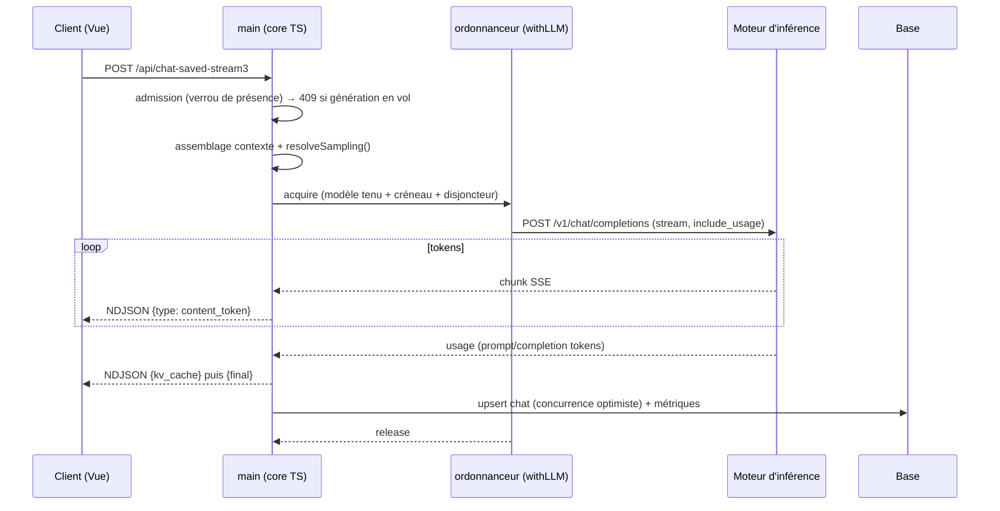

- Le backend ré-applique **son propre** budget de contexte : le client n'est pas
  autorité.
- Le streaming est en **NDJSON** (un objet JSON par ligne), lu au `getReader()`.
- `stream_options.include_usage: true` est obligatoire pour récupérer les tokens
  en streaming.
- La persistance compare `updated_at` (concurrence optimiste) — un conflit
  signifie qu'un autre onglet a écrit entre-temps.

---

## Chat avec outils (boucle agentique)

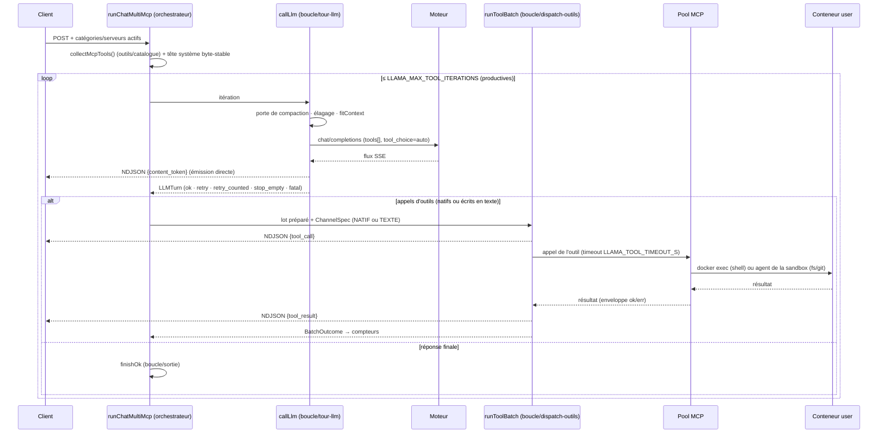

- Le pool MCP **réutilise** les connexions (pas de spawn par requête).
- Seules les itérations **productives** consomment le budget ; le plafond dur
  `hardIterCap` (le plus grand de 2 × budget et budget + 10) arrête une
  cascade d'échecs. Compteurs et issues :
  [La boucle agentique](#la-boucle-agentique).
- Si le moteur ne produit pas de `tool_calls` natifs, le canal texte lit les
  appels écrits dans la réponse avec `extractToolCalls()` (JSON natif,
  backticks, multi-objets, XML GLM ; `classifyTextReply`) ; le lot passe
  ensuite par le même noyau (`runToolBatch`) que les appels natifs.
- Chaque appel est chronométré et journalisé dans `tool_call_metrics` (base des
  pages Observabilité).

---

## Sous-agents (outil `task`)

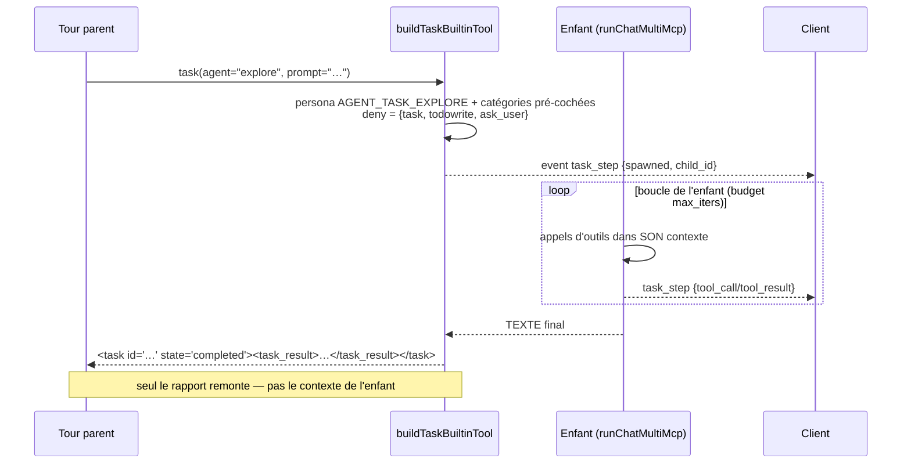

- **Isolation à deux couches** : `denyToolNames` s'applique aussi aux
  catégories cachées et aux builtins (contrairement à `allowedToolNames`).
- **Reprise** : re-passer le `task_id` continue le **même** enfant avec son
  historique (store partagé, TTL `TASK_RESUME_TTL_S`, cap `TASK_RESUME_MAX`).
  Vaut aussi pour les runs interrompus (délai, annulation, échec, limite) :
  l'enveloppe porte le `task_id` à reprendre dès que l'enfant a obtenu un
  résultat d'outil. L'historique stocké est celui de la boucle, lu par
  `OptionsRun.exposerTravail` (`travailCanonique`, `boucle/travail.ts`) et non
  reconstruit depuis les événements : la tête système brute d'origine (l'assemblage
  refusionne le manifeste), puis ce que le moteur a vu après la tête assemblée,
  c'est-à-dire le premier message `user` avec le suffixe fusionné (mémoire AX de
  l'agent web), assistants, résultats d'outils et jalons `<harness_status>` rendus
  en messages ordinaires, sous forme compactée si la boucle a compacté, marques
  d'élagage appliquées, sans clés internes `_…`. Seules les paires appel/résultat
  complètes sont gardées : un appel sans résultat est retiré, un résultat déjà
  obtenu d'un lot interrompu est gardé (jamais rejoué). La réponse finale d'un
  run terminé ferme l'historique. Le préfixe que voit le moteur à la reprise est
  donc celui de son dernier appel (cache de préfixe), tant que le budget de
  contexte n'a rien retiré de sa vue ; un ancien enregistrement (historique de
  `tool_history`, ids `live_*`) se reprend sans changement.
- **Annulation par-enfant** : `POST /api/chat/task-cancel` annule UN
  sous-agent sans toucher au tour parent (`outils/integres/taches-agents.ts`).
- **Aucune récursion** : un sous-agent ne reçoit jamais `task`, quel que soit
  `TASK_SUBAGENT_DEPTH` (sans effet) ; le core et l'hôte d'outils refusent un
  appel `task` venu d'un sous-agent.
- **Tête de l'enfant stable** : le message `system` ne porte que ce qui est fixe
  pour (type d'agent, compte), du plus stable au moins stable : persona, partie
  commune de `<subagent_rules>` (statut, pas de réveil, délai du shell, secrets,
  gabarit de rapport, renvoi à `<task_context>`), index des skills. La boucle y
  ajoute le manifeste des outils, `<runtime_context>` et les fragments de
  capacité, puis le moteur rend les définitions d'outils, que la plupart des
  gabarits placent après le système. Tout ce qui dépend de l'appel (date, budget
  d'itérations, durée, lecture seule ou chemins écrivables, champs exigés
  d'`output_schema`) tient dans un bloc unique `<task_context>`, en tête du
  premier message `user`, suivi du brief : `max_iterations`, `max_seconds`,
  `writable_paths` ou `output_schema` différents ne changent pas un octet du
  préfixe, que le cache de llama.cpp (KV du slot), de vLLM (APC) et de SGLang
  (RadixAttention) réutilisent tant que les tokens sont identiques. Seul un
  jeu d'outils différent (`task(read_only=true)` sur un agent qui écrit)
  change le manifeste et les définitions, donc la fin du préfixe. Une reprise
  par `task_id` garde la tête stockée telle quelle (un ancien enregistrement,
  qui porte `<task_env>` et les règles de lecture seule dans le système, se
  reprend sans changement) ; sa consigne (`consigneReprise`) ouvre le message
  de reprise.
- **Réflexion de l'enfant** : la réflexion reste dans son contexte isolé, seul le
  rapport remonte. Mode par type d'agent (`agents.thinking.defaults`, `off`, `on`
  ou `inherit` = celui du tour parent, que `OptionsTache.thinkingMode` porte),
  surchargé par le choix du compte (`thinking` d'une entrée de `custom_agents`,
  `AgentSpec.thinkingUser`). Effectif = mode voulu ET moteur qui l'honore
  (`reflexionPossible` : vLLM et SGLang acceptent toujours l'interrupteur,
  llama.cpp suit le gabarit via `getThinkingSupport` sans charger le modèle,
  les autres moteurs n'en ont pas ; échec = coupée). Calculé **une fois** au
  lancement de l'enfant et passé à la boucle (`thinkingMode`) : le mode ne varie
  jamais entre deux itérations d'un même enfant, ce qui garde la tête du prompt
  stable. `agents.thinking_budget_tokens` (défaut `LLAMA_THINKING_BUDGET_TOKENS`)
  part dans l'échantillonnage de l'enfant, sauf si le parent en impose un plus
  bas. Sur SGLang, un enfant qui réfléchit reçoit `preserve_reasoning: true`
  (la réflexion de ses tours d'outils repart au gabarit, `reflexionRenvoyee` et
  parseur de réflexion actif), sauf `false` explicite du parent ; llama.cpp et
  vLLM ne reçoivent pas la réflexion des tours d'outils, rien n'est posé. La
  description de l'outil `task` ne cite pas le mode (tête du parent). Le bilan
  `<task_meta>` et l'étape finale `task_step` portent `thinking`.
- **Affinité de slot (llama.cpp)** : `llama-server` garde un cache KV par slot
  et Elpis épingle chaque chat sur un slot (`id_slot`, hachage d'une clé,
  `resolveSlotId` de `apps/core/src/llm/constantes.ts`). L'enfant garde son
  `chatId` (`<chat>#task-<id>`, journal et traces) mais sa **clé d'affinité**
  (`slotKey` de `OptionsRun`) est `<chat parent>#task-<type>` : deux enfants
  successifs du même type, reprise par `task_id` comprise, retombent sur le même
  slot et y retrouvent le préfixe persona + outils au lieu d'écraser un KV
  chaud au hasard. Pendant que `task` s'exécute, le parent est inactif et son
  slot paraît libre dans `/slots` : l'enfant évite donc le dernier slot que le
  parent a réellement pris (`surSlot` de sa boucle, relu par `slotParent`) et
  ceux de ses frères en cours (`slotAvoid`, relu à chaque choix), pour ne pas
  lui faire reprefiller toute sa conversation au retour. S'il n'y a qu'un slot
  ou qu'aucun autre n'est libre, rien n'est évité (slot préféré de la clé) ;
  `--cache-ram` limite alors la casse (voir les modes de scheduling). Un futur
  enfant qui devrait reprendre le KV du parent passerait sa clé sans `slotAvoid`.
- **Parallélisme effectif** : `agents.max_parallel` borne les `task` d'une même
  réponse lancés ensemble. Sur llama.cpp, `runToolBatch` le plafonne à
  `total_slots − 1`, au moins 1 (`plafondParSlots`) : un slot reste au parent,
  sinon des enfants aussi nombreux que les slots se volent le leur à chaque appel
  et refont tout leur prefill ; `total_slots` inconnu, `max_parallel` tel quel.
  vLLM et SGLang regroupent les requêtes (batching continu) et partagent un cache
  de préfixe global (APC, RadixAttention) : aucun `id_slot` n'est envoyé et
  `max_parallel` s'applique sans plafond. La description de l'outil
  (« up to N at a time ») garde la valeur configurée : elle fait partie de la
  tête du parent et reste identique d'un tour à l'autre.
- **Lancer llama-server pour les sous-agents** : `-np 2` au moins (`--parallel`,
  idéalement les sous-agents simultanés + 1), `--kv-unified` (un tampon KV
  partagé par les slots) et `--cache-ram` (cache de prompts en RAM, qui restaure
  un KV évincé). Rien à régler pour vLLM et SGLang.

---

## Mode RAG

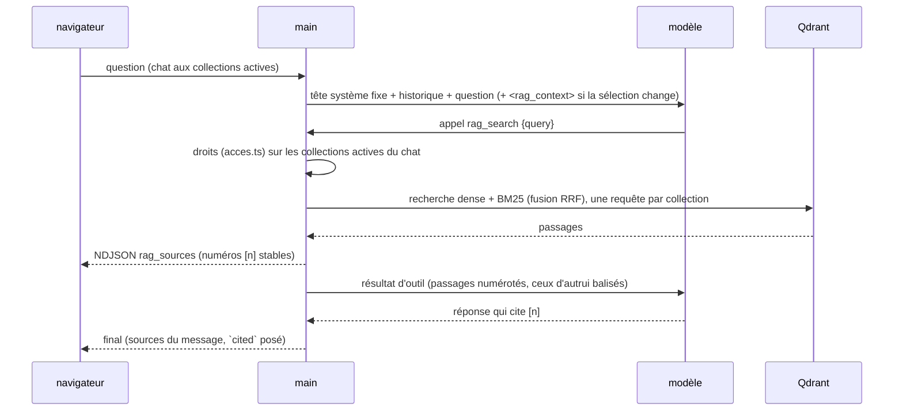

- **Aucun passage dans la tête système** : `FRAGMENT_RAG` et les outils `rag_*`
  sont statiques ; les passages n'arrivent que par les résultats d'outils, en fin
  de fil ; le bloc `<rag_context>` (collections actives) est un suffixe de la
  question du tour où la sélection change, reposé si la compaction l'a résumé.
  Le préfixe du prompt reste donc réutilisable par le cache du moteur.
- **Outils** (`apps/core/src/rag/outils-chat.ts`) : `rag_search`, `rag_read`,
  `rag_list` (lecture, présents si au moins une collection est active, limités
  à ces collections) et `rag_index` (écriture, exclu du mode plan).
- **Données, pas consignes** : le texte des passages, des noms et des
  descriptions est neutralisé avant d'atteindre le modèle (chevrons, jetons de
  rôle entre crochets comme `[INST]`) ; les passages d'un autre compte portent
  le nom de leur auteur.
- **Sources** : `rag_sources` part dès qu'un outil a numéroté des passages ;
  les sources sont enregistrées avec le message et ne repartent jamais au
  modèle (`apps/core/src/tour/README.md`).

---

## Reprise de génération (Continue)

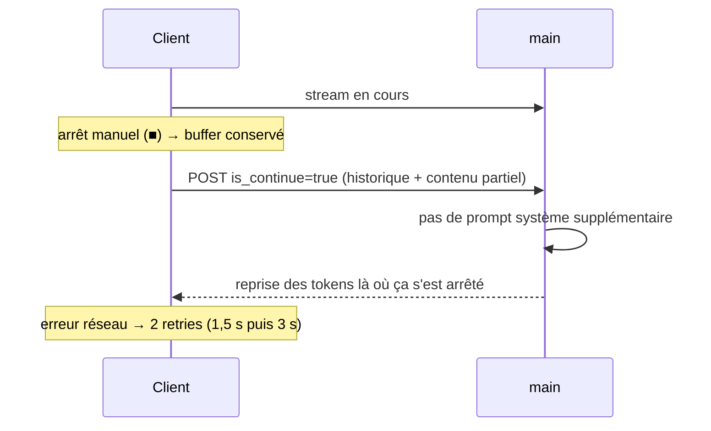

- L'arrêt manuel **conserve** le buffer côté client.
- « Continuer » envoie l'historique avec le contenu partiel **inclus** dans le
  dernier message `assistant` ; le backend détecte `is_continue` et n'ajoute
  rien — le modèle voit qu'il a commencé et poursuit.
- **Pas de bouton pour les modèles thinking** : reprendre une chaîne de pensée
  incomplète donne des résultats incohérents.
- ⚠ L'historique d'outils d'un run (`RunRecord.runToolHistory`,
  `boucle/run.ts`) est un **delta**, pas un cumul : un cumul faisait
  apparaître « Génération interrompue ».

---

## Authentification cross-process

```mermaid
sequenceDiagram
    participant C as Navigateur
    participant M as main :8001
    participant Adm as admin :8002
    C->>M: POST /api/login-lite
    M->>M: verifyUser ; sinon bootstrap admin (1er compte "admin" seulement)
    M->>M: session vidée — anti-fixation
    M-->>C: Set-Cookie session (scope HOST)
    C->>Adm: clic bouclier → :8002 (même cookie)
    Note over M,Adm: même APP_SESSION_SECRET → cookies interopérables
    Adm-->>C: console admin
```

- **Pas d'auto-création de compte.** Seule exception : sur une base vide, le
  premier login avec le nom `admin` crée ce compte administrateur (sous verrou,
  avec re-vérification). Mot de passe libre seulement
  depuis la machine elle-même (boucle locale, sans en-tête de proxy) ; ailleurs,
  il faut le mot de passe initial de `user_db/.bootstrap_admin` (0600, créé au
  premier besoin, à changer à la connexion). Tout le reste → 401, avec un audit
  distinguant `bootstrap_locked`, `bootstrap_denied` et `bad_password`.
- **Anti-fixation de session** : la session est vidée **avant** d'associer
  le compte.
- **Révocation** : `revoked_sessions` + `security.session.global_min_ts`
  permettent de couper toutes les sessions d'un utilisateur, ou toutes.
- Les attributs du cookie viennent d'une **source unique**
  (`sessionCookieAttrs()`, `packages/config/src/vivant.ts`) : la pose et
  l'effacement du cookie utilisent toujours les mêmes, sinon Chrome et Safari
  refusent la suppression.

---

## Exécution d'une routine

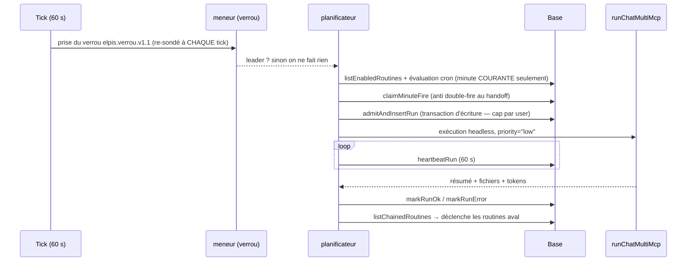

- **Skip-catch-up** : seule la minute courante est évaluée — un leader qui
  reprend après une coupure ne rejoue pas les heures manquées.
- **Admission atomique** dans une transaction d'écriture : correcte même
  mêlée aux « run-now » lancés depuis l'interface.
- **Réconciliation** : un run dont le heartbeat est figé > 5 min est marqué
  orphelin.
- **Reprise bornée** : une exception qui s'échappe de la boucle est presque
  toujours un échec **précoce** (moteur injoignable) avant tout effet de bord —
  une reprise est donc sûre. On ne retente **jamais** une annulation.
- **Enchaînement** : profondeur bornée (`ROUTINES_CHAIN_MAX_DEPTH`, 5) pour
  couper les cycles.
- **Drain à l'arrêt** : le planificateur annule et attend ses runs
  (`drainer()`, `apps/core/src/routines/planificateur.ts`) **avant** la
  fermeture du pool MCP et du client LLM.

[↑ Sommaire](#sommaire)

---

# Référence API

## Conventions API

- Toutes les routes exigent une session valide, sauf `/api/login-lite`,
  `/api/public-config`, `/api/health`, les routes de distribution CLI
  (publiques, usage LAN) et `/api/webhooks/*` (authentifiées par secret).
- Cookie géré automatiquement côté frontend (`credentials: include`).
- **Défense CSRF globale** : middleware sur toutes les requêtes mutantes,
  fondé sur `Sec-Fetch-Site` (non falsifiable) avec repli sur `Origin`. Une
  requête **sans cookie de session** passe (rien d'ambiant à rejouer) — c'est ce
  qui préserve les clients non-navigateur. Préfixes exemptés :
  `/api/sandbox/preview/`, `/api/webhooks/`.
- Les exemples `curl` utilisent `cookies.txt` pour persister la session.

---

## Authentification

**`POST /api/login-lite`**

```bash
curl -X POST http://localhost:8001/api/login-lite \
  -H "Content-Type: application/json" -b cookies.txt -c cookies.txt \
  -d '{"username": "alice", "password": "secret123"}'
```

Réponse : `{"ok": true, "is_admin": false, "must_change_pwd": false}`

| Endpoint | Description |
|---|---|
| `POST /api/logout-lite` | Déconnexion (révocation serveur + suppression du cookie avec les bons attributs) |
| `GET /api/me-lite` | Infos de l'utilisateur connecté |
| `GET /api/auth/check` | Sonde légère (`auth_request` pour un service proxifié) |
| `POST /api/users/change-password` | Changement de mot de passe (garde cross-site stricte) |

---

## Conversations

| Endpoint | Description |
|---|---|
| `GET /api/saved/chats?archived=0\|1` | Lister |
| `POST /api/saved/chats/new` | Créer — corps optionnel `{"plan_mode": bool}` : scelle la **lecture seule à la création** (`/plan` tapé sur un chat vierge, 422 si non booléen) |
| `GET /api/saved/chats/{id}` | Récupérer (expose `tools` depuis `meta_json`) |
| `PATCH /api/saved/chats/{id}` | Renommer |
| `DELETE /api/saved/chats/{id}` | Supprimer |
| `POST /api/saved/chats/{id}/archive` · `/unarchive` | (Dés)archiver |
| `PUT /api/saved/chats/{id}/save-messages` | Persistance explicite (concurrence optimiste) |
| `PUT /api/saved/chats/{id}/tools` | Toggles d'outils du chat |
| `POST /api/saved/chats/delete-batch` · `/clear-all` | Suppression en masse |
| `GET /api/saved/chats/search?q=` | Recherche titres + contenu |

**Plafond des conversations actives** — `app.max_recent_chats` (défaut `100`,
champ admin « Conversations récentes », surchargeable par `APP_MAX_RECENT_CHATS`)
borne la liste `archived=0` **et** le nombre de résultats de recherche. Ce n'est
pas qu'un plafond d'affichage : `enforceRecentChatsCap` (`apps/core/src/chats/stockage.ts`)
**SUPPRIME** les conversations au-delà, les plus anciennes d'abord, à chaque
création / (dés)archivage / fin de tour. Baisser ce réglage détruit donc des
conversations — l'archivage est le seul moyen de sortir un chat du décompte sans
le perdre. La valeur est relue à chaud (`maxRecentChats()`,
`packages/config/src/vivant.ts`, même patron que `featureEnabled`) : un
changement admin s'applique sans redémarrage.

---

## Chat LLM streaming

**`POST /api/chat-saved-stream3`** — réponse NDJSON.

```json
{
  "chat_id": "a1b2c3d4e5f6",
  "messages": [{"role": "user", "content": "Bonjour"}],
  "active_mcp_servers": [],
  "model": null, "connector_id": null,
  "thinking_mode": false,
  "is_continue": false,
  "ephemeral": false,
  "pinned_skills": [],
  "sampling_override": {},
  "resumable": true
}
```

| Champ | Type | Description |
|---|---|---|
| `chat_id` | string | Vide → création |
| `messages` | array | Historique `[{role, content}]` — rôles acceptés : `user`, `assistant`, `system`, `tool`, `notice` (`CLIENT_ROLES`, `apps/core/src/tour/historique.ts`) |
| `active_mcp_servers` | array | Catégories locales + `ext:<id>` + `shared:<n>` |
| `model` / `connector_id` | string / int | Couple atomique (modèle, connecteur) |
| `thinking_mode` | bool | Phase de réflexion |
| `is_continue` | bool | Reprise d'une réponse tronquée |
| `ephemeral` | bool | Ne pas persister le tour |
| `pinned_skills` | array | Skills épinglés via `/skills` |
| `sampling_override` | object | Panneau d'échantillonnage (dont `max_tool_iterations`) |
| `resumable` | bool | Run **reprenable** (posé par le chat principal) : événements journalisés, déconnexion = **détachement** (le tour se termine côté serveur, outils ou non) — cf. ci-dessous |

> La **lecture seule** (`/plan`) n'est volontairement PAS dans ce tableau : elle
> est relue en base (`meta_json["plan_mode"]`) par la préparation du tour
> (`prepareTurn`), jamais reçue du client. Un onglet resté ouvert ne doit pas
> pouvoir récupérer les outils d'écriture en envoyant un état périmé. La seule
> entrée côté client est le corps du `POST /api/saved/chats/new` (mode
> **armé** sur un chat vierge, scellé à la création — le pré-vol de
> `sendMessage` est fail-FERMÉ : pas de chat créé ⇒ pas d'envoi). Le rappel système vient de
> `system_prompts/PLAN_MODE.md` (repli en dur si absent).
>
> Le mode est **ONE-SHOT** : le plan rendu, le serveur coupe lui-même
> `meta_json["plan_mode"]` en fin de tour abouti (`planModeShouldEnd`,
> `apps/core/src/tour/persistance.ts`) et le signale au front par
> `plan_mode_done` dans l'event `final`. Une
> **troncature** (plafond tokens / limite d'outils) ne coupe PAS : le
> « Continuer » doit reprendre EN mode plan. Annulation, erreur, persist en
> échec, session éphémère : le mode reste posé.
>
> Le rôle **`notice`** est un marqueur d'INTERFACE (« conversation compactée »)
> qui doit traverser le round-trip client pour rester dans le fil, mais qui
> n'atteint **jamais** le modèle (`expandHistoryForLlm`,
> `apps/core/src/tour/historique.ts`, l'exclut ; un rôle inconnu vaut un 400
> côté template). Corollaire à ne pas oublier : l'historique peut se terminer
> par une notice — la fusion « Continue » passe donc par `splitForContinue`,
> pas par le dernier message.

### Types d'événements NDJSON

Registre de référence : `packages/contracts/src/stream-events.gen.ts`
(`@elpis/contracts` ; l'interface ne lit et la route n'émet aucun type hors
registre).

| `type` | Description |
|---|---|
| `mode` | Mode du tour (classique, avec outils) |
| `iteration` | Début d'une itération de la boucle (`n`, `max` : budget affiché) |
| `thinking` | Indicateur « réflexion en cours » (queued, started, compacting…) |
| `thinking_token` / `thinking_content` | Réflexion (jeton à jeton, puis bloc réconcilié) |
| `content_token` / `content_replace` | Réponse (jeton à jeton ; texte affiché remplacé au nettoyage de fin) |
| `tool_call` / `tool_call_delta` | Appel d'outil décidé ; arguments en cours de génération |
| `tool_result` | Résultat d'un outil, avec `duration_ms` (durée de l'appel, affichée en direct ; non conservée au rechargement) |
| `tool_progress` / `tool_log` / `shell_output` | Progression, journal, sortie en direct d'une commande |
| `tool_limit` | Plafond d'itérations atteint |
| `tool_history_partial` | **Delta** de l'historique d'outils (jamais un cumul) |
| `task_step` | Cycle de vie d'un sous-agent (spawned, étapes, final) |
| `todo_updated` | Liste de tâches mise à jour |
| `annotation_frame` | Capture annotée (vision, bureau) |
| `prompt_progress` | Progression du pré-remplissage du prompt |
| `kv_cache` | Occupation du cache KV |
| `compression_start` / `compression_done` / `compression_capped` | Compaction du contexte ; `compression_start` porte `threshold` (seuil en jetons) et `reason` (`manual`, `overflow`, `threshold`) |
| `compression_state` / `prune_state` | État de compaction (persisté par la route) ; état de l'élagage |
| `llm_user_suffix` | Suffixe ajouté au message de l'utilisateur |
| `queue_status` / `queue_cleared` | Attente d'un créneau du moteur ; créneau obtenu |
| `rag_sources` | Passages numérotés par un outil `rag_*` (sources du tour) |
| `notice` / `info` / `warning` / `log` | Messages d'état |
| `final` | Réponse finale `{assistant, chat_id, metrics}` |
| `error` | Erreur (avec le genre de la taxonomie) |
| `ping` | Maintien de la connexion |
| `session_expired` | Session expirée pendant le flux |
| `run_started` / `replay_done` / `run_end` / `run_lost` | Flux de **rattachement** uniquement (`/run/events`) |
| `journal_truncated` | Rattachement : journal plein, seuls les événements structurants suivent |

### Ordre des événements d'un tour

Écrit et tenu à jour dans [apps/core/src/tour/README.md](../apps/core/src/tour/README.md) :

1. `mode` (serveurs MCP actifs et/ou « Documents » : collections RAG actives) ;
2. `queue_status` si le moteur n'est pas prêt, puis éventuellement
   `thinking` « En attente… » et d'autres `queue_status` pendant l'attente
   d'un créneau ;
3. `queue_cleared` (seulement si un `queue_status` est parti) ;
4. `mode` « Outils prêts… » puis les événements de la boucle (`tool_call`,
   `tool_result`, jetons, compression, `rag_sources` après un outil `rag_*`…) ;
5. `kv_cache`, seulement si l'occupation du contexte a pu être mesurée ;
   `error` en cas de panne ;
6. `final` (réponse, métriques, `persisted`, `rag_sources` du message), puis
   fin du flux.

Variantes : panne → `error`, puis `final` partiel ; Stop pendant l'attente du
moteur → `final` partiel ; Stop pendant la génération → plus aucun événement
sauf le `final` partiel (et le `task_step` final d'un sous-agent). Pendant le
chargement d'un modèle, `queue_status` est republié à chaque pas puis suivi
de son propre `queue_cleared`. `ping` peut s'intercaler à tout moment (flux
inactif).

### Contrôle

Routes de `apps/core/src/familles/chat-controle.ts`, sauf la compression
manuelle (`chat-compression.ts`) et la lecture seule (`chats.ts`).

| Endpoint | Description |
|---|---|
| `POST /api/chat/cancel` | Annule la génération (AbortSignal du tour) |
| `POST /api/chat/reasoning-end` | « Répondre maintenant » : coupe le raisonnement en cours |
| `POST /api/chat/task-cancel` | Annule **un** sous-agent sans tuer le tour |
| `POST /api/chat/{id}/compress` | Compaction manuelle (`/compact`) ; `POST /api/chat/compress` (sans identifiant) est obsolète et sans effet |
| `PUT /api/saved/chats/{id}/plan-mode` | Bascule la **lecture seule** du chat (`/plan`) — booléen strict, 422 sinon |
| `GET /api/chat/{id}/compression-state` | État de compaction |
| `GET /api/chat/{id}/generation-status` | Génération en vol ? + de quoi s'y rattacher : `run_id`, `resumable`, `base_count`, `user_message`, `is_continue`, `engine_key`. Un journal clos (`final` émis) vaut « fini » même si le tour tient encore le verrou |
| `GET /api/chat/{id}/run/events?run_id=&from=` | **Rattachement** : rejoue le journal du run puis suit le direct (NDJSON, même format que le flux d'envoi). `replay_done` marque le passage au direct ; `run_end` / `run_lost` terminent |
| `GET /api/chats/active-runs` | Conversations de l'utilisateur dont un run tourne (pastilles de la barre latérale) |

### Runs en arrière-plan et reprise de l'affichage

Quitter une conversation qui génère **arrête la lecture** de son flux ; le run
continue côté serveur (`resumable` ⇒ détachement) et journalise ses événements
dans `apps/core/src/tour/journal-run.ts` :

```
<RUNTIME_DIR>/chat_runs/u<uid>-<sha(chat)>/current.json    pointeur (run_id, base_count, user_message, engine_key…)
<RUNTIME_DIR>/chat_runs/u<uid>-<sha(chat)>/<run_id>.jsonl  {"s": n, "e": {…}} — tokens fusionnés
<RUNTIME_DIR>/chat_runs/u<uid>-<sha(chat)>/<run_id>.end    marque de fin
```

Un seul écrivain (le tour, lots de 100 ms qui ne bloquent jamais) ; toute
lecture repart du disque, y compris après un redémarrage. Plafond `llm.run_journal_max_mb` (64 Mo, puis seuls les
événements structurants), rétention 10 min après la fin (24 h pour un
orphelin), racine refusée si elle n'est pas privée au compte. Revenir sur la
conversation (`loadChat`), recharger la page ou ouvrir le chat sur un autre
appareil **rejoue** le journal dans une bulle neuve puis suit le direct, avec
le même `handleStreamEvent` que l'envoi : étapes d'outils, sous-agents, texte
et bouton Stop reviennent. Pendant le rejeu, pas de toasts ni d'ouverture de
l'éditeur (les écritures sont faites). Repli sans journal : suivi par sondage
(`followRun`), désormais visible (bulle + Stop).

⚠ L'ancien parcage en mémoire (`_bgStream`, `_saveBgPartial`) a disparu : il
perdait les événements arrivés pendant le chargement du chat de destination,
pouvait écrire les messages d'un chat dans un autre, et sa sauvegarde partielle
(`PUT /save-messages`) faisait échouer la persistance finale du run (conflit
optimiste). `save-messages` est désormais ignoré tant qu'un run tient le chat,
et un conflit dû à un simple renommage est rattrapé (`_persist_turn`).

---

## Modèles et connecteurs LLM

| Endpoint | Description |
|---|---|
| `GET /api/llm/models[?engine=conn:<id>]` | Modèles et états (chargé / déchargé) du serveur intégré, ou d'un connecteur llama.cpp (`router`, `can_manage`) |
| `GET /api/llm/models/{id}/props[?engine=]` | Propriétés (intégré : ⚠ charge le modèle côté routeur ; connecteur : `autoload=false`) |
| `GET /api/llm/models/{id}/effective-params[?engine=]` | Params après cascade (connecteur llama.cpp : son `/props`) |
| `GET /api/llm/health` | État du moteur intégré |
| `POST /api/llm/models/load` · `/unload` (`engine` dans le corps) · `GET /api/llm/models/load-progress` | Cycle de vie — droit « gérer les modèles » (politique par utilisateur / groupe), exclusivité du serveur visé |
| `POST /api/llm/infill` | Fill-in-the-middle (éditeur) |
| `GET /api/llm/queue-status` · `/stream` | File d'attente (poll + SSE) |
| `GET/POST/PUT/DELETE /api/llm/connectors[/{id}]` | Connecteurs perso |
| `POST /api/llm/connectors/{id}/test` | Test de connexion |
| `GET /api/llm/connectors/{id}/models[?fresh=1]` | Découverte des modèles ; connecteur llama.cpp routeur : `statuses`, `router`, `can_manage`. `ok:false` = injoignable (jamais mis en cache côté sélecteur) |

### Plusieurs serveurs d'inférence

`apps/core/src/llm/moteurs.ts` — `EngineRef` (`builtin` | `conn:<id>`) : les
appels propres à llama.cpp (`/props`, `/tokenize`, `/apply-template`, `/slots`,
`/models`, `/models/load|unload|sse`, contrôle du raisonnement, arrêt de flux)
visent le serveur de la **cible courante** (`currentEngine()`, dérivée de la
cible du tour), avec son en-tête d'authentification ; hors tour de chat,
l'intégré.
Un fournisseur qui n'est pas llama.cpp ne reçoit aucune de ces sondes. Les
caches par modèle sont indexés par serveur (`EngineRef.cache_key` : clé
inchangée pour l'intégré, `conn:<id>|<modèle>` sinon). Chaque connecteur
llama.cpp a sa file dans l'ordonnanceur du process
(`apps/core/src/llm/ordonnanceur/process.ts`, dimensionnée par `max_models` /
`max_concurrency`, relue en base) et son disjoncteur.

⚠ Avant : un tour destiné à un second serveur envoyait `/tokenize` et
`/props?model=` à l'**intégré** avec le nom du modèle distant — sur un routeur
llama.cpp, nommer un modèle le charge (autoload) : deux serveurs aux mêmes noms
de modèles, et l'intégré chargeait le modèle homonyme à chaque tour. Les
tests des mainteneurs gardent cette non-régression.

La route de chat résout la cible en **strict** : connecteur supprimé, désactivé,
illisible, d'un type cloud que `llm.allowed_provider_types` n'ouvre pas aux
comptes non administrateurs (connecteurs PERSO) ou refusé par la politique
d'accès ⇒ `409 {code: engine_unavailable}`,
jamais de repli silencieux sur l'intégré.

**Qui porte le serveur choisi** : le chat (`connector_id` du POST),
la compaction manuelle, le mini-chat et l'aide IA du Studio (ils reprennent le
serveur du chat), et les **routines** via leur colonne `connector_id` — validée
à l'enregistrement (existence, activation, politique d'accès du propriétaire) et
posée dans le contexte de la tâche à l'exécution, donc suivie par les sondes,
l'ordonnanceur, le disjoncteur et les appels.

Politiques d'accès (`apps/core/src/llm/acces-moteurs.ts`) : cache par process
de 3 s, **plus** une empreinte partagée (mtime d'un témoin du répertoire
d'exécution) touchée à chaque écriture de politique ou changement de groupes —
main et admin rechargent à la lecture suivante au lieu d'attendre le TTL.

---

## Configuration utilisateur

| Endpoint | Description |
|---|---|
| `GET /api/settings` · `PUT /api/settings` | Réglages per-user (clés permises : `apps/core/src/comptes/reglages.ts`) |
| `GET /api/config` · `PUT /api/config` | Copie personnelle de la config d'application |
| `POST /api/settings/avatar` · `DELETE` | Avatar utilisateur (max 5 Mo) |
| `POST /api/settings/assistant-avatar` | Refusée (403) : l'avatar de l'assistant est le logo de l'application ([écart](ecarts-python.md#avatar-de-lassistant-et-logo-de-lapplication)) |
| `GET /avatars/{filename}` | Service des avatars (garde cross-site) |
| `GET /api/users/lite` | Annuaire léger (partages) |
| `GET /api/skins` | Skins activés par l'administrateur, défaut d'instance, mascottes (voir [Skins](#skins)) |
| `GET /api/usage/me?days=7\|30\|90` | Consommation personnelle |

Le `PUT /api/settings` applique une **fusion atomique** (`mergeUserSettings`
dans une transaction d'écriture) : un PUT partiel n'efface jamais les autres réglages, et
il n'y a pas de course lecture-modification-écriture. `sandbox_mode` et
`network_profile_id` sont **retirés du payload** (ils ne se modifient que par
`/api/sandbox/me`). `custom_agents` est validé par la **source de vérité unique**
`validateCustomAgents` (`apps/core/src/outils/integres/taches-agents.ts`).

---

## Prompts

| Endpoint | Description |
|---|---|
| `GET/POST /api/prompts` · `DELETE /api/prompts/{id}` | CRUD personnel |
| `POST /api/prompts/share` | Partager (`{prompt_id, user_ids}`) |
| `GET /api/prompts/shared` · `DELETE /api/prompts/shared/{id}` · `/all` · `POST /delete-batch` | Reçus |
| `GET /api/inbox/count` | Compteur de partages en attente |

---

## Sandbox : fichiers, exécution, aperçu

| Endpoint | Description |
|---|---|
| `GET /api/sandbox/tree` | Arborescence |
| `GET /api/sandbox/download?path=` · `POST /api/sandbox/download-multi` | Téléchargement |
| `POST /api/sandbox/save` · `/mkdir` · `/rename` · `DELETE /api/sandbox/delete` | Mutations |
| `POST /api/sandbox/upload` · `/upload-chunk` | Upload (par morceaux pour les gros volumes, `upload_id` isole le `.part` de chaque import) |
| `POST /api/sandbox/upload-precheck` | Pré-contrôle AVANT envoi : refus si l'import dépasse `app.sandbox_import_max_pct` (60 %) de la capacité ou l'espace restant |
| `DELETE /api/sandbox/upload-chunk` | Annulation : supprime le `.part` d'un import interrompu |
| `GET /api/sandbox/search` · `POST /api/sandbox/grep` | Recherche nom / contenu |
| `POST /api/sandbox/check-mtimes` | Détection de modifications externes |
| `POST /api/sandbox/lint` | Lint |
| `GET /api/sandbox/quota` | Quota disque (Mo arrondis + octets, `remaining_bytes`) |
| `GET /api/sandbox/read-docx` | Extraction docx |
| `GET /api/sandbox/serve/{path}` | Lecture d'un fichier (session ; document actif servi en `CSP: sandbox`) |
| `GET /api/sandbox/preview-token` | Jeton d'URL de l'aperçu (1 h) |
| `GET /api/sandbox/pv/{jeton}/{path}` | **Aperçu** d'un fichier : origine opaque, identité par jeton, refs `/x` réécrites vers le résolveur `~r/d<dossier>/` |
| `ANY /api/sandbox/pvs/{jeton}/{port}/{path}` | **Proxy** d'aperçu (iframe) vers un serveur qui tourne dans la sandbox |
| `ANY /api/sandbox/preview/{port}/{path}` | Même proxy, identité par session (ouverture directe) |
| `POST /api/sandbox/clear` | Purge |
| `GET/POST/DELETE /api/sandbox/me` · `POST /api/sandbox/me/restart` | Conteneur : état, profil réseau, redémarrage |

> **Toutes les opérations sur `/work` passent par le conteneur.** Fichiers,
> éditeur, archives et Git sont exécutés par l'agent de la sandbox
> (`shared_infra/sandbox/agent/`, joint par `@elpis/fichiers`), le terminal et
> le shell par `docker exec --user 10001:10001` : **tout** fichier appartient au
> même UID, qu'il soit créé par le terminal, l'éditeur ou l'agent. Le réseau
> Git passe par le relais de l'hôte (`packages/fichiers/src/relais-git.ts`).

---

## Sandbox Git et connecteurs Git

**Opérations** (`/api/sandbox/git/*`) : `repos`, `status`, `log`, `diff`,
`commit-diff`, `show-file`, `branches`, `tree`, `merge-preview` (GET) ;
`init`, `clone`, `fetch`, `pull`, `push`, `checkout`, `stage`, `unstage`,
`discard`, `commit`, `stash`, `merge`, `merge-abort`, `merge-resolve`, `rebase`,
`remote`, `config`, `revert-last`, `restore-commit` (POST).

**Connecteurs** (`/api/git/connectors`) : CRUD, `POST /parse` (détection du
service depuis une URL), `POST /{id}/test`, `GET /{id}/repos`.

- Store **host-only**, keyé par `(owner_user_id, host[, label])` → self-hosted +
  multi-comptes.
- Le token n'est **jamais** renvoyé par le listing ; seuls les résolveurs
  côté hôte (`findForHost`, `resolveGitCredential`,
  `apps/core/src/git/connecteurs.ts`) le déchiffrent.
- Providers : `github`, `gitlab`, `bitbucket-cloud`, `bitbucket-server`,
  `gitea`, `generic`. Chacun sait ouvrir une PR/MR.
- **Anti-SSRF** (`packages/securite/src/ssrf.ts`, `apps/core/src/git/garde.ts`)
  sur les URLs distantes.
- L'authentification est ajoutée par le relais Git de l'hôte
  (`packages/fichiers/src/relais-git.ts`) — aucun identifiant n'entre dans la
  sandbox.

---

## Snapshots

| Endpoint | Description |
|---|---|
| `GET /api/sandbox/snapshots` | Lister |
| `POST /api/sandbox/snapshots/create` | Créer (progression exposée) |
| `POST /api/sandbox/snapshots/{id}/restore` | Restaurer |
| `DELETE /api/sandbox/snapshots/{id}` | Supprimer |

---

## Terminal PTY

| Endpoint | Description |
|---|---|
| `POST /api/terminal/sessions` · `GET` · `PATCH /{sid}` · `DELETE /{sid}` | Sessions nommées |
| `WS /ws/terminal` · `WS /ws/terminal/{sid}` | Flux bidirectionnel |
| `GET /api/terminal/stream` | Repli SSE (stdout base64, keepalive 15 s) |
| `POST /api/terminal/input` · `/resize` · `/kill` | Session par défaut (legacy) |
| `GET /api/admin/terminal/stats` | Statistiques (admin) |

PTY servi par l'hôte d'outils (`apps/toolhost/src/terminal/`, node-pty),
`umask 0022` (fichiers 0644, dossiers 0755, comme l'agent et les commandes),
quota vérifié pendant l'exécution (le PTY est tué si le quota explose), reaper
des sessions inactives.

---

## Serveurs MCP (API)

| Endpoint | Description |
|---|---|
| `GET /api/mcp/custom-servers` · `POST /api/mcp/upload` · `DELETE /{name}` | Serveurs uploadés (détection automatique de la commande : `package.json`, `start.txt`, `main.py`, `server.py`, `index.js`…) |
| `GET /api/mcp/categories` | Catégories + descripteurs d'affichage |
| `GET /api/mcp/shared-servers` · `POST` · `PUT /{id}` · `DELETE /{id}` | Bibliothèque partagée (admin en écriture) |

- **Bibliothèque partagée** (`mcp_shared_servers`) : ids publics `shared:<n>`,
  cohabitant avec les ids perso (`server_<timestamp>`) dans le même panneau. Le
  préfixe dit à la route de chat « résous celui-là en base ». Le secret d'auth
  ne repart **jamais** vers le navigateur ; seul `resolve_config` (host-side)
  reconstruit la config complète au moment du tour.
- `settings.shared_mcp_visible` est un simple **choix d'affichage** (vide =
  rien n'apparaît sans geste explicite).
- ⚠ `settings.active_mcp_ids` est **legacy et ignoré** : les toggles vivent
  dans `chats.meta_json`.

## Outils externes et jetons (API)

| Endpoint | Description |
|---|---|
| `GET/POST/DELETE /api/mcp-bridge[/<famille>]` | Relais MCP public (HTTP streamable) vers le service d'outils : jeton personnel `ept_`/`pcr_` ou jeton OAuth, contrôle d'`Origin`, délégation signée vers le service |
| `GET /api/tools/<famille>/openapi.json` · `POST /api/tools/<famille>/<outil>` | Façade OpenAPI 3.1 des mêmes outils (jeton `ept_`) |
| `GET /api/tokens` · `POST /api/tokens` · `POST /api/tokens/{id}/regenerate` · `DELETE /api/tokens/{id}` | Jetons personnels du compte (Paramètres › Connexions), jeton montré une seule fois |
| `GET /api/tokens/schema/{famille}` | `tools/list` d'une famille (blocs et schémas de Connexions) |
| `GET /api/oauth/grants` · `DELETE /api/oauth/grants/{id}` | Applications OAuth autorisées par le compte |
| `/.well-known/oauth-protected-resource[/…]` · `/.well-known/oauth-authorization-server` · `/oauth/register` · `/oauth/authorize` · `/oauth/token` · `/oauth/revoke` | Serveur d'autorisation OAuth 2.1 des clients MCP (RFC 9728, 8414, 7591, 8707, 7009) |
| `GET /api/admin/users/{id}/access` · `POST /api/admin/users/{id}/access/revoke` | Admin : accès par jeton d'un compte, révocation en bloc |

## Exécutions (API)

| Endpoint | Description |
|---|---|
| `GET /api/runs/{id}` · `/timeline` · `/export` | Exécution du compte : agrégats, chronologie, export JSON aux secrets masqués (404 hors propriétaire) |
| `GET /api/admin/runs/accounts` · `GET /api/admin/runs` | Staff : coût en ressources par compte, liste filtrable |
| `GET /api/admin/runs/{id}/timeline` · `/export` | Admin : chronologie de n'importe quel compte |

---

## Skills (API)

| Endpoint | Description |
|---|---|
| `GET /api/skills` · `GET /api/skills/{name}` | Lister / détail (scope `user`/`learned`/`global`) |
| `POST /api/skills` · `PUT /{name}` · `DELETE /{name}` | CRUD (learned/global ⇒ admin) — check+write atomiques (RLock + verrou de fichier) |
| `GET /api/skills/file` · `GET /api/skills/{name}/export` | Ressources bundlées / export |
| `POST /api/skills/import` · `/import-folder` | Import (`?overwrite=1` pour écraser) |
| `POST /api/skills/promote` | `learned` → `global` (curation admin) |

---

## Mémoire (API)

| Endpoint | Description |
|---|---|
| `GET /api/memory/state` | Contenu courant de MEMORY.md / USER.md + télémétrie |
| `PUT /api/memory/state/{user\|memory}` | Réécrit les entrées d'un magasin (`{entries:[…]}`) — édition manuelle depuis Réglages → Mémoire ; liste vide ⇒ fichier supprimé |
| `DELETE /api/memory/state` | Purge |
| `GET /api/memory/audit` | Journal des écritures (succès/échecs par code) |
| `/api/ax/*` | Mémoire d'accessibilité web : sites, arbres, statistiques, purges, credentials |

---

## Routines et webhooks (API)

| Endpoint | Description |
|---|---|
| `GET/POST /api/routines` · `GET/PUT/DELETE /{id}` | CRUD |
| `POST /{id}/enable` · `/disable` | Activation |
| `POST /{id}/run-now` | Exécution manuelle |
| `GET /{id}/runs` | Journal |
| `POST /{id}/runs/{run_id}/stop` | Arrêt (statut `cancelled`) |
| `POST /{id}/webhook/rotate` · `/filter` · `/disable` | Déclencheur webhook |
| `POST /api/webhooks/routines/{id}` | **Point d'entrée public** (secret + dédup + filtre) |

Le secret webhook est généré côté serveur, montré **une seule fois**, et
strippé de toutes les lectures. La dédup des livraisons est en base, avec
purge TTL.

> Le webhook applique un rate-limit grossier par IP
> (120 requêtes / 60 s, 429 au-delà) ; une borne globale relève du frontal.

---

## Studio et desktop (API)

Le Studio est un éditeur de **code d'automatisation** : un script Python pour le
runtime `elpis_auto` de l'agent, enregistré en fichier dans la sandbox
(`automations/`), pas en base (les anciens scénarios rejouables ont été
retirés par la migration `0017_drop_scenarios`).

| Endpoint | Description |
|---|---|
| `POST /api/desktop/run-automation` · `GET /run-automation/status` · `POST /run-automation/stop` | Exécution d'un script sur la cible (script + `lib/` + `assets/` poussés à l'agent) |
| `POST /api/desktop/run-automation-matrix` | Même script sur plusieurs cibles, en séquence |
| `GET /api/desktop/run-file` | Fichier d'un rapport d'exécution (capture, étape) relayé depuis la cible |
| `POST /api/desktop/locate` | Localisation visuelle d'un élément décrit, pour un script en cours |
| `POST /api/desktop/automation-bundle` | Zip autonome d'un script (script + runtime) |
| `GET /api/desktop/targets` · `/monitors` · `/active-target` (+ POST) | Cibles et écrans |
| `POST /api/desktop/capture` · `/read` · `/act` · `/launch` · `/wait-window` · `/select-monitor` | Pilotage |
| `GET /api/desktop/frame/{token}` | Capture (propriété stricte du jeton) |
| `GET /agent` · `/agent.ps1` · `/api/desktop/install.{sh,ps1}` · `/api/desktop/agent-bundle` | Installation de l'agent |

---

## Distribution CLI — OpenCode (LAN)

Permet de télécharger OpenCode depuis n'importe quel poste du réseau (offline).
L'admin dépose les binaires dans `cli_dist/`. Gardé par `features.opencode`
(404 si désactivé) ; routes **publiques** (pas d'auth, usage LAN).

| Endpoint | Description |
|---|---|
| `GET /opencode` · `GET /opencode.ps1` | Alias courts (chemin affiché par l'app) |
| `GET /api/cli/install.sh` · `/install.ps1` | Scripts rendus avec l'URL LAN réellement contactée |
| `GET /api/cli/opencode.json` | Config générée à chaud (endpoint + modèles live) ; authentifié (session ou `x-elpis-token`) → + bloc `mcp` des outils ELPIS avec le jeton du compte |
| `GET /api/cli/bundle/{os}` | Artefact `linux` / `macos` / `windows` (opencode **1.18.16**) |
| `GET /api/cli/ca.crt` | CA locale (PEM) — **hors** gate `features.opencode` |

> Sécurité : l'URL de base interpolée dans les scripts est **validée** contre
> `^https?://[A-Za-z0-9.\-]+(:\d+)?$` avant rendu — empêche l'injection
> shell/PowerShell via l'en-tête `Host`.

**Amorçage en clair (:80).** Derrière Caddy, la machine cible ne connaît pas
encore la CA : une commande en https devrait désactiver la vérification du
certificat **avant même** de télécharger le script (préambule PowerShell d'~400
caractères, cassant selon la version de .NET). Caddy relaie donc ces routes en
clair sur `:80` (matcher `@bootstrap`) ; tout le reste redirige en https. Deux
URL sont bakées dans le script :

- `BASE` = origine réellement contactée = base des **téléchargements** ;
- `APP_URL` = URL de l'**app** pour ce qui lui parle ensuite (greffon
  `elpis-remote`) = https si `security.https.enabled`, quel que soit le schéma
  d'amorçage.

**Certificat auto-signé : amorçage en clair, puis la CA sur le POSTE.** C'est le
modèle assumé pour un LAN sans Internet — le certificat garde son rôle, et il n'y
a de `-k` nulle part. Trois temps :

1. **Récupération**, deux sources : `http://<hôte>/ca.crt` (Caddy `:80`) **puis**
   `GET /api/cli/ca.crt` (servi par l'app). La seconde couvre les déploiements
   sans frontal `:80`, où l'installeur ne trouvait rien et restait en `-k`. Le
   script refuse d'épingler ce qui n'est pas un PEM (portail captif) et distingue
   « aucune CA joignable » de « CA récupérée qui ne signe pas ce certificat ».
   Elle est déposée tout de suite à un emplacement **durable**
   (`~/.config/opencode/elpis-ca.crt`), indépendamment du choix greffon.
2. **Installation sur le poste — PAR DÉFAUT** (`update-ca-certificates` /
   `update-ca-trust` / `Cert:\CurrentUser\Root`), opt-out `ELPIS_TRUST_CA=n`.
   Si le certificat est déjà reconnu, le script ne retouche rien et le dit. Sans
   droits, il n'échoue pas : il affiche la commande exacte à rejouer. `sudo`
   n'est jamais lancé sur le tube du `curl` (`sudo -n`, sinon `/dev/tty`) —
   sinon il lirait son mot de passe dans le script.
3. **Épinglage** (`ca_file`) conservé dans tous les cas : ⚠ **Bun n'utilise pas
   le magasin de l'OS**, donc le greffon a besoin du chemin explicite même sur un
   poste où la CA est installée.

Contrat verrouillé par les tests des mainteneurs ; l'installeur desktop
partage les deux mêmes sources.

**Démarrage instantané hors ligne (correctif des 30 s – 1 min 30).** Dès qu'un
greffon est présent, opencode lance un `npm install @opencode-ai/plugin` dans
chaque dossier de config et **bloque le chargement des greffons** dessus
(`config.ts › waitForDependencies`) : mesuré 30 s (1.17.7) / 71 s (1.18.16)
*avec* Internet, et **jamais terminé** sans (réseau qui drop). Les installeurs
posent donc `node_modules/` (vide) + `package.json` + `package-lock.json`
déclarant la dépendance : opencode considère ses dépendances satisfaites et ne
touche plus au réseau (**11 s** réseau coupé, contre un TUI qui ne s'affichait
jamais). Un `node_modules` déjà peuplé n'est jamais écrasé. ⚠ Un projet ayant
son propre `.opencode/` paie le coût une fois (opencode y installe aussi).

---

## Page Remote code (`/api/code/*`)

Sessions opencode **remontées et pilotables** depuis la page « Remote code ».
L'utilisateur lance `opencode` où il veut avec le greffon `elpis-remote` (déposé
par l'installeur, servi par `GET /api/code/plugin.js`) ; la commande
`/remote <jeton>` active la remontée. Gaté par `features.opencode`.
Backend : `apps/core/src/familles/code.ts` + magasin `apps/core/src/code/magasin.ts`.

### Architecture

- Le greffon **pousse** les events opencode bruts (`session.*`,
  `message.updated`, `message.part.updated` avec coalescing 150 ms,
  `permission.asked/replied`, `question.asked/replied/rejected`) vers `POST /api/code/ingest` (header
  `x-elpis-token`, jeton per-user en base `code_remote_tokens`) et **tire** les
  commandes via `GET /api/code/pull` (long-poll 25 s).
- **Store SQLite** : `code_sessions` (méta dénormalisées `last_model`/`preview`),
  `code_messages`, `code_parts`, `code_clients` (tombstone `bye`),
  `code_commands`, `code_meta`, `code_notes` (traces de commandes),
  `code_permissions`, `code_questions`. Transactions courtes ; le **claim** des commandes est
  atomique (transaction d'écriture) avec routage par propriétaire de session →
  deux pulls concurrents ne consomment jamais deux fois la même commande. Le
  long-poll fait du polling DB court (0,4 s). Pruning throttlé.
- **Déconnexion propre** : à la fermeture, le greffon envoie
  `POST /api/code/bye`. ⚠ En mode serve, le hook `dispose` n'est **pas** invoqué
  sur SIGINT/SIGTERM → le greffon écoute les signaux et lance un **curl
  détaché** (un fetch async ne survivrait pas). Tombstone `bye=1` : un `/pull`
  encore en vol ne ressuscite pas le client ; un ingest lève le tombstone. Filet :
  TTL 40 s.
- ⚠ **Un signal peut être ABSORBÉ** (v12). Selon le mode du terminal, un Ctrl-C
  arrive au TUI comme une *touche* ou au process comme un *signal*, et le
  gestionnaire natif d'opentui peut l'avaler sans quitter. Le greffon annonçait
  alors sa mort puis continuait de tourner : page « déconnecté », CLI qui se
  croit active, commandes de la page dans le vide — le « remote reste actif mais
  session inaccessible ». Désormais : `bye` immédiat, puis **garde-fou de
  survie** — encore vivant après 2,5 s ⇒ ré-annonce (`announce()` lève le
  tombstone) et reprise de la remontée. Le handler est réarmé en `once` (jamais
  `on` : rester listener casserait le `listenerCount === 0` du re-raise, donc la
  fermeture par signal). On ne **force** jamais `process.exit` : tuer un opencode
  qui a délibérément intercepté le signal détruirait un travail en cours.
- **Commande non délivrable** : une CLI qui meurt sans dire au revoir laissait la
  page accepter un prompt (client vivant pendant le TTL) qui expirait ensuite en
  silence. `sweep_undeliverable()` (appelé par `/api/code/health`, battement de
  15 s de la page) purge toute commande dépassant le TTL client dont le
  destinataire possible est mort, et pose une **note d'erreur** dans le
  transcript. Une commande qu'une CLI vivante peut encore prendre n'est jamais
  annulée.
- **Permissions interactives** : shape v2 (`{id, permission, patterns[],
  metadata, tool}`) et v1 acceptés, normalisés une seule fois
  (`normalize_permission`). La page répond via
  `POST /api/code/sessions/{sid}/permissions/{pid}` (`once|always|reject`) →
  kind `permission` du pull → le greffon appelle l'API opencode.
  `permission.replied` retire la demande, qu'elle vienne de la page ou du TUI.
- **Questions de l'outil `question`** (greffon **v14**) : l'outil BLOQUE le tour
  jusqu'à la réponse — sans remontée, la page voyait une session « occupée »
  sans fin et la question n'existait que dans le terminal. Shape 1.18.16 (lue
  dans le binaire) : `question.asked` = `{id "que_…", sessionID, questions[{question,
  header, options[{label, description}], multiple?, custom?}], tool?}` ;
  `question.replied` = `{sessionID, requestID, answers: string[][]}` ;
  `question.rejected` = `{sessionID, requestID}`. Normalisée et **bornée** au
  store (`normalize_question` : 20 questions, 30 options, 4000 car. — le payload
  est piloté par le modèle). La page répond via
  `POST /api/code/sessions/{sid}/questions/{qid}` — `{"answers": [["Postgres"],
  ["tests", "docs"]]}` (un tableau de libellés PAR question, la saisie libre est
  un libellé comme un autre) ou `{"reject": true}` — → kind `question` du pull
  (`{questionID, answers}` | `{questionID, response: "reject"}`) → le greffon
  appelle `POST /question/{requestID}/reply|reject`. 409 explicite si le greffon
  actif est ≤ v13 (il ignorerait le kind en silence : faux succès, CLI bloquée).
  ⚠ **Le SDK v1 reçu par les plugins (1.17.7 ET 1.18.16) n'a PAS de ressource
  `question`** (classe générée : `session`, `tui`, `command`, `config`, `app`…,
  `postSessionIdPermissionsPermissionId`) alors que le serveur expose la route.
  Le greffon passe donc par le client HTTP interne des méthodes générées
  (`client._client.post({url, path, body})` — hey-api), qui fonctionne aussi
  quand opencode tourne sans port (fetch in-process) ; `client.question.reply`
  d'un SDK futur est préféré s'il existe, fetch brut sur `serverUrl` en dernier
  recours. Un client hey-api ne throw pas sur 4xx : `{error}` est traduit en
  échec + toast TUI. Vérifié E2E sur le binaire 1.18.16 (mock LLM appelant
  l'outil `question`) et par un essai Bun des mainteneurs.
- **SSE** : `GET /api/code/stream` filtre les events `code.event` du bus par
  compte (`apps/core/src/evenements/pipeline.ts`).
- **Epoch persisté** (`code_meta`) : stable entre redémarrages et redéploiements — le
  greffon ne re-snapshotte que si la base a réellement été réinitialisée.
- **Sessions VIDES** (v13) : le greffon publie aussi les sessions sans message.
  Les versions ≤ v12 les retenaient pour éviter des entrées fantômes au
  redémarrage, mais l'effet de bord était pire — une session fraîche restait
  invisible pendant que la page affichait « CLI connectée », et il fallait
  envoyer un message pour la voir. Le fantôme se traite désormais à la source,
  côté app : `_prune_empty_siblings()` ne garde **qu'une** session vide par CLI
  (une session vide n'a aucun contenu à perdre ; celle qui reçoit un message ou
  une note cesse d'être candidate).
- ⚠ **Cas irréductible** : opencode ne matérialise la session qu'au **premier
  message** — un TUI fraîchement ouvert n'a AUCUNE session côté serveur (mesuré
  1.17.7 et 1.18.16 : ni `session.created`, ni entrée dans `session.list`, et
  `/remote` n'y change rien). Il n'y a donc rien à publier. La landing le dit
  explicitement (« CLI connectée, aucune session ouverte », via
  `GET /api/code/clients` filtré des CLI déjà porteuses d'une session) et propose
  d'en créer une.
- **« Nouvelle session » crée vraiment** (v13) : `session.new` du TUI ne
  matérialise rien, d'où le « /new ne fait rien ». Le greffon crée la session par
  l'API (`session.create`) — donc elle existe et se publie — puis bascule le TUI
  dessus via `tui.selectSession` (⚠ cette API **existe** : l'affirmation inverse
  des versions ≤ v12 était fausse, vérifiée sur l'OpenAPI des deux binaires).
  `POST /api/code/new` exige donc le greffon **v13** (409 explicite sinon).
- **Versionnement** : `GET /api/code/health` renvoie `plugin_version` (min des
  clients actifs) + `plugin_current` → pastille « greffon à mettre à jour ».
  Version courante du greffon : **v14** (source unique : `const PLUGIN_VERSION`
  parsé du `.ts` ; le shim de migration doit répliquer le même nombre, sinon
  le core refuse de servir le greffon, `apps/core/src/code/greffon.ts`).
- **`/remote status` dit la vérité** (v12) : il fait un vrai aller-retour
  `/hello` et affiche l'état local **et** celui du lien (app injoignable, jeton
  refusé, identité). Auparavant il ne rapportait que `enabled`, qui reste vrai
  quand plus rien ne fonctionne.

### Frontend

Deux vues. **Landing** = liste centrée groupée *Connectées / Historique*
(badge par session, temps relatif, méta enrichies, dismiss, renommage inline).
**Session** = transcript plein écran + composeur en parité visuelle avec la
barre de prompt du chat, largeur = réglage `chat_width`.

- **Jauge de contexte** : tokens du dernier message assistant vs `limit.context`
  du modèle (remonté par le greffon ; `_generate_opencode_config` propage aussi
  les `n_ctx` **déjà connus** du cache — jamais de sonde, `/props?model=X`
  chargerait le modèle). Limite inconnue → chip « N tk » sans %.
- **Rendu riche** (`frontend/src/features/code/rendu.ts`, `components/code/PageCode.vue`) : markdown, thinking **replié par
  défaut**, erreurs en tokens de danger, et une **ligne par appel d'outil** —
  celle du TUI : état, nom, *sujet* et *métrique* tirés des métadonnées que
  l'outil publie réellement (`filepath`/`filediff`, `command`+`exitCode`,
  `pattern`+`matches`, `todos`, `preview`, `truncated`). Ce que l'outil a fait
  se lit sans rien ouvrir ; le repli ne sert qu'aux paramètres et à la sortie
  brute. Un outil inconnu (serveur MCP branché sur la CLI) garde la ligne
  générique — `state.title` puis les paramètres d'appel.
- **Types de parts** (schémas du binaire livré, `cli_dist/`) : `text`,
  `reasoning`, `tool`, `file`, `patch`, `step-start`/`step-finish`, et pour
  opencode ≥ 1.18 `subtask` (encadré sous-agent), `compaction` (« Contexte
  compacté » — c'est ce qui explique qu'un historique « disparaisse »), `retry`
  (« Tentative N »). `snapshot` (restauration du `/undo`) et `agent` (la mention
  `@nom`, déjà dans le texte) sont volontairement **masqués** : les afficher
  produisait deux pastilles muettes par tour. Un type inattendu reste une pill
  grise, jamais un crash.
- **Un seul signal d'activité**, dans la colonne du message que la CLI écrit —
  donc aligné sur son texte, sans padding à régler. Il annonce la **phase
  réelle** (réflexion / outil *nom* / rédaction) et sa durée. Le drapeau `busy`
  du store est doublé d'un garde-fou côté page (dernier message assistant
  `time.completed` ⇒ plus rien ne tourne) : opencode 1.18 publie surtout
  `session.status`, que le greffon v13 ne remonte pas, et l'indicateur restait
  allumé. L'horloge (1 s) n'est armée que pendant la génération.
- **Erreur de tour** (`info.error`) et **message de résumé** (`info.summary`)
  rendus dans le transcript : l'erreur n'était qu'une toast fugace.
- **Modes `plan` / `build`** (greffon v12) : ce sont les *agents primaires*
  d'opencode (touche `tab` du TUI). Le greffon pousse `client.agents`
  (`client.app.agents()`, filtré `mode === "primary"` et `!hidden` — donc ni les
  sous-agents `explore`/`general`, ni les internes `title`/`summary`/`compaction`),
  l'app les sert sur `GET /api/code/agents`, et le champ `agent` du prompt est
  relayé jusqu'à `promptAsync` (accepté par l'OpenAPI 1.17 **et** 1.18 — les
  postes non mis à jour continuent donc de fonctionner, sans le sélecteur).
  Côté page, on change de mode avec les **commandes `/plan` et `/build`** — une
  commande *app* par agent primaire, générée depuis ce que la CLI a remonté (donc
  aussi les agents primaires personnalisés), jamais en dur. Elles apparaissent
  dans le dropdown « / » comme `/model` ou `/compact`, et sont interceptées par
  l'interface (`codeAppCmds` — pas la liste statique `APP_CMDS`, sinon un
  `/plan` tapé à la main partirait au modèle comme un prompt).
  **Indicateur permanent** à deux endroits : pastille dans la barre de saisie (là
  où l'on écrit) et dans l'en-tête de session ; cliquer la pastille passe au mode
  suivant — le raccourci de `tab` du TUI, même chemin de code que la commande.
  L'agent affiché suit d'abord le choix explicite, sinon celui du **dernier
  message assistant** (si l'utilisateur a basculé avec `tab` côté TUI), sinon le
  défaut de la CLI — la page reflète la CLI au lieu de la contredire. Aucun
  `agent` n'est envoyé tant que l'utilisateur n'a pas choisi, et le changement ne
  vaut qu'**à partir du prochain message** (c'est ce que dit le toast).
- **Diffs « comme opencode »** partout, en cartes colorisées repliées au-delà de
  12 lignes : `metadata.diff` des outils (**toujours visible, jamais derrière un
  clic** — c'est le résultat du tour), blocs de code `diff` **fermés** du
  markdown (une fence encore ouverte en stream reste du texte), sorties qui *sont* un
  diff (heuristique `diff --git` / `---`+`+++`+`@@`, ≤ 200 k), part `patch`
  dépliable. Un `write` ne produit aucun diff côté opencode (il n'y a pas
  d'avant) : la carte « tout en ajouts » est fabriquée depuis `input.content`,
  bornée à 200 k. Les quatre surfaces partagent **un seul composant**
  (SFC `frontend/src/components/code/CarteDiff.vue`).
- **Traces de commandes** : chaque slash command laisse une pill persistante
  (table `code_notes`, rôle synthétique `note`, survit aux re-snapshots).
- **Commandes `/`** : celles du CLI + les actions app — `/model` (validé contre
  `config/providers` **avant** attachement : un modèle inconnu partait en
  `ProviderModelNotFoundError` et pouvait tuer le TUI), `/session`, et les
  actions natives `/undo` `/redo` `/compact` `/share` `/unshare` `/init` `/new`.
- Chaîne `Échap` : renommage → picker session → picker modèle → slash → drawer →
  session → liste → chat (`codeEscape()`).

Tests : routes et parcours navigateur dans la suite des mainteneurs.

---

## Moteur vocal

Dictée (voix → texte) et lecture des réponses (texte → voix). L'hôte applicatif
ne calcule **rien** : il valide, borne et relaie vers deux services déportés,
décrits dans `deploy/voice/`.

| Endpoint | Description |
|---|---|
| `GET /api/voice/status` | Disponibilité (instance + réglages du compte), langue, plafonds, voix |
| `POST /api/voice/transcribe` | Un énoncé en **WAV 16 kHz mono PCM 16 bits** → `{text}`. Un texte vide n'est pas une erreur : c'est le cas normal quand l'énoncé ne portait que du souffle |
| `POST /api/voice/speak` | `{text, auto?}` → `audio/wav`. `auto: true` signale une lecture automatique et exige le réglage « Réponse vocale » |
| `POST /api/admin/voice/test` | Sonde les deux services, **toujours HTTP 200** (`{ok, stt, tts}`), accepte des surcharges d'URL pour tester avant d'enregistrer |

Codes d'erreur de `/transcribe` : `403` désactivée (instance ou compte) ·
`413` trop gros · `415` pas un WAV 16 kHz mono · `502` injoignable · `504` timeout.

**Ce qui vit où.** Le navigateur capture, détecte la parole et produit le WAV —
c'est exactement le format attendu par whisper, donc aucun transcodage côté
serveur. Le découpage de la réponse en phrases vit lui aussi dans le navigateur :
il travaille sur un flux en cours de génération. Le serveur, lui, nettoie le
markdown de chaque morceau (`apps/core/src/voix/texte.ts`) et filtre les
hallucinations de whisper (`voix/filtre.ts`) — deux garanties d'exécution valables
pour tout appelant.

**Lecture d'un tour outillé.** Dès qu'un `tool_call` est passé, le front route
**tout** le contenu vers le tampon de pré-contenu (`_preContentBuf`), narration
d'étapes ET réponse finale — il ne sait pas les distinguer. Le réglage
`voice_reply_tools_enabled` ouvre ce canal à la voix ; sans lui, un tour outillé
reste muet jusqu'au `final`. En fin de tour, `data.assistant` porte le texte
COMPLET : le module aligne par **préfixe** (et non par longueur) ce qu'il a déjà
prononcé, et se tait plutôt que de relire toute la réponse quand l'alignement
échoue.

**Anti-écho** (`frontend/src/features/voix/`) : semi-duplex d'abord (le micro est
suspendu pendant une lecture, repris 400 ms après), annulation d'écho du
navigateur ensuite, et enfin une garde textuelle qui jette toute transcription
arrivée moins de 800 ms après une lecture et contenue dans ce qui venait d'être
prononcé.

---

## Notifications, usage, événements

| Endpoint | Description |
|---|---|
| `GET /api/notifications?before=&limit=` | Liste + non-lus |
| `GET /api/notifications/unread-count` | Badge |
| `PATCH /{id}/read` · `/unread` · `POST /read-all` · `DELETE /{id}` · `POST /clear` | Gestion |
| `GET /api/usage/me?days=` | Usage personnel (chats, tokens + origines, messages, routines) |
| `GET /api/system-events` | Flux SSE consolidé |
| `GET /api/health` · `GET /api/public-config` | Sondes publiques |
| `GET /api/app-logo?v=…` | Logo de l'application (`app_info.logo_b64`), avatar de l'assistant ; adresse à empreinte donnée par `app_logo_url` de `/api/public-config` |
| `GET /api/help/readme?doc=user\|dev` | Sert ce document et le guide utilisateur à la modale d'aide |
| `POST /api/tools/extract-text` | Extraction texte d'un upload (**max 2 Mo**) |
| `GET /api/playwright/screenshot/{filename}` | Capture, avec contrôle de propriété et suppression anti-rejeu |
| `GET /api/charts/{chart_id}` | Graphique généré |

Événements SSE émis :

```
data: {"type": "log", "message": "12:00:00 - INFO - ...", "level": "INFO"}
data: {"type": "restart", "message": "Le serveur redémarre..."}
data: {"type": "cache_invalidated", "by": "alice"}
data: {"type": "worker_recycling"}
data: {"type": "code.event", ...}
```

> ⚠ En headless, la boucle `events` peut renvoyer un flux **vide** : ne pas en
> conclure que le bus est cassé.

---

## RAG (API)

> Servies par main (`apps/core/src/familles/rag*.ts`). Chaque route passe par
> `apps/core/src/rag/acces.ts` : droit RAG du compte (`rag.groups`), puis rôle
> sur la collection (`proprietaire` ou `lecteur`). Une collection que le compte
> ne lit pas répond **404**, comme une collection absente ; l'admin n'a aucun
> rôle implicite. Erreurs : `{detail, code}` (`CODES_ERREUR_ROUTES_RAG`,
> `packages/contracts/src/rest/rag.ts`).

| Endpoint | Rôle | Description |
|---|---|---|
| `GET /api/rag/etat` | compte | Droit RAG, services (extracteur, Qdrant, embeddings) et raison d'une panne, quotas et usage |
| `GET /api/rag/collections[?masquees=1]` · `GET /{id}` | lecteur | Mes collections puis celles partagées avec moi (`hidden` pour celles que j'ai masquées) |
| `POST /api/rag/collections` · `PATCH /{id}` · `DELETE /{id}` | propriétaire | Création sous quota ; nom, description, découpage, OCR (un changement relance l'indexation des documents concernés) ; suppression |
| `PUT /{id}/publication` · `GET /api/rag/groupes-publication` | propriétaire | Privée, groupes dont je suis membre, ou tous les comptes (admin seulement) ; `allow_source_open` ; `notified` = comptes prévenus |
| `PUT /{id}/masquage` | lecteur | « Masquer de ma liste » une collection partagée |
| `GET /{id}/documents` · `GET /{id}/documents/{doc}` | lecteur | Documents (filtre, état, tri, pagination par 500) |
| `POST /{id}/documents` | propriétaire | Dépôt multipart (1000 fichiers au plus, corps total borné par le quota du fichier) : `ajoute`, `remplace`, `deja_present` (même sha256) ou `refuse` par fichier |
| `POST /{id}/import-sandbox` | propriétaire | Copie de fichiers de `/work` par l'hôte d'outils (500 chemins) |
| `DELETE /{id}/documents/{doc}` · `POST /{id}/vider` · `POST /{id}/reindexer` | propriétaire | Suppression, vidage, réindexation |
| `POST /{id}/recherche` | lecteur | Onglet Tester : passages comme l'assistant les recevra, carte des documents, estimation en jetons |
| `GET /{id}/documents/{doc}/passages` · `/pages/{n}` · `POST /localiser` | lecteur | Visionneuse : fenêtre de passages, page rendue (WebP, cache), rectangles d'un passage ; débit borné par compte |
| `GET /{id}/documents/{doc}/original` | propriétaire, ou lecteur si `allow_source_open` | Fichier d'origine |
| `GET /api/rag/travaux` | compte | Mes travaux d'indexation (progression aussi par l'événement système `rag_job`) |
| `PUT /api/saved/chats/{chat_id}/rag` | compte | Collections actives d'un chat (10 au plus, toutes lisibles), mode, `top_k` |

Formats acceptés : pdf, docx, pptx, xlsx, html, md, txt, csv, json, yaml.
Routes de la console : voir [Administration](#administration-api).

---

## Administration (API)

> Tous ces endpoints exigent `is_admin`. Servis exclusivement par le process
> admin sauf en `APP_MODE=full`.

### Métriques et observabilité

| Endpoint | Description |
|---|---|
| `GET /api/admin/stats-dynamic[?ids=]` | Layout + data du dashboard (parallèle ; `ids` = rafraîchissement sélectif) |
| `GET /api/admin/metrics/prometheus` | Export Prometheus — session admin **ou** jeton de scrape (`Authorization: Bearer` / `?token=`). Séries de conso sur **trois fenêtres** (`window="1d\|7d\|30d"`) : un collecteur ne peut pas reconstituer 30 jours depuis une jauge à 24 h |
| `GET/POST /api/admin/metrics/scrape-token` | Jeton de scrape révocable (admin strict) |
| `POST /api/admin/metrics/purge` | Purge sélective/totale, `dry_run` d'abord, journalisée à l'audit (admin strict) |
| `GET /api/admin/export-metrics?target=` | Export CSV (`metric_events` ou `usage_events`) |
| `GET /api/admin/logs/recent` | Ring buffer (300 dernières entrées) |
| `GET /api/admin/report/daily[/list\|/auto]` · `POST /generate` · `POST /auto` | Digest quotidien |
| `GET /api/admin/observability/tool-summary` · `/tool-failures` · `/audit-recent` | Santé des outils, audit |
| `GET /api/admin/llm-traffic[/{call_id}]` · `DELETE` | Viewer du trafic LLM |

### Utilisateurs et groupes

| Endpoint | Description |
|---|---|
| `GET /api/admin/users-with-groups` | Liste + membership + profils réseau + accès serveurs (`llm_*` : réglage propre et effectif) |
| `POST /api/admin/users/new` · `DELETE /{id}` | Créer / supprimer (cascade) |
| `POST /api/admin/users/{id}/role` · `/sandbox-quota` · `/network-profile` | Rôle, quota, profil réseau **imposé** |
| `POST /api/admin/reset-password` | Réinitialisation (pose `must_change_pwd`) |
| `GET/POST/PUT/DELETE /api/admin/groups[/{id}]` · `PUT /api/admin/users/{id}/groups` | Groupes |
| `GET/PUT /api/admin/users/{id}/llm-access` · `GET/PUT /api/admin/groups/{id}/llm-access` | Serveurs utilisables (`engine_keys` : `null` = hérité/sans règle, `["*"]` = tous, sinon `builtin` / `conn:<id>`) et droit de gérer les modèles (`can_manage_models`) ; compte > union des groupes > tous, admin = tout |
| `GET /api/admin/llm/engine-options` | Serveurs proposables (intégré + connecteurs partagés) |

### Configuration et système

| Endpoint | Description |
|---|---|
| `GET/POST /api/admin/config-file?type=main` | Édition JSON (backup `.bak` automatique) |
| `GET/POST /api/admin/compression-config` | Règles de compaction |
| `GET /api/admin/system-prompts[/{category}\|/_template\|/_preview]` · `PUT /{category}` | Prompts système |
| `POST /api/admin/restart` · `/cache/invalidate` | Redémarrage, caches |
| `GET /api/admin/backup?scope=` · `POST /api/admin/restore` | Sauvegarde / restauration |
| `GET/POST /api/admin/backup/remote[/key\|/password\|/send\|/test]` | Sauvegarde distante (SFTP par clé, rsync par mot de passe, dossier monté) + planification « toutes les N heures/jours » (`apps/core/src/ops/sauvegarde-distante.ts`, dans main) |
| `GET/POST /api/admin/executors` · `GET /healthcheck` | Config sandbox |
| `GET /api/admin/sandbox/containers` · `POST /{id}/stop` · `DELETE /{id}` · `POST /api/admin/sandbox/gc` | Conteneurs |
| `GET /api/admin/llm-capabilities` · `POST /probe` · `POST /api/admin/llm-scheduling-mode` | Capacités et planification |
| `GET/POST/PUT/DELETE /api/admin/llm/connectors[/{id}]` · `POST /{id}/test` | Connecteurs partagés |
| `GET/PUT /api/admin/llm/allowed-providers` | Types de fournisseurs autorisés aux utilisateurs |
| `GET/POST /api/admin/security/https` | Toggle HTTPS (avec garde anti-lockout) |
| `GET /api/admin/security/sessions` · `POST /revoke-all` · `/revoke-user/{id}` · `/clear-user-revocation/{id}` | Sessions |
| `POST /api/admin/rag-service/test` | Santé de l'extracteur du RAG (URL et jeton du formulaire ou enregistrés) |
| `GET /api/admin/rag/etat` · `POST /api/admin/rag/essai/{service}` | État et essai des services du RAG (extracteur, Qdrant, embeddings, reclassement, OCR) |
| `GET /api/admin/rag/collections` · `DELETE /{id}` | Métadonnées de toutes les collections ; suppression (jamais le contenu) |
| `GET /api/admin/rag/comptes` · `PUT /{user_id}/quota` | Usage et quota RAG par compte |
| `GET /api/admin/rag/travaux` · `POST /{job_id}/suspendre\|reprendre\|annuler` | Travaux d'indexation de l'instance |
| `GET /api/admin/rag/reindexation` · `POST /api/admin/rag/reindexer` | Réindexation de toutes les collections (changement de modèle d'embedding) |
| `POST /api/admin/internal/restart-self` | Contrôle interne (loopback) |

[↑ Sommaire](#sommaire)

---

# Sous-systèmes

## Outils MCP locaux

L'hôte d'outils (`apps/toolhost`) sert lui-même les familles portées en
TypeScript (`apps/toolhost/src/mcp/<famille>/`, sur le serveur MCP de
`packages/outils-mcp/src/serveur.ts`) : `fs`, `shell`, `git`, `browser`,
`desktop`, `skill_run`, `office` (moteur Python `office/`, lancé en worker
par l'hôte). Les familles liées au
compte (`chart`, `memory`, `skill`, `todo`) sont servies en processus par
main. Les définitions publiées des outils (nom, description, schéma) sont
figées dans `packages/outils-mcp/goldens/<famille>.json`, lues à l'exécution.
Chaque outil porte sa catégorie (`meta.category`) : la correspondance
catégorie → outils voyage **dans le protocole** et le core la lit directement
sur `tools/list`.

**Pile de traitement** d'un appel : limite de débit → enveloppe `{ok: false}`
rendue avec `isError: true` (l'enveloppe est conservée) → titre complété.

**Contrat unique** (`packages/outils-mcp/src/boite.ts`) — une seule enveloppe de résultat,
une seule forme d'erreur, une seule règle de troncature, un seul jeu de
coercitions d'entrée :

```
{"ok": true, "todos": [...], "total": 3}
{"ok": false, "error": "bad_path", "message": "path is outside the sandbox",
 "fix": "pass a path relative to the project root",
 "next_action": "call list_files to see what's available"}
```

Une erreur doit **enseigner comment se corriger** : `code` machine-lisible,
`message` humain, `fix` (comment corriger *cet* appel), `next_action` (quoi
faire d'autre), `retryable`, plus du contexte structuré
(`valid_choices`, `did_you_mean`…). Le wording est surchargeable à froid via
`context_config.json › errors.<code>`.

**Budgets de sortie** (env) : `TOOL_TEXT_BUDGET` (6000 c.), `TOOL_LINES_BUDGET`
(400 lignes), `TOOL_LIST_BUDGET` (50 items). Toute troncature laisse un marqueur
parsable indiquant ce qui a été omis et comment obtenir le reste — un résultat
d'outil est du contexte **permanent** pour le reste du run.

**Catalogue** (~55 outils exposés) :

| Famille (servie par) | Catégorie | Outils |
|---|---|---|
| `fs` (hôte d'outils) | `fs` | `read_file`, `write_file`, `edit_file`, `list_files`, `manage_files`, `code` |
| `shell` (hôte d'outils) | `shell` | `execute_shell` |
| `git` (hôte d'outils) | `git` | `git_query`, `git_write`, `git_action`, `git_rf`, `git_inspect`, `git_start_work`, `git_commit`, `git_submit`, `git_abandon`, `git_clone`, `git_set_credential` |
| `browser` (hôte d'outils) | `browser` | `pw_session`, `pw_find`, `pw_act`, `pw_page`, `pw_wait`, `pw_expect`, `pw_chain`, `pw_mock`, `pw_recorder`, `pw_observe`, `pw_a11y`, `pw_visual`, `pw_memory` |
| `desktop` (hôte d'outils) | `desktop` | `desktop_session`, `desktop_observe`, `desktop_read`, `desktop_clipboard`, `desktop_act`, `desktop_wait`, `desktop_launch`, `desktop_shell`, `desktop_windows`, `desktop_focus` (+ `desktop_screenshot`/`_inspect` en opt-in) |
| `chart` (main) | `chart` | un outil par type : `chart_bar`, `chart_line`, `chart_heatmap`, `chart_sankey`, `chart_gantt`… `chart_table` (30) |
| `office` (worker Python) | `office` | `docx_create`, `docx_read`, `docx_edit`, `pptx_create`, `pptx_read`, `pptx_edit`, `office_export` |
| `memory` (main) | `memory` | `memory`, `session_search` |
| `skill` (main) et `skill_run` (hôte d'outils) | `skill` | `skill_save`, `skill_add_file`, `skill_get`, `skill_read_file`, `skill_run_script` |
| `todo` (main) | `task` (cachée) | `todowrite` |
| `task` (core) | builtin | `task` (construit **par tour**, pas enregistré sur le serveur MCP) |
| `ask_user`, `routine_save` (core) | builtin | questionnaire au-dessus de la barre de saisie ; routine créée en pause (réglage `routine_tool_enabled`) — construits **par tour** |
| `rag` (core) | builtin | `rag_search`, `rag_read`, `rag_list` (si une collection est active dans le chat), `rag_index` (écriture) |

### Fichiers (`fs`)

Six outils volontairement larges plutôt que quinze étroits : `read_file`,
`write_file`, `edit_file` (remplacement de chaîne tolérant CRLF/BOM),
`list_files`, `manage_files` (copier/déplacer/supprimer/mkdir/chmod), et `code`
(intelligence de code — définitions, références, symboles,
`apps/toolhost/src/mcp/fs/code/`).

Toutes les opérations s'exécutent dans la sandbox de l'utilisateur, par
l'agent de son conteneur ; les chemins sont ramenés sous `/work` par l'hôte
d'outils, les liens résolus par l'agent.

### Terminal (`shell`)

`execute_shell(command, cwd?, timeout_sec?, stdin?, env?, save_stdout?)` —
exécution **dans le conteneur Docker de l'utilisateur** via `bash -c`.

**Aucune policy applicative.** La gate de validation shell a été **retirée** :
le conteneur *est* la frontière (`docker exec -u 10001:10001`, réseau selon profil,
seules les capacités nécessaires, limites mémoire/CPU/PIDs).
Toutes les fonctionnalités bash sont disponibles.

**Terminal en direct** : la sortie est diffusée au fil de l'eau via `ctx.info`
(events `stdio`). ⚠ Le batcher doit être fermé (`batcher.close()`) **avant** de
retourner le résultat de l'outil, sinon les derniers chunks sont perdus.

### Git (`git`)

Dépôts dans la sandbox de l'utilisateur. Outils regroupés par intention plutôt
que par commande : interrogation (`git_query`, `git_inspect`), écriture
(`git_write`, `git_rf`), flux de travail (`git_start_work` → `git_commit` →
`git_submit` / `git_abandon`), et `git_clone` / `git_set_credential`.

`git_submit` ouvre la PR/MR via le provider résolu depuis le connecteur Git.
Timeout des commandes locales : `APP_GIT_TOOL_TIMEOUT_S` (60 s) ; les commandes
réseau ont leur propre budget (120 s).

> Git tourne dans le conteneur, par l'agent (`git_ops`) : les dépôts sont
> créés sous l'UID de la sandbox, sans élargissement de droits côté hôte.

### Navigateur (`browser`)

Playwright/Firefox via `browser-service` (Node, port 3000).

**DSL de ciblage unifié** — un seul paramètre `target` au lieu de dizaines de
signatures :

```
target="role=button|name=Login|nth=0|max=20"
```

Clés : `role`, `name`, `text`, `label`, `placeholder`, `test_id`, `css`,
`xpath`, `nth`, `ref`, `max`.

**Noms d'arguments unifiés** — le geste s'appelle `action=` sur
TOUS les `pw_*`, la valeur `value=`, la cible `target=`. Les anciens noms
(`op=`, `do=`, `assertion=`, `mode=`, `v=`, `selector=`) restent acceptés et
convergent vers le même appel, par un seul résolveur
(`apps/toolhost/src/mcp/browser/`).

```python
pw_find(session_id="abc", target="role=button|name=Login")
pw_act(session_id="abc", action="click", target="text=Plus d'infos|nth=1")
pw_act(session_id="abc", action="fill", target="label=Email", value="alice@example.com")
pw_act(session_id="abc", action="goto", url="https://example.com")
pw_page(session_id="abc", action="screenshot")
pw_page(session_id="abc", action="eval", value="document.title")
```

Le prompt `FRAGMENT_WEB` impose un ordre d'appel : `pw_session(action="list")`
**d'abord**, réutiliser une session existante si possible, puis inspecter,
trouver, agir, et arrêter en fin de travail.

Gotchas :

- Ne pas passer `role=`/`name=`/`nth=` en arguments séparés — tout dans
  `target`.
- Les valeurs peuvent contenir `=` sans échappement ; pour un `|` littéral,
  écrire `\|`.
- **Une instance de navigateur PAR UTILISATEUR**, réutilisée. Les sessions
  `pw_*` sont per-user : **jamais** de teardown depuis un sous-agent. Ne pas
  promettre « un navigateur neuf » dans une persona.
- Reaper côté Node après 15 min d'inactivité.
- `pw_memory` s'appuie sur la mémoire AX (arbre d'accessibilité persistant par
  site) pour éviter de re-explorer une page déjà cartographiée.
- **Tout hook qui lit les arguments BRUTS d'un `pw_*` doit passer par
  `pw_verb()`**, jamais par une clé en dur : `_track_pw_session_ownership`
  (propriété de session, multi-user) et l'injection de capture vision de la
  boucle (`run_tool_batch`, canal natif) lisaient `action`/`op` en dur — avec
  les synonymes, ça les rendait aveugles à la moitié des appels.
- `pw_page(action="extract")` n'extrait que des **tableaux** (`target=` pour
  viser lequel). Pour du texte courant, c'est `action="text"`.

#### Précision : listes déroulantes, GWT, iframes

Six écarts mesurés sur banc réel, tous corrigés :

| Symptôme | Cause | Correctif |
|---|---|---|
| `<select>` par libellé → timeout 10 s | `selectOption({value})` d'abord, timeout PLEIN avant repli | `selectOptionSmart()` lit les `<option>` puis choisit — 0,22 s |
| Le modèle devine le libellé | `options` seulement en `level="full"` | jointes à **tous** les niveaux |
| Dropdown non natif impilotable | `/handle_dropdown` relié à rien | `pw_act(action="pick")` |
| Widgets GWT/GXT invisibles | `[onclick]` ne matche que l'ATTRIBUT | passe heuristique `cursor:pointer` + classe de widget, marquée `detected_by` |
| `#gwt-uid-7` rendu comme ancre « stable » | filtre d'ids auto-générés incomplet | `isGeneratedId()` (⚠ garder `gwt-debug-*`, lui est stable) |
| Aucun défilement de page | `scroll` mappé sur `scroll_into_view`, non traité sans cible | `scroll` = page / conteneur / mise à l'écran selon les arguments |

⚠ **`OFFICIAL_TRY_MS` (2,5 s)** — quand la couche outil joint un `selector` de
repli, la tentative « locator officiel » doit échouer VITE, sinon elle mange le
budget du client et `smartResolveLocator` (remontée par texte, iframes, replis
par attribut) ne tourne jamais. Le repli est lui-même plafonné à 5 s.

⚠ **Dialogues natifs** : un seul `attachDialogHandler`, politique armable par
session (`pw_dialog`). Ne pas re-poser de `page.on('dialog', … accept())` sur
une nouvelle page — c'est ce qui rendait impossible de refuser un confirm.

### Contrôle d'écran (`desktop`)

Pilote un `desktop-agent` installé sur une VM (Windows pywinauto / Linux
AT-SPI). Cycle : `desktop_session` → `desktop_observe` → `desktop_act` →
`desktop_wait`.

- **Scope d'observation** par défaut : `focus` (seule la fenêtre au premier
  plan) — le moins bruité pour des modèles 30-120B. Élargissable par appel
  (`monitor`, `desktop`).
- **Liste d'éléments complète par défaut** (`DESKTOP_MAX_ELEMENTS = 0`) :
  tronquer masquait des éléments dont le modèle avait besoin. Le plafond
  importance-aware est **opt-in**.
- **Gating vision** : si l'arbre a11y expose ≥ `VISION_A11Y_SKIP_MIN` éléments
  et qu'aucun grounding explicite n'est demandé, on **saute** la détection
  visuelle (coûteuse). Elle reste le filet des surfaces sans a11y (canvas, jeux).
- **`desktop_shell`** exécute sur la VM cible, qui n'a **aucune isolation** et
  dont l'agent est sans auth (LAN) → privilège complet. Kill-switch opérateur :
  `APP_DESKTOP_DISABLE_SHELL=1` côté app (masque l'outil) **et**
  `DESKTOP_DISABLE_SHELL=1` dans l'env de l'agent (bloque l'exécution, 501).
- Les endpoints **mutants** ne sont jamais rejoués sur erreur réseau (risque de
  double action) ; seuls les endpoints idempotents le sont
  (`DESKTOP_TRANSPORT_RETRIES`).

### Graphiques, mémoire, skills, todo, RAG

- **`chart`** — un outil par type de graphique (`chart_<type>`, 30 dont
  `chart_table`), servi par main. Le modèle donne des lignes ;
  `apps/core/src/graphiques/moteur/` lit
  tolérant (casse, synonymes, nombres en texte), construit une option Apache
  ECharts en JSON pur et renvoie un `!id` ; rendu par
  `frontend/src/features/chat/rendu/graphiques.ts` (ECharts, chargé au premier
  graphique).
- **`office`** (worker Python de l'hôte) — documents Word et PowerPoint **de la sandbox**, sept
  outils par intention (`docx_create` / `docx_read` / `docx_edit`,
  `pptx_create` / `pptx_read` / `pptx_edit`, `office_export`). Moteur sans
  état `office/elpis_office` : chaque appel lit le fichier par l'agent,
  le transforme en mémoire (python-docx, python-pptx) et le réécrit avec
  l'écriture gardée de `write_file` (verrou de l'éditeur, historique) ; une
  modification n'écrit que si le fichier n'a pas changé depuis sa lecture
  (`concurrent_modification`), une création remplace. Le retour porte `path` +
  empreintes, d'où la carte « fichiers modifiés ». Contenu Word en Markdown (`!id`, `> [!NOTE]`, `[TOC]`,
  `\newpage`), diapos `{layout, …}` lues avec tolérance ; modifications par
  lot, index figés au début de l'appel. Les graphiques viennent des outils
  `chart_*` : natifs éditables (barres, courbes, aires, secteurs, anneau,
  radar, nuage, bulles, histogramme), `chart_table` / `chart_kpi` en tableau
  ou tuiles, les autres en image ECharts rendue côté serveur
  (`office/elpis_office/echarts_ssr.cjs`, Node, qui charge `frontend/dist/echarts-ssr.cjs`,
  bundle construit par `frontend/build-ssr.mjs` avec le thème et les formateurs
  du chat) puis
  PNG par LibreOffice isolé (`convertBytes`, `apps/toolhost/src/office/apercu.ts`) ; sans Node ou
  LibreOffice, tableau des données. Images et modèles : chemins de la sandbox
  seulement ; archive contrôlée avant ouverture (bombe zip), macros retirées.
  Les graphiques sont lus dans le cache de la famille `chart` (`<tmp>/elpis_charts`,
  ou `CHART_CACHE_DIR`) : un hôte d'outils déporté doit partager ce dossier
  avec l'app, sinon un `!id` est introuvable.
- **`memory`** (main) — `memory` (add/replace/remove/rewrite avec ciblage par id
  court ou sous-chaîne normalisée) et `session_search` (FTS5 sur l'historique).
- **`skill`** (main) et **`skill_run`** (hôte d'outils) — `skill_save`, `skill_add_file`, `skill_get`,
  `skill_read_file`, `skill_run_script` (cwd `/work`, env propagé). `ask_user` (question non
  bloquante ; **refusée** aux sous-agents) est un outil intégré du core, hors de cette famille.
- **`todo`** (main) — `todowrite` : todo-list de session, catégorie **cachée**,
  incluse d'office dès qu'un serveur d'outils est actif. Un
  `<todo_status>` éphémère est réinjecté par tour tant que des tâches sont
  ouvertes.
- **`rag`** (main) — `rag_search`, `rag_read`, `rag_list` sur les collections
  actives du chat, `rag_index` vers une collection du compte
  (`apps/core/src/rag/outils-chat.ts`, voir [Mode RAG](#mode-rag)).

### Ajouter un outil

- **Famille native (TypeScript)** : le code va dans
  `apps/toolhost/src/mcp/<famille>/`, sur la boîte à outils de
  `packages/outils-mcp/src/boite.ts` (enveloppes `ok` / `err`, coupes,
  tolérance d'entrée) ; sa définition publiée (nom, description, schéma,
  annotations) s'ajoute à `packages/outils-mcp/goldens/<famille>.json`. Une
  famille liée au compte se branche dans le core
  (`apps/core/src/outils/mcp/en-processus.ts`).
- **Famille Office** : un outil du moteur `office/elpis_office/` (`TOOLS`), sa
  définition publiée dans `packages/outils-mcp/goldens/office.json` ; fichiers
  et conversions côté hôte, `apps/toolhost/src/mcp/office/`.
- Optionnel : un `system_prompts/FRAGMENT_<X>.md` pour la consigne de
  capacité, câblé dans l'assemblage de la tête système
  (`apps/core/src/contexte/assemblage.ts`).

**Annotations de comportement.** Chaque outil choisit le jeu de kwargs qui
décrit ce qu'il fait — les hints MCP (`readOnlyHint`, `destructiveHint`,
`idempotentHint`, `openWorldHint`) atterrissent dans le schéma JSON et
permettent aux clients de sauter une confirmation, d'avertir sur un outil
destructeur, ou de rejouer un échec idempotent :

| Jeu | Sémantique |
|---|---|
| lecture seule | Lecture pure |
| idempotent | Mutant mais idempotent (mêmes arguments → même résultat) |
| mutant | Mutant, non idempotent |
| destructeur | Destructeur (suppression, force-push) — l'UI le signale |
| monde ouvert | Touche un réseau / service externe |

Les paramètres `_username` et `_chat_id` sont **injectés automatiquement** par
le backend pour tout outil dont le préfixe est reconnu comme local.

**Convention de description** (c'est la seule chose que le modèle voit) : ligne 1
= une phrase impérative ; puis quand l'utiliser et quand **ne pas** l'utiliser
(vs. les outils frères) ; puis un exemple concret ; puis les paramètres avec
leurs contraintes et limites.

> ⚠ **Python, FastMCP.** Une closure annotée peut lever un `NameError` à
> l'enregistrement avec le vrai FastMCP (résolution des annotations) : vérifier
> avec le vrai serveur avant de livrer.

---

## Sandbox Docker et profils réseau

Un conteneur persistant par utilisateur (`elpis-sb-<nom>`), volume
`user_sandboxes/<nom>/work` monté sur `/work`.

```
--user 10001:10001            # exec_user configurable ("0:0" = root)
--network none | bridge | <profil allowlist>
--memory --cpus --pids-limit  # limites admin
-v <sandbox>:/work:rw
# PAS de /var/run/docker.sock  → pas d'évasion DinD
# seccomp + AppArmor Docker par défaut actifs
```

Modèle « permissif mais cloisonné » : **dans** son conteneur l'utilisateur (et
le modèle) a les pleins pouvoirs (sudo NOPASSWD, apt/pip, toolchain) ; ce qui
protège l'hôte et les autres reste en place.

### Profils réseau

Définis par l'admin dans `executors.network_profiles` :

| Champ | Rôle |
|---|---|
| `id` / `name` / `description` | Identité |
| `mode` | `none` \| `bridge` \| `allowlist_ip` |
| `ips` | IP ou CIDR autorisés (mode allowlist) |
| `domains` | Domaines résolus et autorisés |
| `ports` | Ports autorisés |
| `dns` | Résolveurs |

- **Résolution** : **toujours** passer par `resolve_network_profile_id()` —
  l'admin peut **imposer** un profil (`forced_network_profile_id`), qui prime
  sur le choix de l'utilisateur. Repli fail-closed : `isolated`.
- Le profil `isolated` est ré-ancré sur `mode: none`.
- Le filtrage `allowlist_ip` est appliqué par iptables dans le namespace du
  conteneur.
- ⚠ Le filtrage par **ports** exige l'image de sandbox ≥ 1.6.0 (image par défaut ;
  un conteneur plus ancien doit être recréé).
- `elpis.netcfg` sert de marqueur de dérive : si la config du profil change, le
  conteneur est reconfiguré.

### Droits de `/work`

Racine `<racine>/user_sandboxes` (ou `APP_SANDBOX_DIR`). Un seul UID écrit
dans `/work`, celui du conteneur : l'agent, les commandes (`sb.exec`) et le
terminal travaillent en umask 0022 (fichiers 0644, dossiers 0755). Au
démarrage, le root du conteneur rend `/work` à cet UID en 0755 ; une fois
par compte (marqueur `.work-modes-v1` à `P`), il reprend tout l'arbre
hérité de l'ancien élargissement 0666 / 0777 (`chown -R`, `chmod -R go-w`,
`UserSandbox._reconcile_work_modes`).

---

## Sous-agents

Voir [le diagramme](#sous-agents-outil-task) pour le flux. Points de conception :

- **Un sous-agent est un chat dont les toggles du panneau MCP sont
  pré-cochés.** Il reçoit des **catégories entières** (`allowed_tool_names=None`
  partout). Les allowlists par outil ont été supprimées : le casting précédent
  donnait 6 à 9 outils nommés à la main, et c'était **la** cause des enfants qui
  n'arrivaient à rien — il manquait toujours le geste suivant (un `explore` qui
  ne peut pas lire l'historique d'un fichier renommé, un `implement` qui ne peut
  pas supprimer le module qu'il remplace).
- La spécialisation vit dans **(1)** les catégories pré-cochées, **(2)** la
  **persona** (`system_prompts/AGENT_TASK_*.md`, procédure numérotée et rapport à
  titres imposés) et **(3)** le budget d'itérations.
- Une persona en lecture seule **nomme explicitement** les outils d'écriture
  qu'elle s'interdit — sinon elle contredirait le manifeste `# Active tools`,
  qui liste ce que l'agent a *vraiment*.
- `_DENY_BASE = {task, todowrite, ask_user}` est la seule barrière dure.
- **Corollaire assumé** : aucun enfant intégré n'hérite des builtins du parent →
  pas de RAG ni de MCP externes en sous-agent intégré. Les agents **custom** ont
  `mcp_server_ids` pour ça.
- **Agents custom** : validés par `validate_custom_agents` (source unique,
  importée par `PUT /api/settings`). Max 10 ; nom `^[a-z0-9][a-z0-9_-]{0,30}[a-z0-9]$`
  hors noms réservés ; description ≤ 200 c. ; prompt ≤ 16 000 c. ; ≤ 12
  catégories ; ≤ 8 serveurs MCP. Un agent invalide ne fait **plus** rejeter tout
  le blob de réglages. Un agent custom sans catégorie reçoit le socle
  d'`implement`, **écrit** dans l'agent (donc visible et modifiable), jamais
  appliqué en douce au lancement.
- **Registres en mémoire** : les sous-agents actifs et annulés vivent dans
  main (un seul process) ; la reprise passe par un magasin partagé, qui
  survit au tour parent.
- **Opt-in** : per-user `settings.agents_enabled` (défaut OFF), per-routine
  `agents_enabled` (défaut OFF, **jamais** hérité du chat), interrupteur maître
  d'instance `llm.task.enabled` exposé au front comme `features.agents`.

---

## Skills : le loader

`apps/core/src/skills/bibliotheque.ts` — trois sources fusionnées par précédence **user >
learned > global** ; matching **lexical déterministe** contre les `description`
du frontmatter ; injection des top-N corps dans le prompt système.

| Réglage | Défaut | Rôle |
|---|---|---|
| `skills.top_n` | 3 | Corps complets injectés |
| `skills.min_score` | 1.0 | Score lexical minimal |
| `skills.char_budget` | 12000 | Budget du bloc assemblé |
| `skills.index_max` | 100 | Entrées de l'index injecté (0 = illimité) |

Un skill est un **dossier** : `[<domaine>/]<name>/SKILL.md` + `scripts/`,
`references/`, `assets/`. Les **packages** peuvent contenir des sous-skills
(`parent/enfant`) : seuls les skills de niveau 0 figurent dans l'index, les
corps des sous-skills se chargent à la demande via `skill_get`.

**Store perso hors sandbox** : `USER_SKILLS_DIR/<user>/` est la source de
vérité ; la sandbox n'en contient qu'une **copie de travail**, re-synchronisée à
chaque écriture et auto-réparée par `skill_get`. Auparavant les skills vivaient
dans `<sandbox>/skills/`, montés RW dans le conteneur — un `rm -rf` du modèle
détruisait la bibliothèque.

**Écritures atomiques** : `RLock` in-process + verrou `elpis.verrou.v1.1` entre
processus (`SKILLS_FILELOCK=1`). Le check et l'écriture sont dans la même section
critique.

Bibliothèque livrée : les skills d'assistant seulement (`creer-un-skill`, `creer-une-routine`, `apparence`) ; les
skills métier sont ceux des comptes ou de l'admin. ⚠ Ne pas bundler de `.md` orphelin ; purger les
`__pycache__` avant packaging.

**Assistants de création.** Côté front, `features/chat/coeur/assistants.ts` décrit chaque assistant (champs du
cadrage, catégories d'outils, skill épinglé, amorce) ; un seul `FormulaireAssistant` et un seul `lancerAssistant`
les servent. Côté core, `routine_save` et `ask_user` sont des **outils intégrés du tour** (comme `generate_image`,
`task` et `rag_*`), sans famille MCP : `outils/integres/routine.ts` crée une routine **toujours en pause** par la
validation partagée `routines/validation.ts` (celle du formulaire), avec les seules catégories locales connues et
sans serveur externe ; `outils/integres/question.ts` affiche le questionnaire. `routine_save` est proposé quand les
outils sont actifs, hors mode plan, et que le réglage `routine_tool_enabled` n'est pas décoché ; `ask_user` dès que
les outils sont actifs, mode plan compris. Ni l'un ni l'autre n'est proposé à un tour éphémère (Studio). Ils sont
refusés en dur, quel que soit le registre : `deniedForRoutine` les ajoute à la politique `deny_for`, et
`OUTILS_JAMAIS_SOUS_AGENT` ainsi que la liste de refus des sous-agents les écartent.

**Assistant d'habillage.** L'entrée `apparence` de `ASSISTANTS` épingle le skill livré `apparence` (catégorie `skill`
seule, pour lire les références ; `ask_user` est un intégré générique) ; le modèle répond par un bloc
` ```elpis-skin ` de jetons. `chat/rendu/carte-skin.ts` en fait une carte (réponse finale
seulement) qui appelle `/api/skins/perso/verifier` une fois par contenu ; Importer et Importer et appliquer sont
des clics (`reglages/skins-perso.ts`, le seul client de ces routes, aussi utilisé par Paramètres › Mes habillages).
La modale `ApercuSkin.vue` lit `assets/apercu.html` du skill par
`/api/skills/file`, y injecte la feuille validée par le serveur et l'affiche dans deux iframes `/apercu-code` via
`ouvrirApercu()` (la poignée de main commune avec l'aperçu des blocs HTML) : aucun pont retour, le tableau des
contrastes est rendu par l'application. Les événements `elpis:skins-perso` (liste rechargée, skin à appliquer) et
`elpis:skin-correction` (message au chat) relient le DOM de la carte à la racine.

---

## Mémoire long terme

`apps/core/src/memoire/` — un
`MarkdownStore` est une vue fichier sur une liste
d'**entrées** séparées par `§` (seul sur sa ligne). Deux magasins :
`MEMORY.md` (environnement/projets) et `USER.md` (profil).

- **Limite stricte de caractères** : un `add` qui ferait dépasser renvoie une
  erreur explicite — **jamais** de troncature silencieuse. C'est ce qui force
  l'agent à consolider. Défauts : 2200 c. (MEMORY) et 1375 c. (USER).
- **Ciblage v2** : chaque entrée a un **id court stable** dérivé du contenu,
  affiché `[a1f4]` en tête. Une cible se résout par id ou par sous-chaîne
  **normalisée** (casse/espaces/retours tolérés) ; en cas d'échec, le résultat
  porte le candidat le plus proche pour que l'agent se corrige au coup suivant.
  Les ids ne sont **jamais** persistés — recalculés à chaque lecture.
- `rewrite` accepte `---` ou `§` comme séparateur d'entrées. ⚠ Il redécoupe donc
  un DOCUMENT : une entrée contenant un trait horizontal Markdown y serait
  coupée en deux. Les appelants qui tiennent déjà les entrées une par une
  (`PUT /api/memory/state/{kind}`) passent par **`set_entries(list)`**, même
  transaction et mêmes garde-fous, frontières préservées.
- **Édition manuelle** (Réglages → Mémoire, bouton « Éditer ») : la curation
  reste le travail de l'assistant, mais une entrée fausse doit pouvoir se
  corriger sans tout effacer. Elle emprunte le même store (donc le même verrou
  et la même limite) et laisse une ligne d'audit `source:"settings"` — sinon le
  journal laisserait croire que tout le contenu vient de l'assistant.
- Verrou `elpis.verrou.v1.1` avec délai (`StoreBusyError` si contention).
- Store **host-owned**, hors sandbox.
- **Opt-in** per-user (`settings.memory_enabled`, défaut OFF) ; interrupteur
  d'instance `memory.enabled`.
- **`session_search`** interroge `session_messages` + FTS5 — c'est ce qui rend
  l'élagage des sorties d'outils sans perte.

---

## Routines : le scheduler

Voir [le diagramme](#exécution-dune-routine). Compléments :

| Réglage | Défaut |
|---|---|
| `ROUTINES_PER_USER_CAP` | 5 runs simultanés |
| `TICK_SECONDS` | 60 |
| `HEARTBEAT_SECONDS` | 60 |
| `ORPHAN_STALE_AFTER_S` | 300 |
| `RUN_MAX_ATTEMPTS` / `RUN_RETRY_BACKOFF_S` | 2 / 3,0 s |
| `ROUTINES_CHAIN_MAX_DEPTH` | 5 |

- Le planificateur (`apps/core/src/routines/planificateur.ts`) démarre dans
  main seulement, et n'agit que s'il tient le verrou de leader
  (`routines/meneur.ts`). Il n'est **pas** démarré en mode admin (le process
  admin exécuterait des runs LLM d'utilisateurs chez lui).
- **Watchdog** : `schedulerAlive()` détecte un leader dont la boucle est morte
  mais qui garde le verrou.
- Le **snapshot MCP** d'une routine est dépouillé de tout secret
  (`MCP_SECRET_KEYS` : `auth`, `authorization`, `headers`, `token`, `api_key`,
  `password`, `secret`…) **avant persistance**. À l'exécution,
  `_rehydrate_mcp_secrets` reconstruit la configuration complète depuis les
  réglages de l'utilisateur et, pour un id `shared:<n>`, depuis
  `mcp_servers.resolve_config`.
- Les **skills** ne sont snapshottés que par **id** : une mise à jour d'un skill
  profite immédiatement aux routines existantes.

---

## Banque d'agents : les intégrés sont des modèles


- Les cinq intégrés (`AGENTS` dans `apps/core/src/outils/integres/taches-agents.ts`) sont des
  **modèles**. Une entrée de `settings.custom_agents` qui porte le nom de l'un
  d'eux est une **surcharge** champ par champ (prompt, catégories, budget,
  serveurs MCP, `enabled`, `read_only`, `thinking`), jamais une collision : `RESERVED_AGENT_NAMES` ne
  contient plus que `task`. ⚠ Une surcharge ne stocke **que les écarts** —
  prompt vide = persona livrée (qui suit ses mises à jour), catégories vides =
  celles du modèle — et une surcharge sans écart n'est pas écrite du tout
  (`validate_custom_agents` la retire ; le front aussi, `_overrideIsEmpty`).
- `enabled: false` retire l'agent (intégré ou perso) de l'enum et du roster du
  tool `task` : le modèle ne peut plus le demander.
- Roster effectif : `_agents_roster(custom_agents)` = `_AGENTS` surchargés EN
  PLACE (l'ordre ne bouge pas, définition byte-stable par compte ; sans entrée,
  strictement `_AGENTS` → zéro-arg byte-identique) puis les personnalisés.
- `GET /api/settings/agent-templates` sert les modèles tels que livrés
  (persona entière) : c'est ce que le formulaire pré-remplit.
- Onglet Paramètres › Agents : **une** liste (`agentBank`, modèles puis
  personnalisés), badge « modèle » / « modifié », interrupteur Actif, Modifier
  (nom verrouillé pour un modèle), Dupliquer (variante `verify-2`),
  Réinitialiser (modèle modifié seulement), Supprimer (personnalisés seulement).
  Le catalogue se charge à l'ouverture de l'onglet (`loadAgentTemplates`,
  repli sur `ELPIS_BUILTIN_AGENTS` si l'API ne répond pas).

---

## Studio et agent desktop

- **Le code est le document** (`frontend/src/features/studio/automatisation.ts`) :
  l'éditeur contient un script Python pour le runtime `elpis_auto`
  (`desktop-agent/elpis_auto/`) ; chaque action faite sur la capture (mode
  REC) ou depuis le mini-chat y insère sa ligne au curseur. Les scripts sont des
  fichiers de la sandbox (`automations/`).
- **Exécution** (`apps/core/src/familles/bureau.ts`, `/api/desktop/run-automation`) : le script, ses `lib/` et
  `assets/` sont poussés à l'agent de la cible et lancés dans la session
  interactive ; le rapport (captures, étapes) se relit par
  `/api/desktop/run-file`.
- **Garde de fraîcheur** : un acte Studio par coordonnées est refusé
  (`stale_frame`) si l'écran a changé de ≥ `DESKTOP_STALE_FRAME_HAM` bits (dHash
  64 bits) depuis la capture cliquée. N'affecte **que** le chemin Studio.
- `desktop-agent/` — serveur Python sur la VM cible (port 8765 par défaut, sans authentification) ; backends pywinauto
  (Windows, IUIAutomation en MTA via comtypes) et AT-SPI (Linux). Bundle offline
  + installeurs `.sh`/`.ps1`/`.bat`.
- ⚠ Le code COM n'est **pas** testable hors VM Windows.

---

## RAG intégré : collections, indexation, extracteur

Le RAG vit dans le core (`apps/core/src/rag/`, `packages/rag/` pour les
clients Qdrant, embeddings et reclassement) ; seule la lecture des documents
reste en Python, dans l'extracteur `rag_app`.

| Brique | Où | Rôle |
|---|---|---|
| Droits | `rag/acces.ts` | Droit RAG du compte (`rag.groups` ; l'admin l'a toujours), rôle propriétaire ou lecteur, collections lisibles ; cache de 3 s invalidé entre processus |
| Collections, publication | `rag/collections.ts`, `familles/rag.ts` | Une collection appartient à un compte ; visibilité privée, groupes ou tous ; un lecteur ne modifie rien |
| Magasin | `rag/magasin.ts` | `<rag.store_dir>/<uid>/<collection>/sources/<doc>.<ext>` (original), `extraits/<doc>.json` (texte structuré, réindexation sans réextraire), `pages/<doc>/<n>.webp` (cache de rendus) ; chemins construits d'identifiants validés, aucun lien suivi ; `.purges/` garde les purges à refaire |
| Dépôt | `rag/depot.ts` | Écriture en flux (`.part`, sha256, plafonds), quotas et doublons sous verrou |
| Indexation | `rag/travailleur.ts`, `rag/indexeur.ts` | Meneur unique dans main ; file en base (`rag_jobs`), 2 documents à la fois sur l'instance et 1 par compte (`rag.indexation`), reprise après redémarrage ; extraction, découpage (512 jetons, chevauchement 64), embeddings par lots, BM25, écriture Qdrant puis retrait des anciens passages |
| Qdrant | `rag/qdrant.ts` | Une collection `elpis_<uuid>` par collection (vecteurs `dense` et `bm25`) ; un changement de modèle d'embedding construit une nouvelle génération pendant que l'ancienne sert |
| Recherche | `@elpis/rag`, `rag/essai.ts` | Mixte (dense + BM25, fusion RRF), par le sens ou mots exacts ; plusieurs collections fusionnées par RRF ; reclassement facultatif |
| Chat | `rag/chat.ts`, `rag/outils-chat.ts` | Voir [Mode RAG](#mode-rag) |
| Visionneuse | `rag/sources.ts`, `rag/rendu.ts` | Passages voisins, page rendue avec le passage surligné, original si permis |
| Suppression d'un compte | `rag/nettoyage.ts`, `rag/avis.ts` | Lignes en base (cascade), puis fichiers du magasin et collections Qdrant ; les lecteurs de ses collections publiées sont prévenus |
| Console | `rag/admin.ts` | Services, essais, quotas par compte, métadonnées de toutes les collections (jamais leur contenu), réindexation globale |

### Extracteur (`rag_app`)

Service FastAPI **sans état** (port 8000, `127.0.0.1`), appelé par le core seul
avec le jeton de `user_db/.rag_service_token` : `POST /api/extract` (flux NDJSON
de blocs avec page et rectangles), `/api/render` (page en WebP), `/api/locate`
(rectangles d'un passage), `GET /api/health`. Il lit le magasin du core
(`RAG_STORE_DIR`, chemins relatifs, sans lien) et n'écrit que dans son cache
(`RAG_CACHE_DIR`). Chaque analyse tourne dans un processus enfant borné
(mémoire, CPU, délai) ; cet enfant et LibreOffice (conversion des Word, Excel et
PowerPoint pour leurs pages) tournent dans une prison bubblewrap sans réseau.
L'OCR des pages scannées passe par un modèle de vision compatible OpenAI dont
le core envoie les réglages (`rag.ocr`) à chaque extraction. Détail :
[`rag_app/README.md`](../rag_app/README.md).

> `pdf2docx` et PyMuPDF (AGPL, `./install.sh --with-agpl`) servaient à
> l'ancienne console RAG ; plus aucun code d'Elpis ne les importe.

---

## Maintenance périodique

`apps/core/src/ops/entretien.ts` — l'application est faite pour tourner **des
mois** sans redémarrage : l'entretien de la base ne peut pas attendre le
démarrage. Une passe quotidienne tourne dans main :

1. Purge `metric_events` (90 j), `usage_events` (180 j — plus léger, c'est
   l'historique de conso), `tool_call_metrics` (90 j),
   `editor_routine_runs` (180 j), `daily_usage_reports` (400 j) — rétentions
   configurables, `0` désactive. La passe dépose un marqueur
   `maintenance_pass`, qui dit à l'exploitant que l'entretien tourne encore.
2. Purge des dédups webhook périmées.
3. `wal_checkpoint(TRUNCATE)` **en dernier** — fusionne les DELETE dans le `.db`
   et remet le `-wal` à zéro (sans quoi il grossit indéfiniment).
4. Digest quotidien d'usage (notification admin + snapshot persisté).

La boucle survit à toute exception. Démarrée inconditionnellement avec main —
indépendante de l'état de la feature Routines.

---

## Sécurité transverse

| Mécanisme | Module | Note |
|---|---|---|
| **CSRF** | `packages/auth/src/csrf.ts` | Sur les requêtes mutantes ; `Sec-Fetch-Site` primaire, `Origin` en repli ; sans cookie ⇒ toléré ; exemptions `/api/sandbox/preview/`, `/api/webhooks/` ; les handshakes WebSocket sont contrôlés à part |
| **Erreurs avalées** | `apps/core/src/observabilite/traces.ts` ; `shared_infra/observability/tracing.py` côté Python | Erreur volontairement avalée : comptée et journalisée avec sa pile, sans changer le flot ; jamais une annulation |
| **Sessions** | `packages/config/src/vivant.ts` › `sessionCookieAttrs()` ; cookie signé `packages/auth/src/cookie.ts` | Source **unique** des attributs de cookie ; `max_age` aligné sur l'expiration logique |
| **Révocation** | `revoked_sessions` + `security.session.global_min_ts` | Le logout révoque réellement côté serveur |
| **Anti-fixation** | `apps/core/src/familles/comptes.ts` | Session vidée avant association du compte |
| **Audit** | `packages/securite/src/audit.ts` | Toute tentative de login (succès/échec, IP réelle derrière proxies de confiance, motif) |
| **Chiffrement au repos** | `packages/securite/src/chiffrement.ts` | Fernet pour clés API LLM et secrets MCP partagés (format lu aussi par le Python restant) |
| **En-têtes de sécurité** | `packages/http/src/entetes.ts` | `nosniff`, `Referrer-Policy`, `frame-ancestors` posés s'ils sont absents, erreurs comprises |
| **CSP des pages** | `apps/core/src/interface/pages.ts` › `POLITIQUE_CSP`, `POLITIQUE_APERCU_CODE` ; posées par `apps/core/src/familles/interface.ts` | Chat et console : `script-src 'self'`, ni script en ligne ni `eval`, selon `security.csp` (`enforce` par défaut). Aperçu HTML des blocs de code (`/apercu-code`) : sa propre politique, toujours posée (bac à sable `allow-scripts`, scripts du contenu en ligne, aucun accès réseau) |
| **Anti-SSRF** | `packages/securite/src/ssrf.ts`, `apps/core/src/git/garde.ts` | URLs Git distantes, diagnostic AX |
| **Corps bornés** | `packages/http/src/app.ts` (`limiteCorps` par route) | Un envoi au-delà de la limite de sa route est refusé |
| **Path traversal** | chemins de l'éditeur normalisés par l'hôte d'outils (`apps/toolhost/src/fichiers/`) ; liens résolus par l'agent du conteneur | Point de passage unique |
| **Toolhost** | `apps/toolhost/src/porte.ts` | Hors `/health`, deux preuves : jeton de service en Bearer (`user_db/.local_mcp_token`) et identité signée (`X-Elpis-Identity`, HMAC du jeton, horodatage borné, `packages/securite/src/identite.ts`). `/mcp*` exige le Bearer |
| **Frontière shell** | conteneur Docker | Le sandbox **est** la frontière ; pas de policy applicative |

> ⚠ **Agent desktop non authentifié.** `desktop-agent` n'a aucune couche
> d'authentification : il suppose un réseau de confiance. Sa frontière est le
> réseau (et le kill-switch `DESKTOP_DISABLE_SHELL`) ; ne pas l'exposer hors LAN.

[↑ Sommaire](#sommaire)

---

# Annexes

## Tests

Les tests vivent dans le dépôt de développement des mainteneurs : Vitest pour
le core, l'hôte d'outils, les paquets et le frontend (contrats testés contre
le core réel), pytest pour le Python restant, parcours réels dans Chromium
contre le core TS, et des scénarios figés (« goldens ») de la boucle et du
flux de chat. Ils passent avant chaque fusion. Dans ce dépôt, une contribution
se vérifie par :

```bash
npm ci
npm run typecheck   # tsc et vue-tsc
npm run lint        # ESLint
npm run build       # core, hôte d'outils et frontend
```

Pour essayer l'interface à la main, tester **aussi** avec
`prefers-reduced-motion: reduce`.

---

## Problèmes connus

### Parser tool-calls avec GLM-4.x

**Symptôme** : `parse error at line 1, column 34` dans les logs du moteur, ou
tool-calls non extraits.
**Cause** : GLM émet ses tool-calls en XML propriétaire
(`<tool_call>NAME<arg_key>K</arg_key><arg_value>V</arg_value></tool_call>`) ; les
anciennes versions de llama.cpp le parsaient comme du JSON.
**Solution** : mettre à jour llama.cpp.
**Contournement** : repli `extractToolCalls()` (`apps/core/src/boucle/analyse-appels.ts`)
+ seconde requête sans tools — fonctionne mais double les appels.

### Slot `id_slot` non exposé

Certains builds ne propagent pas l'identifiant de slot dans les chunks SSE : le
log `SLOT=N` n'apparaît jamais. Aucun impact fonctionnel.

### Routeur avec `-np > 1`

Certaines quantifications ne supportent pas la parallélisation du cache KV →
instabilité quand plusieurs instances partagent le GPU. Réduire `max_instances`
à 1 pour le modèle concerné, ou changer de quantification.

### Cache `/props` par process

Le log `Props caches` apparaît une fois par process (main, admin) : normal,
chaque process a son cache.

### Template GLM : warning upstream

`Template supports tool calls but does not natively describe tools.` — informatif :
llama.cpp détecte la logique tools mais ne reconnaît pas le XML comme « natif ».
Les tool-calls sont correctement parsés avec une version récente.

### browser-service : sessions orphelines

Accumulation de processus Firefox si le modèle oublie d'arrêter ses sessions.
Reaper automatique côté Node (TTL 15 min).

### Streaming : « shorter than Content-Length »

Ce message masque presque toujours une **exception levée dans le générateur**
de réponse. Chercher la vraie erreur dans `runTurn`
(`apps/core/src/tour/execution.ts`), pas dans le socle HTTP.

### Markup de tool-call dans la bulle

Voir [Prérequis](configuration.md#prérequis) : `--jinja` manquant. Le backend nettoie le markup
à l'affichage (`_strip_tool_call_markup`) — ⚠ le serveur consomme les balises
**ouvrantes**, le nettoyage doit en tenir compte.

### Réponse piégée dans le bloc thinking

Certains modèles laissent leur conclusion dans la phase de réflexion.
`_thinking_reconcile` la promeut en réponse — sauf si `finish_reason == length`
(la promotion est alors **inhibée** : le bloc est tronqué, pas terminé).

---

## Codes d'erreur HTTP

| Code | Signification |
|---|---|
| 200 / 201 / 204 | OK / créé / sans contenu |
| 400 | Requête invalide (champ manquant, JSON non-objet) |
| 401 | Non authentifié |
| 403 | Refusé (admin requis, path traversal, cross-site) |
| 404 | Introuvable — **ou feature globale désactivée** |
| 409 | Conflit : username pris, `generation_running`, `compression_running`, conflit de version, profil réseau isolé (aperçu) |
| 413 | Payload trop volumineux |
| 429 | Trop de requêtes (rate limit) ou trop d'exécutions en cours pour l'utilisateur (`too_many_runs`, `llm.max_runs_per_user`) |
| 500 | Erreur serveur |
| 502 | LLM ou RAG indisponible |
| 503 | Service indisponible (redémarrage, sandbox pas encore prête → **retry client**) |
| 504 | Timeout LLM |

---

## Licences

Elpis est distribué sous licence **MIT** (voir [`LICENSE`](../LICENSE)
et [`NOTICE`](../NOTICE)). L'inventaire des composants tiers embarqués (bundle
web `frontend/dist`, bundles du core et de l'hôte d'outils, fichiers vendorisés)
et des dépendances installées se trouve dans
[`THIRD_PARTY_NOTICES.md`](../THIRD_PARTY_NOTICES.md), les textes dans
[`THIRD_PARTY_LICENSES/`](../THIRD_PARTY_LICENSES/) (licences SPDX du projet dans [`LICENSES/`](../LICENSES/)). Politique : MIT, ISC, Apache-2.0, BSD (et 0BSD,
Unlicense) pour ce qui est livré, MPL-2.0 ou BlueOak pour les seuls outils de
développement (`migration-kit/deps.map.json`). `npm run licences` réécrit les
tables du core et de l'hôte d'outils et refuse un paquet hors politique
(le build vérifie qu'elles sont à jour) ; le tableau du
bundle web se tient à la main à chaque dépendance ajoutée à `frontend/package.json`.

Le paquet hors ligne (`make_release.sh`) porte `LICENSE`, `NOTICE`,
`THIRD_PARTY_NOTICES.md`, `LICENSES/` et `THIRD_PARTY_LICENSES/` à sa racine, `wheels/LICENCES-PYTHON.txt`
(licences des roues Python), une SBOM CycloneDX dans `sbom/` et, pour l'image
sandbox (hadolint, upx, radare2 : GPL ou LGPL) et le lot vocal (piper-tts :
GPL), la liste des sources et une offre écrite (`docs/exploitation.md`). La
licence de `khroma` (sans champ `license` dans son `package.json`) est déclarée
dans `migration-kit/deps.map.json` (`politique.surcharges`). Elpis était sous
Apache-2.0 avant la 0.0.1 (voir `NOTICE`).

Les dépendances sous licence AGPL (PyMuPDF, pdf2docx) ne sont **pas
installées par défaut** : elles ne s'ajoutent qu'avec `./install.sh --with-agpl`
(`requirements-agpl-optional.txt`). Sans elles, le RAG utilise `pypdfium2`.

Inventaire des dépendances installées :

```bash
mkdir -p licenses        # dossier de sortie au choix
pip install pip-licenses && pip-licenses --format=markdown --with-urls > licenses/licenses-python.md
(cd browser-service && npx license-checker --csv > ../licenses/licenses-node.csv)
```

[↑ Sommaire](#sommaire)

---

*Documentation développeur Elpis.*
