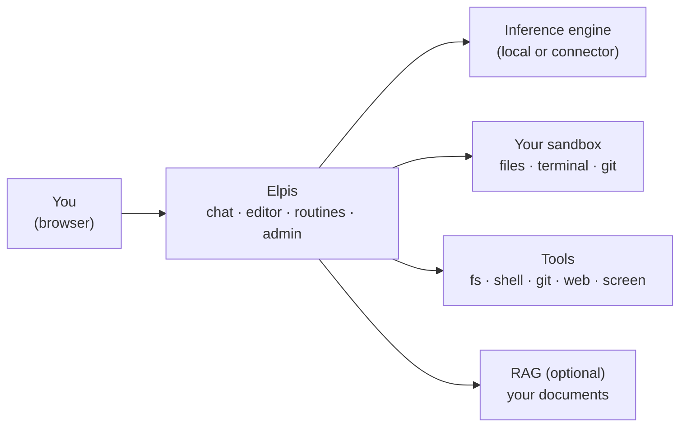
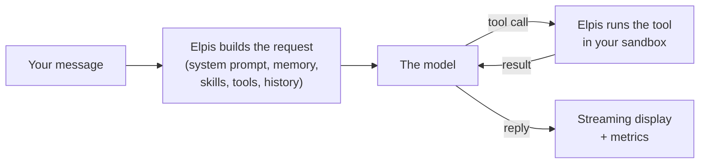
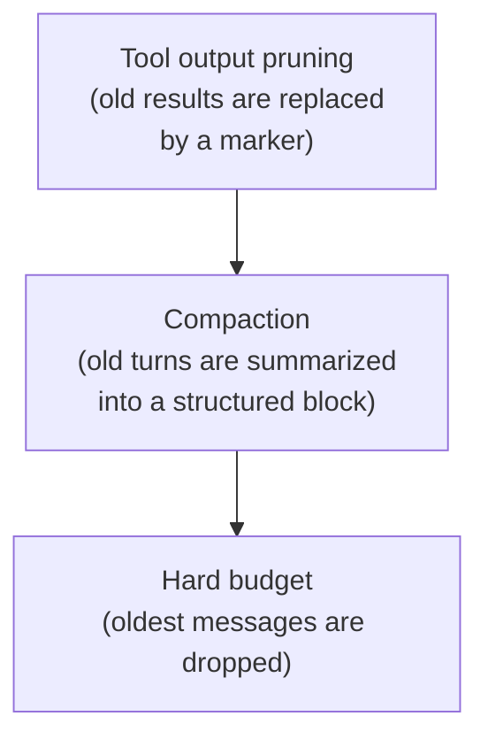
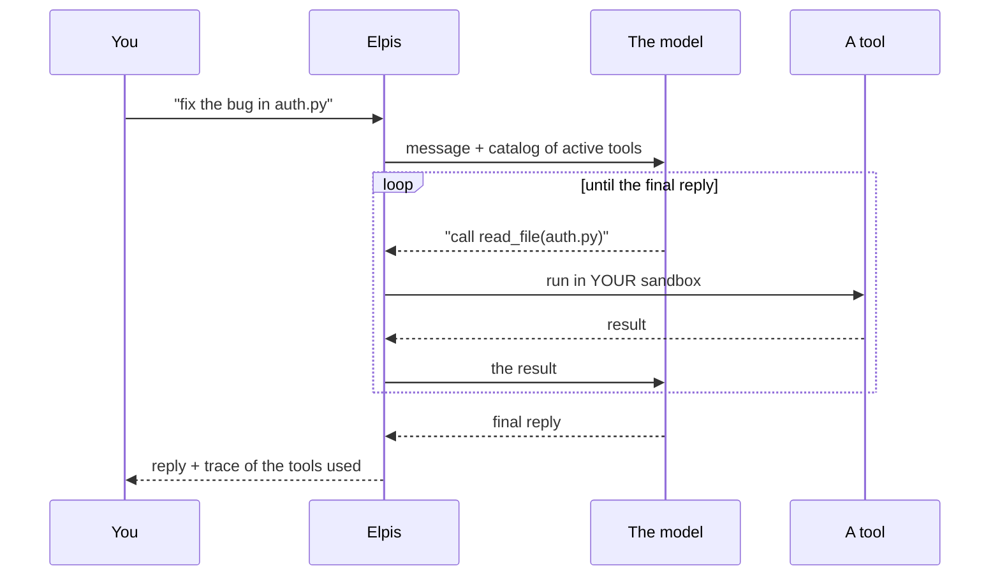

# Elpis — User Guide

> A **self-hosted** LLM assistant: a chat that can act (tools, subagents,
> memory), a code editor with a sandbox and terminal, scheduled tasks,
> a RAG engine and an admin console. Everything runs on your network.

> **Application name.** The name, logo and welcome screens can be
> configured by your administrator ("Elpis" is the default name).

---

## Contents

### Getting started
- [Overview](#overview)
- [Signing in](#signing-in)
- [Interface tour](#interface-tour)

### How it works
- [The journey of a message](#the-journey-of-a-message)
  - [What the model receives](#what-the-model-receives)
  - [The context gauge](#the-context-gauge)
  - [Thinking](#thinking)
- [Compaction and pruning: staying within context](#compaction-and-pruning-staying-within-context)
- [Tools](#tools)
- [The sandbox: where the assistant works](#the-sandbox-where-the-assistant-works)
- [Subagents](#subagents)
- [Skills (procedural memory)](#skills-procedural-memory)
- [Long-term memory](#long-term-memory)
- [RAG](#rag)

### Everyday use
- [Chat](#chat)
  - [Sending a message](#sending-a-message)
  - [Dictating and listening to replies](#dictating-and-listening-to-replies)
  - [`@file` mentions](#file-mentions)
  - [Slash commands (`/`)](#slash-commands-)
  - [Logging in to websites](#logging-in-to-websites)
  - [Attachments and images](#attachments-and-images)
  - [Generating images](#generating-images)
  - [Streaming, stop, resume, regenerate](#streaming-stop-resume-regenerate)
  - [Following the assistant's work](#following-the-assistants-work)
  - [Metrics under each reply](#metrics-under-each-reply)
  - [Managing your conversations](#managing-your-conversations)
- [The MCP panel](#the-mcp-panel)
- [The Generation panel](#the-generation-panel)
- [Models and providers](#models-and-providers)
- [Your collections (RAG)](#your-collections-rag)
- [The code editor](#the-code-editor)
- [The terminal](#the-terminal)
- [Routines (scheduled tasks)](#routines-scheduled-tasks)
- [Studio (screen control)](#studio-screen-control)
- [Remote code (OpenCode sessions)](#remote-code-opencode-sessions)
- [Skills library](#skills-library)
- [Git accounts](#git-accounts)
- [Notifications](#notifications)
- [Saved and shared prompts](#saved-and-shared-prompts)
  - [Prompt templates](#prompt-templates)
- [Settings](#settings)

### Help
- [Admin console](#admin-console)
- [Keyboard shortcuts](#keyboard-shortcuts)
- [Frequently asked questions](#frequently-asked-questions)
- [What to do when something goes wrong](#what-to-do-when-something-goes-wrong)

---

# Getting started

## Overview

Elpis combines several components to give you an assistant that does more than
talk: it **acts**, in a workspace that is yours alone.

- **A large language model (LLM)**, served by a local engine (`llama.cpp`,
  vLLM…) or, if your administrator allows it, by an external provider.
- **A personal sandbox**: an isolated Docker container with your files,
  a terminal, Git and a build toolchain.
- **Tools** that the model can call: read and write files, run commands,
  drive a browser, use Git, produce charts, keep a memory.
- **A built-in code editor** (the VS Code engine) connected to that sandbox.
- **Subagents**: the assistant can hand a sub-task to a specialized agent that
  works in its own context.
- **Routines**: the same mechanism, but scheduled (cron) or triggered by a
  webhook.
- **An optional RAG**: the assistant answers from your document collections
  and cites its sources.

You use the application in a browser. There is nothing to install on the client
machine.



> **Local by default.** The model, your files and your conversations stay
> on your organization's server. The only possible exits are the ones that are
> explicitly opened: an external LLM connector, a browser tool, or a sandbox
> network profile allowed by the administrator.

[↑ Contents](#contents)

---

## Signing in

The sign-in screen asks for a username and a password.

**Accounts are created by an administrator.** There is one exception: on a
fresh instance, the very first sign-in with the name `admin` creates that
account and gives it administration rights. After that, any attempt with a
nonexistent account is refused (`invalid credentials`).

If you are an administrator, a shield icon appears at the bottom of the
sidebar.

> **Good to know.** Your password is stored hashed (PBKDF2-SHA256,
> 150,000 iterations, random salt). Nobody — not even an administrator —
> can read it. An admin can, however, assign you a new one; at your next
> sign-in the application asks you to choose your own.
>
> The password policy (minimum length, uppercase letters, digits,
> special characters) is set by the administrator.

**Session length.** By default, a session lasts 24 hours and the cookie expires
when you close the browser. An administrator can revoke all your sessions
remotely (you will be signed out).

[↑ Contents](#contents)

---

## Interface tour

The application is a **single surface**. You do not switch pages: you open
and close panels on top of the chat.

| Area | Contents |
|---|---|
| **Sidebar (left)** | New chat, search, conversation list, notifications, access to views (MCP, Sandbox, Routines; RAG, Studio and Remote code in the **More** submenu), Settings, Admin |
| **Center area** | The conversation |
| **Right panel (optional)** | The code editor + the terminal |
| **Composer (bottom)** | Message, attachments, model selector, generation settings, active RAG collections (chips), thinking mode, running-tasks chip |

The **Sandbox**, **Routines**, **Studio** and **Remote code** views open
full screen on top of the chat; `Esc` always goes back one step.

[↑ Contents](#contents)

---

# How it works

This section describes what the application does around the model: what it
sends to the model, how it keeps the conversation within the context window, and how it
runs tools. If you just want to use the tool, skip to
[Chat](#chat).

## The journey of a message



### What the model receives

On every turn, the application rebuilds the full request, including what you
do not see:

```
system prompt + memory + skills + tool definitions
+ conversation history + tool results + your message
```

The head of the request (system prompt and instructions for the active tools)
is built in a fixed order, identical from one turn to the next.

The reply appears as it is generated (**streaming**). Under each reply,
`1849 in / 425 out` shows the size of the request sent and of the
reply, in tokens.

### The context gauge

The request must fit in the model's **context window** (`n_ctx`, read
from the inference server). A gauge in the chat header shows how full it
is. When it overflows, the application does not cut at random — see
[Compaction and pruning](#compaction-and-pruning-staying-within-context).

### Thinking

With a model that can reason before answering:

- the reasoning appears in a collapsible section above the reply,
  with an auto-generated title that summarizes the line of thought;
- the **thinking budget** (Generation button, 8,192 tokens by default) limits
  this phase;
- you switch the mode from the composer;
- you can hide these blocks permanently (Settings → Chat → *Hide
  reasoning*).

> ⚠ If you interrupt the model in the middle of thinking, the **Continue** button
> is not offered: the application does not resume a cut-off thought.
> Use **Regenerate**.

[↑ Contents](#contents)

---

## Compaction and pruning: staying within context

A long agentic session (the assistant reads 30 files, runs tests,
fixes, starts over) quickly fills the context window. Three mechanisms
take over from one another, from the gentlest to the most drastic:



1. **Pruning.** Old tool results (a big `grep` output
   from 40 turns ago) are replaced in what is sent by an explicit marker. They
   stay **stored in full** — the assistant can find them again through
   session search. Recent turns are always protected.
2. **Compaction.** The model summarizes old turns into a structured
   block (context, established facts, actions done, state, pitfalls) that
   keeps what is needed to resume the task. The last turns stay
   intact, word for word.
3. **Hard budget.** As a last resort, the oldest messages are dropped.

**You stay in control:**

- `/compact` in the composer compacts **now**. A card appears
  in the thread; expand it to read the summary produced.
- **Automatic** compaction is a personal choice: Settings →
  Compaction → *Automatic compaction* (off by default). When it is off, only `/compact`
  compacts, and you can see saturation coming on the gauge.

[↑ Contents](#contents)

---

## Tools

The application describes the conversation's active tools to the model, runs
the ones it asks for and sends back the result. Tools go through
**MCP** (*Model Context Protocol*), whether they are built in or provided by an
external server.

### The agent loop



Each call appears in the conversation thread: tool name,
parameters, result — all expandable. You see exactly what was done.

This loop can run for a long time (200 productive turns by default).
That is what lets you say "read this file, change it, run the tests, fix the
errors" in a single request.

### Tool categories

Tools are grouped into **categories** that you tick in the **Tools** panel.
Ticking a category gives the model *all* of its tools.

| Category | What the model can do |
|---|---|
| **Files** (`fs`) | Read, write, edit by replacement, list, search, navigate code (definitions, references) |
| **Terminal** (`shell`) | Run any command in your container (pipes, redirections, scripts…) |
| **Git** (`git`) | Clone, inspect, branch, commit, push, open a pull request |
| **Browser** (`browser`) | Drive a Chromium browser: navigate, click, fill in, capture, wait, check |
| **Screen control** (`desktop`) | Observe and drive a machine running the desktop agent (Windows/Linux) |
| **Charts** (`chart`) | Produce charts (trend, proportion, distribution, financial) and tables |
| **Memory** (`memory`) | Write and re-read its long-term memory, search the session history |

Two tools are **always** present as soon as a category is active, without
appearing as checkboxes:

- the **session to-do list**, which the model keeps itself to structure a
  long task (visible through the "tasks" chip in the composer);
- the **`task`** delegation tool, if you have enabled
  [subagents](#subagents).

### External MCP servers

On top of the built-in tools, you can connect **third-party MCP servers** —
any service that speaks the protocol (Jenkins, an internal database, an
in-house API).

- **Your servers**: added from the MCP panel, with the *Manage / add
  a server* button in the External section (HTTP, SSE or local). The window lists
  your servers and the shared servers on the left; the selected server is edited
  on the right (*Test*, *Save*), and the result of its
  last test shows in the list. Templates (Jenkins, Wiki.js) prefill
  a new server.
- **The shared library**: the administrator publishes a server once
  (scope *All*, HTTP or SSE), and each person chooses whether to show it in their
  MCP panel (*Show in panel*). Authentication secrets
  stay on the server side — they never pass through your browser.

Each external server is ticked independently, like a category, **for the
current conversation**.

> **Isolation.** All tools are confined to your space. You cannot
> reach another user's files or the host system.
> See [The sandbox](#the-sandbox-where-the-assistant-works).

### Plugging your tools into an MCP client

The same tools are served over **MCP** (Model Context Protocol, streamable
HTTP) at the application's address: an editor, a command-line assistant, an
agent or a script that speaks MCP can use them.

1. Create a **tool token** in **Settings › Access tokens** and tick the
   families you want (`browser` and `desktop` are never ticked by default).
2. Copy the configuration block provided: one entry per family, with the URL
   `https://<server-address>/api/mcp-bridge/<family>` and the header
   `Authorization: Bearer ept_…`.

Each call runs in your sandbox, under your account. A client that
runs in a browser, on another origin, is refused until the
administrator adds that origin to `mcp.allowed_origins`.

**No token to copy (OAuth).** An MCP client that handles OAuth authorization
only needs the address: `https://<server-address>/api/mcp-bridge`
(all your families) or `…/api/mcp-bridge/<family>`. On first connection,
it opens an Elpis page: sign in if needed, check the application's name and its
return address, tick the families to entrust to it
(`browser` and `desktop` are never ticked by default), then click **Authorize**. Access lasts
30 days at most (the administrator can change this); remove it whenever you like
in **Settings › Access tokens › Authorized apps**.

### Using your tools from another platform (OpenAPI)

The tools that work in your sandbox — files (`fs`), terminal
(`shell`), Git (`git`), browser (`browser`), screen control (`desktop`)
and skill scripts (`skill_run`) — are also exposed as an **OpenAPI 3.1 API**, for
platforms and scripts that do not speak MCP.

1. Create a **tool token** (`ept_…`) in **Settings › Access tokens**, ticking
   the families you want. It is shown only once; if you lose it,
   regenerate it.
2. In the platform, declare one tool server per family:
   - **URL**: `https://<server-address>/api/tools/<family>` (the schema
     is read from `…/api/tools/<family>/openapi.json`);
   - **Key**: your token, sent as `Authorization: Bearer ept_…`.

   Calls must come from a server or a script: a call made
   from a web page on another origin is refused by default (cross-origin,
   `app.cors_origins` empty). Over `https` with the internal certificate
   authority, the client must trust it.

Each tool becomes a `POST /api/tools/<family>/<tool>` whose body is
the arguments object. Calls run **in your sandbox, under your
account** — exactly as in the chat. A tool failure answers `200` with
`"ok": false` and a hint on how to fix it; a missing, expired or revoked token
answers `401`. The driven browser (`browser`) and screen control
(`desktop`) are exposed only if they are ticked on the token.

[↑ Contents](#contents)

---

## The sandbox: where the assistant works

Each account has a **persistent Docker container** that holds its
workspace, mounted at `/work`.

What this means in practice:

- **Inside the container, you (and the model) have full power**: passwordless
  `sudo`, package installation, compilation. This is intended — one container per
  user is disposable.
- **The host and the other users are protected**: no access to the Docker
  socket, dangerous capabilities removed, memory / CPU / process limits,
  partitioned volume.
- **The network is off by default.** The administrator defines **network
  profiles** (isolated, bridge, allowlist of IPs/domains/ports) and you
  choose one — unless one is imposed on you.
- A **disk quota** applies; it is visible in the editor.
- An idle container is stopped automatically and restarts by itself on
  your next action. Your files do not move.

You control all this from **Settings → Sandbox**: container state,
network profile, restart, purge.

> ⚠ **A closed network is not a failure.** If the assistant reports that a
> `pip install` or a `git clone` fails with connection refused, it is
> probably the network profile. The assistant knows this: its context tells it
> the real state of the network on every turn.

[↑ Contents](#contents)

---

## Subagents

On a broad mission, the main assistant can **delegate** a sub-task
to a child agent. The child runs its own tool loop, in its
**own context**, and only its **final report** comes back to the conversation.

The benefit is direct: reading 30 files to find where a function lives burns
the *child's* context, not yours. Your conversation receives three
paragraphs of conclusions instead of 40,000 tokens of digging.

**The built-in cast:**

| Agent | Mission | Pre-ticked tools |
|---|---|---|
| `explore` | Read-only exploration: locate, read, assess, trace Git history | Files, Git |
| `implement` | Write the change in the sandbox and verify it (does not commit) | Files, Terminal, Git |
| `verify` | Run the tests and commands, diagnose failures, change nothing | Terminal, Files, Git |
| `web` | Web research by driving a real browser, read-only by default | Browser, Files |
| `pr` | Branch, commit, open the pull request for work already in place | Git, Files |

A subagent is **a chat whose MCP panel boxes are already
ticked**: it receives whole categories. Its specialization comes from its
**persona** ("you are read-only") and its **iteration budget**, not
from a trimmed tool list.

**Your custom agents.** Agents page (sidebar › More): a grid of
cards (Built-in, then Personal) and, when you click a card, the agent's sheet
(General, Tools, Permissions, Instructions): name, description, system
prompt, tool categories, external MCP servers, read-only,
**thinking** and web session. Up to 30 personal agents. Note: no agent
publishes through `git_submit`, Elpis's Git tool, but that rule covers only that tool. An agent to which you attach an external
MCP server that can publish (the GitHub server, for example: create a
pull request, push files) publishes **without** asking, as
the assistant would: attach only servers that you accept it using
on its own, or disable their write tools in the MCP panel.

**Read-only.** `explore` and `web` are built in as read-only: they read
(files, web pages) but write nothing in your sandbox; a `web` agent keeps
its whole browser, only file writes are removed.
The administrator sets this default for each type (Admin console › Sandbox ›
Subagents), each agent has its "Read-only" box in the Permissions tab of the Agents page
(your choice overrides the default, unless the administrator enforces it) and
the assistant can request it for a mission.

**An agent's thinking.** An agent can think before acting: its thinking
stays in its isolated context and only its report comes back. An agent's Permissions tab
offers "Same as conversation", "On" or "Off"; by default, the administrator sets the mode for
each type (`implement` and `verify` think, `explore`, `web` and `pr` do not). It has no effect
if the model does not think; the agent's card shows "thinking" when
thinking tokens have been measured.

**Create an agent with the assistant.** On the Agents page, click **Assistant** (in the header, or the "Create
with the assistant" card while you have no personal agent): give a name and the mission, optionally the
tools and constraints. The assistant opens a chat, asks you at most two rounds of questions (mission and
expected result, tools and MCP servers, read-only, budget, thinking), writes the full sheet
with its persona in English, shows it to you, then saves it **after your approval** (`agent_save` tool). The agent is
always created **disabled** and in its own web session: review it and enable it from the Agents page (the
"Open in Agents" button under the result), where you tick "My web session" if it should use yours. An agent with the
same name is replaced only if you ask, and it is replaced entirely: disabled, web session back to its own.
If the administrator has turned subagents off, the assistant writes the agent but cannot save it; the tool does not exist
in plan mode, in a routine, in a subagent, or when the assistant is woken by a background task.

**Blank slate.** An agent starts from scratch: the assistant writes it a complete brief,
and the child stays isolated from the discussion. The assistant can also pass it what
the conversation already knows (your last request, the files read or written
in the turn, the repository and branch, the open tasks of the list): the agent
receives them as data, and the brief remains its instruction.

**An agent's browser.** An agent that drives the browser (`web`) works
in **its own session**, with an empty profile: it sees neither your logins nor your
cookies, does not touch your tabs or those of another agent, and its session is
closed at the end of its mission, whatever the outcome. Simultaneous `web` agents each
get their own, up to four sessions per account (yours
included, adjustable by the administrator): beyond that, the agent is not started and
the assistant knows. For an agent to use **your** signed-in session, choose
"My web session" in the Permissions tab of its sheet (the administrator can forbid this
for everyone): it then works with your logins, in a tab of its own, and cannot
close the session. Clearing the box also applies to an agent already started: when resumed, it
goes back to its own session. This choice appears only for an agent that has web
tools; under each group of the Permissions tab, a line says what the selected option does.

**Publishing a branch.** `git_submit` (push the branch and open the merge
request) is visible outside your machine: no agent calls it. The `pr` agent
prepares the branch and the commit, then hands back the exact call; the assistant
runs it, in the chat, where you see it. No agent, and not the assistant either, ever
receives a Git token: you add it yourself in Settings → Git accounts.

**Several agents at once.** The agents that a single message launches start together,
within the limit set by the administrator. The harness does not order them: the
assistant divides the work (distinct files for each, one after the
other, or a sync file that it names in their instructions). When another
agent of the account was writing at the same time, the card says so: some modified
files may be its own.

**Per-turn limits.** So that a turn does not delegate endlessly, the administrator
sets (Admin console › Sandbox › Subagents) the number of agent launches per turn (12
by default; the same agent is resumed at most three times
per turn, on top of that) and, optionally, a cap on tokens consumed by the
agents of a turn, including those still working at best as far as is known
(none by default). At the cap, the assistant can no longer
launch any: it finishes with what its agents reported, or asks you
how to continue; agents already launched run to the end. Routines
have the same caps.

**An agent's duration.** The assistant can bound a mission (`max_seconds`, at
most the administrator's limit, 1 hour by default). The countdown starts as soon as
the delegation begins. The agent receives a slightly shorter deadline, which
leaves room for its report (2 minutes in general, at most a third of the limit
for a short mission). At that deadline, the text the model was in the middle of
writing is interrupted and kept, an action still in progress is stopped (its
result is marked unconfirmed) and no new one starts, then the agent writes its
report. If the model stays stuck until the limit, no new call is made to it:
the card carries the start of its report, or a partial report assembled by
Elpis (the agent's last message, actions done or still in progress, files
modified, remaining work), and the assistant can resume it (`task_id`) with
the history already built.

**Stopping or restarting mid-work.** If you stop the turn while an
agent is working, then click "Continue", the assistant finds the agent's
identifier (`task_id`) and can resume it where it left off. While it works,
the agent keeps a checkpoint, taken at the start of each step that follows a finished
series of calls (in memory immediately, on disk every 10 seconds at
most, without slowing the server): if the server restarts abruptly in the middle of
work, the agent resumes from that point. Whatever was in progress at that moment is
lost: the reply the model was writing and the series of calls in flight
(including a multi-minute command, which may have acted without leaving a trace),
plus the last ten seconds if their checkpoint was not yet written. The agent is
told to check the state of the files before repeating a write or a
command. At the first message you send afterward in the conversation,
the assistant receives the list of interrupted agents (their identifier and
mission): tell it "resume" or "continue" for it to relaunch them.

**What you see.** Each delegation appears as a card in the thread,
with the chosen agent, its mission, its context in tokens and an **eye icon**
that opens, in a large window, the instructions, result, report and full timeline of
the child (its tool calls). A
cross cancels *one* subagent without killing the current turn. The token count is,
as at the foot of the main message, the context of the agent's last request as
the engine reported it: it never exceeds the model's window. It is updated
on every request, on the agent's line in all timelines; the tooltip
adds the input accumulated across all its calls to the engine (each call rereads the context,
so this total can exceed the window), the cache and the output. Nothing is estimated:
a cut-off request (deadline, stop) whose usage the engine did not report (vLLM,
SGLang) is not counted, and thinking appears only if the engine counts it.

**Background agents.** For a long mission that it does not need right away,
the assistant can launch an agent **in the background**: it gets control back immediately and continues
its turn (or answers you) while the agent works. The card carries
"in background" and stays live after the turn ends, and after a reload of the
page; the background tasks list (the composer chip, or `/jobs`) also
shows it, marked "subagent", with its step and its tokens. Its report arrives
on its own: with the next tool result if the assistant is still working, otherwise
in a new message that wakes the conversation, like a background task
("Don't wake me" applies). The assistant can check where it stands (its
latest steps included) or wait for it a while, without asking again. It
can also write to it along the way, to clarify or change the instructions, or to
ask it to wrap up right away with what it has: the agent reads the message before its
next step, and its window shows it in the timeline, under "Assistant message". An agent that wraps up this way returns a partial report and can be resumed
afterward. The turn's Stop button **does not stop it**: only its cross, or "Stop" in the background tasks list, does
(its partial report is then attached to your next message, without a wake-up). A background agent has its own time limit (1 hour by default) and stops cleanly before it, like the
others; the administrator sets how many can run together for an account (2 by
default) and this limit (Admin console › Sandbox › Subagents). Each background agent keeps an
engine slot while you continue, and each wake-up is one more call to the model.
If the server restarts, the agent is lost: the assistant is told, with
its identifier, so it can resume it.

**An agent's status.** The card's badge takes the `Status:` line that the
agent writes **at the very top** of its report (done, partial, blocked), corrected
by what the harness observes (budget exhausted, time limit exceeded, error, cancelled). Only
the first lines count, before the first heading: a `Status: done` quoted
further down (a web page copied under "Evidence", a quotation, a code block) decides
nothing. An agent that writes no readable line gets **"unknown
status"**: this is never counted as done. A `verify` agent also writes
`Verdict: pass | fail | inconclusive`: a well-diagnosed failing test is
"done" work with the verdict "verification failed", without a green check. Only
modified files, commits, errors and the number of calls are recorded by
the harness itself; the green check in the thread appears only for an agent declared
done (and, for `verify`, whose verification passed); an agent that is partial, blocked,
of unknown status or with a failed verification shows a warning sign. Check the
work of an agent that writes (reread the diff, or run a `verify` agent) before
considering it done.

A `git_action` that touches the index (stage, stash…) appears under Git ("Index
modified").

> Subagents are **off by default** (Agents page, "Subagents" switch). A
> child cannot delegate in turn, has no to-do list of its own and cannot
> ask you a question — it has no interface.

[↑ Contents](#contents)

---

## Skills (procedural memory)

A **skill** is a procedure written in Markdown: *how* to do something
concrete with your own tools — deploy with Ansible, reset
a vector database, write a Robot Framework test.

It is the assistant's third memory:

| Memory | Contents |
|---|---|
| Long-term | **Facts**: your profile, the environment, decisions |
| Session (to-do) | The **steps** of the current task |
| **Skills** | **How to do X** |

A light index of all skills is injected on every turn; the **body** of the
relevant skills (at most 3, selected by matching your
request) is added to the prompt. The assistant can also load one
explicitly, read its attached files and run its bundled scripts.

A skill is a folder: `SKILL.md` + `scripts/`, `references/`, `assets/`.
Three scopes overlap, the closest one winning: **your skills** >
**learned** (drafts awaiting admin curation) > **global**.

From the composer, `/skills` lists the library and **pins** a
skill in your prompt.

[↑ Contents](#contents)

---

## Long-term memory

Independent of conversations, it keeps two Markdown files that the assistant
curates by itself:

- **MEMORY.md** — facts about the environment, projects, decisions.
- **USER.md** — your profile: role, preferences, way of working.

These files are injected into the system prompt of later conversations.
They have a **strict character limit**: beyond it, the write is refused
with an explicit message, which forces the assistant to **consolidate** instead of
piling up. A memory that grows without end is not a memory.

The assistant also has a **search through the history** of your past sessions
(full-text indexing) — useful for "what did we decide
about the log format?".

Settings → **Memory**: turn it on or off (off by default),
view and edit the profile and notes, clear everything.

[↑ Contents](#contents)

---

## RAG

RAG lets the assistant answer from **your documents**, citing
its sources:

1. You put documents into a **collection** (RAG page). Each one is
   read (text, headings, tables, pages), split into passages, and each passage
   is converted into a vector that captures its meaning.
2. In a chat, you activate one or more collections. When the question
   calls for it, the assistant searches them for useful passages (`rag_search` tool)
   and reads their neighbors if needed (`rag_read`).
3. It answers, citing each passage by its number (①, ②…), which leads to
   the exact spot in the document.

Three search modes: **Mixed** (meaning and words, the default), **By
meaning**, **Exact words**. Passages remain **data**: the assistant
does not follow instructions that a document might contain, and a passage taken from
another account's collection carries its author's name.

> RAG appears only if your administrator has configured it (embeddings
> server); they can reserve it for certain groups. Scanned documents
> are read with OCR when the administrator has connected a vision model and
> you enable it for the collection.

[↑ Contents](#contents)

---

# Everyday use

## Chat

### Sending a message

Type, then press `Enter` (or click the send button). `Shift+Enter` inserts a
line break.

While the message is being processed, an indicator shows the real state: queued,
starting, tool call in progress, thinking, compaction…

### Dictating and listening to replies

If your administrator has configured the voice engine, two settings appear
in **Settings → Chat**:

| Setting | Effect |
|---|---|
| **Dictation** | Adds a microphone button to the composer |
| **Voice reply** | Replies are read aloud while they are being written |
| **Read between tool calls** | Also reads what the assistant announces before each tool call |

**Dictate.** Click the microphone and speak normally. The text is written **sentence
by sentence**, each time you pause — so you can
keep going without waiting. The text stays editable, and **nothing is sent
automatically**: you review it, then you send.

`Esc` stops dictation at any time without touching what you have already written.

On a long task, the assistant announces its steps between tool calls
("Running the tests…"). This text is read only if **Read between tool calls** is
ticked: useful when you are looking elsewhere, annoying when you are waiting for the
reply — hence two separate settings.

**Listen.** Each finished reply has a play button (hover over it).
It stays available even if automatic reading is turned off. A second click
stops the reading, as does `Esc`.

While a reply is being read, the microphone is **muted**: the assistant does not
hear itself. It resumes on its own at the end of the sentence.

> The microphone requires an **HTTPS** connection — that is a browser rule, not
> an application one. On a plain HTTP instance, the setting says so.

### `@file` mentions

Type `@` to inject the **contents** of a file from your sandbox into the
message.

1. A menu lists your files; keep typing to filter (`@main`,
   `@src/utils`…). The filter applies to the full path, ignoring
   case.
2. `↑` / `↓` to navigate, `Enter` to confirm, `Esc` to cancel.
3. The file appears as a chip above the input; its contents are sent
   with the message.

You can mention several files in the same message.

### Slash commands (`/`)

Type `/` at the start of the input:

| Command | Effect |
|---|---|
| `/skills` | Browse the library and **pin** a skill in the prompt |
| `/template` | Insert a [prompt template](#prompt-templates) (variables are requested before insertion) |
| `/compact` | Compact the conversation now (summarizes the older history) |
| `/image [16:9] [x2] description` | Generate an image directly, without opening Images mode |
| `/routine [goal]` | Open the routine creation assistant (scoping, then an interview in the chat) |
| `/rag …` | The chat's document collections: see [In the chat](#in-the-chat) |
| `/secret …` | Logins the assistant may use in this conversation: see [Logging in to websites](#logging-in-to-websites) |

If your input matches no command, the menu switches
automatically to skill search.

### Logging in to websites

The assistant can log in to a website for you without ever seeing the password. You keep the
login in your **vault** ([Settings › Secrets](#secrets)): a name such as `intranet-admin`, its type
(`web-login` for a login form, `http-auth` for a browser password prompt), the exact addresses
where it may be used (for example `https://intranet.example.lan:8443`, plus the address of the
sign-in page when it lives elsewhere), the user name and the password. The password can be
written, never read back.

A secret is used only in a conversation you attach it to:

| Command | Effect |
|---|---|
| `/secret` | Lists the secrets attached to this conversation, then the ones you can attach |
| `/secret attach <name>…` | Attaches one or more secrets; a chip `secret:<name>` stays above the input |
| `/secret detach <name>` or `--all` | Detaches them; the × of a chip detaches that secret |

The menu completes the sub-commands and the names: `attach` offers your verified `web-login` and
`http-auth` secrets that are not attached yet, `detach` offers `--all` then the attached ones.
Only these two types attach, and an imported secret must first be checked (**Verify** in
Settings › Secrets); a refusal is shown in one line. In an existing conversation the attachment
is saved at once; in a new conversation the chips wait in the composer and are saved with your
first message, before the assistant starts working. Opening a conversation shows its chips
again. The subagents of the conversation inherit the attachment unless the secret's policy says
otherwise; routines use a secret only when its policy allows routines.

**What the assistant sees.** With your next message it receives a short list, never a value:

```
<secrets selection="…">
Secrets the user attached to this conversation and its sub-agents, from this message on. Values are never shown to you: never ask the user for a password.
- intranet-admin  web-login  https://intranet.example.lan:8443  user=admin
…
</secrets>
```

When it opens a page on one of these addresses, the browser opens a session for that secret, with
the certificate check of the secret (verified unless you allowed otherwise); an `http-auth` secret is
applied at once, and that session cannot be recorded (HAR or trace). Otherwise the session is an
ordinary one: the assistant keeps all its testing tools there (scripts, mocks, recorder, exports).
For a login form it calls `pw_login`, the only protected step: the browser service reloads the
login page, sets the assistant's mocks and other tabs aside, checks the form, types the user name
and password, submits, then reopens the page in a new tab so that the password is no longer in it.
The assistant only learns whether the login worked; the password stays out of its view, of
recordings and of the network log. A form placed inside another site's frame is refused, and so is
a login while the session records a HAR or a trace. If the site itself shows the password back on a
page after the login, that page is the site's content: the assistant can read it like any other. A
session serves one secret: the assistant goes back to it for that secret instead of opening new
ones. If a page asks for a login that is not attached, the assistant asks you to attach one with
`/secret attach <name>`, or to give the credentials in the chat if they are only test data (they then
stay in plain text in the chat history). Each use is written to the security journal.

Logins that the browser used to remember by itself (before the vault) are moved into it at the
update, as **unverified** secrets named after their site: check them in Settings › Secrets before
attaching them.

### Attachments and images

Paperclip button, or **drag and drop** directly into the window.

| Type | Limit | Handling |
|---|---|---|
| Text / code | 5 MB | Contents inserted into the message |
| Image | 15 MB | Sent to the model if it supports vision |
| Network capture (`.pcap`, `.pcapng`, `.cap`) | — | Refused (not supported) |

Maximum **10 files** per message. A file that is too large is refused with
a clear message, without blocking the others.

### Generating images

Visible when the administrator has connected an image engine and your
account is allowed to use it. **+ › Images** menu (or **Alt+I**): the composer bar
switches to Images mode.

- **Bar**: aspect ratio (⇄ button to switch to portrait), size (longest
  side), count, **Enhance** (the chat model rewrites the description),
  **⋯** for the seed, what to avoid, the steps and the strength
  (depending on the engine). The starting values are your preferences.
- **Edit an image**: attach an image, or click **Edit** on a generated
  image: it becomes the reference.
- **During generation**: each image has its own slot, in the right aspect ratio, with
  "Queued · 2nd" or "Generating · 12 s / ≈30 s" (≈ = estimate based on
  previous generations). The slot's ■ button stops the request.
- **Result**: model, aspect ratio, duration and seed below the grid.
  **Variants** reruns the same request with a new seed without erasing
  the current images; **Regenerate** replaces the reply; **Copy** copies
  the description. A click opens the viewer (← → between images,
  Download). **Delete** can be undone for 5 seconds.
- **The model can also create images** during a reply (`generate_image`
  tool), if "By the model" is ticked.
- **Retention**: only your most recent images are kept (the number
  is set by the administrator); a purged image shows "Expired".
  Settings › Features › Images: your preferences, the counter and the
  **Library** (all your images, or those of the conversation).

### Model questionnaire

In any chat whose tools are active (plan mode included), the model can ask you
several questions at once (`ask_user` tool): a panel opens above the composer, with
options to click and a free-text field; your answers go out in a single message. It does not exist in a routine or in a
subagent.

### Streaming, stop, resume, regenerate

- **Clean stop**: the `■` button stops generation. Everything already
  produced is kept — nothing is lost.
- **Continue**: after a stop or a cut-off, an amber "Reply
  interrupted" banner offers to resume. The full history, partial content
  included, goes back to the model: it continues where it stopped.
  *(Not offered after stopping a thinking model — see above.)*
- **Regenerate**: reruns the same message with a new generation.
- **Edit and resend**: editing one of your messages restarts the conversation
  from that point.
- **Automatic reconnection**: on a network drop, the application
  retries twice with an increasing delay. The status bar shows
  `Reconnecting (1/2)…`. If everything fails, a **Retry** button appears.

> The periodic recycling of a server process is **invisible**: the stream
> ends cleanly and the client reconnects within a second. You see
> nothing. Only a real full restart shows a banner.

### Following the assistant's work

The conversation thread interleaves text and actions in their real order:

- **Tool calls**: name, parameters and result, expandable.
- **Live terminal**: the output of a long command scrolls in real time
  in the thread, instead of appearing all at once at the end. *(Settings → Chat →
  Live terminal, on by default.)*
- **File cards**: a file written or modified appears as a card with
  the colorized diff, clickable to open it in the editor.
- **Tasks chip**: as soon as the assistant keeps a to-do list, a `3/7` counter
  appears in the composer; a click expands the list with the current step
  highlighted.
- **Subagents**: one card per delegation, with the eye to see the timeline.
- **Charts**: rendered directly in the thread.

### Metrics under each reply

Under each reply: input / output tokens, prefill speed (prompt reading),
generation speed, duration, model used. Hover for the detail.

A thumbs-down lets you flag an unsatisfactory reply.

### Managing your conversations

In the sidebar:

- **New chat**: `+` button or `Ctrl+Shift+O`.
- **Rename**: double-click the title, or right-click → Rename.
- **Archive**: removes the conversation from the active list without deleting it.
- **Delete**: permanent.
- **Multiple selection**: delete several conversations, or clear them all.
- **Search**: the magnifier searches titles **and** content.

The application keeps a bounded number of **active** conversations (set by
the administrator); beyond that, the oldest are deleted. **Archived**
conversations **do not count** toward this limit — that is the way
to keep a conversation indefinitely.

**Export** a conversation: conversation menu → PDF, Markdown, plain text
or JSON.

[↑ Contents](#contents)

---

## The MCP panel

Open it with the **MCP** icon in the sidebar:

- **Internal** — the built-in categories (Files, Terminal, Git, Browser,
  Screen control, Charts, Memory). One box per category.
- **Declared** — the servers installed with the application, if any.
- **External** — your MCP servers and those of the shared library that you
  chose to show. The *Manage / add a server* button opens their
  management.

**The boxes are specific to each conversation** and saved with it:
reopening yesterday's chat restores exactly the tools that were active.

The **MCP** module (Settings → Features) turns off *all* tools
at once; only memory remains.

> **Less is often better.** Each active category adds the
> description of its tools to the context. For a pure writing question,
> unticking everything speeds up the reply and makes it more direct.

[↑ Contents](#contents)

---

## The Generation panel

The **Generation** button, next to the model selector, sets the generation
parameters for the current conversation: temperature, top-p, top-k, min-p,
repetition penalty, maximum length, thinking budget, tool iteration
cap.

- The model's default values are shown grayed out; an empty field keeps
  them.
- A setting specific to llama.cpp is marked *no effect* when an external
  engine is selected: it is removed from the request.
- A **debug mode** at the bottom of the panel shows the exact JSON that will go to the
  model.
- The Generation panel and the MCP panel are mutually exclusive.

[↑ Contents](#contents)

---

## Models and providers

**The model selector** (composer) lists the available models, if it
is enabled by the administrator. The chosen model applies to the next
message; older messages stay associated with the model that produced them.

The "info" icon shows the current model's properties: context size,
default parameters, capabilities (vision, tool calls).

**Your providers** (Settings → AI models). If the administrator allows it,
you can connect your own providers — Anthropic, OpenAI, OpenRouter,
Mistral, Moonshot… — with **your** API key. By default, none is open
to non-administrator accounts: only the ones the administrator has opened
are offered.

- The key is **encrypted at rest** and is never sent back to your browser.
- A **Test connection** button checks the connection and lists the models.
- The provider's models then appear in the selector.

> The (provider, model) pair is atomic: changing provider changes
> the model accordingly. You cannot route an Anthropic model to an OpenAI
> endpoint by mistake.

[↑ Contents](#contents)

---

## Your collections (RAG)

See [RAG](#rag) for how it works.

### The RAG page

**RAG** entry in the **More** submenu of the sidebar. On the left: **My
collections**, **Shared with me** (with the author's chip), the
indexing progress and your storage quota. On your first visit,
drop in files: the collection is created.

Accepted formats: PDF, Word (docx), PowerPoint (pptx), Excel (xlsx), HTML,
Markdown, text, CSV, JSON and YAML. Default quotas (the administrator can
change them): 2 GB, 10 collections, 200 MB per file, 2,000 documents per
collection.

A collection has three tabs:

- **Documents**: drag in files or a folder, or **Import from the
  sandbox**. Each row shows the strip of its passages and its state (pending,
  extracting, indexing, ready, or failed with the reason, for example
  "No text: turn on OCR"). The indexing banner offers Pause
  and Cancel. A file that is already present (same content) is ignored.
- **Test**: a question shows the passages the assistant would receive,
  where they are in the documents, and their estimated cost in tokens.
- **Settings** (owner): name, **description** (the assistant reads it to
  know when to search), chunking, OCR for scanned documents, and the danger
  zone (empty, or delete after typing the name).

### Publishing

**Publish…** opens the publishing dialog: **Private**, **Groups** (those you
belong to) or **All accounts** (administrators only). Accounts that gain access
receive a notification. The **Open source documents** switch decides whether
they can open your original files; without it, they see only the passages found.

A collection published by another account is **read-only**: you
can search it (**Chat with**, Documents and Test tabs) or
**Hide from my list**, nothing else. The administrator sees the name, author
and size of all collections and can delete one; they never read
the contents of a collection that is not open to them.

### In the chat

**Chat with** opens a new chat with the collection already active. Active
collections appear as chips above the input; the cross
removes one. With no active collection, the assistant searches no
document. The `/rag` command does the rest:

| Command | Effect |
|---|---|
| `/rag use <collection>` | Query this collection in this chat (several are possible; the menu lists yours, then those shared with you) |
| `/rag off` | Stop querying any collection |
| `/rag search <question>` | Show the passages found in a notice in the thread, without an assistant reply |
| `/rag add <collection>` | Index the attached files or the sandbox `@files` into one of your collections |
| `/rag new <name>` | Create a collection from the attached files |
| `/rag status` | See the indexing jobs in progress |
| `/rag open [collection]` | Open the RAG page |

**Sources.** In the reply, each reference becomes a numbered chip;
on hover (or with the keyboard), a bubble shows the document, page,
section, collection, the excerpt with the words of your question highlighted,
and the relevance. Below the reply, the sources footer lists the documents
cited and, under "N passages read, not cited", what the assistant set aside.

**The viewer.** "View in document" opens a panel on the right:
**Page** shows the actual page with the passage highlighted in place,
**Text** the extracted text with the neighboring passages. The arrows move
from one cited source to the next; a strip shows where the passages are
in the document. **Open original** appears only if you have the right to.

### When an account leaves

When an account is deleted, its collections are deleted too (files and
passages). Accounts that were reading one of its published collections receive
a notification; replies already given keep their cited excerpts,
but the document no longer opens. As long as the account exists, its publications
remain valid even if it leaves a group or loses the RAG permission; its
private collections are then readable by no one.

[↑ Contents](#contents)

---

## The code editor

The built-in IDE is based on **Monaco** (the VS Code engine) and works
directly in your sandbox. Turn it on from Settings → Features
or with the sidebar icon.

### Editor style

Each skin can bring its own editor style: colors, code
highlighting, terminal. Choose the skin in Settings → Appearance; the
**Editor** list offers *Follow skin* (default) or *Classic*. A skin without
an editor style keeps the classic editor. You can also switch from the editor
menu ("⋯ › Classic editor", "+ › Skin editor"), and nothing is lost from your
changes in progress.

### File explorer

At the top of the column, three icons switch views: **Files**, **Git** (with the
number of changes) and **History**. In the Files view, "New file"
stays visible, and the "⋯" menu gathers the other actions: new folder, import,
hidden files, reveal active file, collapse all, refresh. The classic
editor keeps its dropdown list and its row of icons.

The tree of your sandbox. Left-click to open or expand, right-click
for the context menu: new file, new folder, rename,
delete, download. A search bar filters by
name; a content search finds text across all files.

**Import / export**: drag and drop files or whole folders
(chunked upload for large volumes), multiple download as an
archive. A **quota** indicator shows the space used.

### Editing

Tabs, syntax highlighting for more than 50 languages (including a
dedicated Robot Framework parser), automatic detection by extension. `Ctrl+S` saves;
a dot marks unsaved changes.

Options in Settings → Features: size and font, indentation, word wrap,
minimap, line numbers, auto save, remembering open
tabs. The dark theme is set in Settings → Appearance → Editor.

A **diff mode** compares your buffer to the saved version. A **split
view** shows two files side by side. Files written by the assistant
are highlighted and can open automatically.

### Navigation and AI actions

Right-click in the code:

- **Navigation**: go to definition, find references, rename
  symbol, format document, toggle comment.
- **AI actions**: explain this code, find bugs, refactor,
  optimize, generate tests, add a docstring, add comments.

If the inference engine serves a model that supports **fill-in-the-middle**
(FIM), the editor can complete code at the exact cursor position, taking into
account what comes before *and* after.

### Preview

The **Preview** button renders an HTML page from your sandbox in a built-in
panel, and refreshes after each save. Absolute references
(`/style.css`) are resolved correctly.

A second preview mode targets a **server running in your sandbox**:
give the port (`localhost:3000`) and the application proxies the page. You
can type a free address to browse the served application, and
open it in a browser tab.

> This mode requires a network profile that allows the port; with an isolated profile, the
> connection is refused with an explicit message.

### Built-in Git

A complete Git panel, on the repositories in your sandbox:

| | |
|---|---|
| **Status** | Modified / staged files, current branch, remote repository |
| **History** | Commit log, diff of a commit, contents of a file at a revision |
| **Work** | Stage, unstage, discard, commit, stash |
| **Branches** | Local and remote, create, switch |
| **Remote** | Clone, initialize, fetch, pull, push, rebase |
| **Merge** | Preview before merging, conflict resolution, abort |
| **Repair** | Undo the last commit, restore a commit |

Authentication goes through your [Git accounts](#git-accounts): no
credential is written to the sandbox.

### Snapshots

A **snapshot** of your sandbox, taken on demand, restorable in one click.
The safety net before letting an agent work on its own.

[↑ Contents](#contents)

---

## The terminal

A real terminal (PTY) in your container, under the editor.

- **Several named sessions**, renamable by double-click, as in VS
  Code.
- Real-time output, automatic resizing.
- Files created in the terminal and those created from the editor or by
  the assistant belong to the **same user** — no undeletable
  file on either side.
- An idle session is closed automatically; the disk quota is
  monitored while it runs.

[↑ Contents](#contents)

---

## Routines (scheduled tasks)

A **routine** is a task that the assistant runs **without you**: same
engine, same tools, same skills — but triggered by a clock, a
webhook, or the end of another routine.

*"Every morning at 7: pull the `main` branch, run the test suite,
summarize the failures for me."*

### Create a routine with the assistant

The easiest way: say what you want to automate.

- On the **Routines** page, the **Assistant** button (next to "New", or in the empty state);
- or, in the chat, the `/routine` command (for example `/routine summarize the tickets every Monday`): the text
  becomes the goal for the scoping step.

The assistant opens a chat, asks you at most two rounds of questions (goal, frequency, tools, notifications),
writes the routine, shows you the complete draft, then saves it **after your approval**. The routine is
always created **paused**: review it, then enable it from the Routines page ("Open in Routines" button
under the result). The cron day of the week counts from 1 (Monday) to 7 (Sunday).

Saving by the model (`routine_save` tool) is set in Settings › Features › **Routines** ›
"Create routines" (ticked by default): when unticked, the assistant writes the routine but cannot save it.
The tool does not exist in plan mode, in a routine or in a subagent.

### Create a routine by hand

Editing is full screen, in tabs:

| Tab | Contents |
|---|---|
| **Name** | The routine's label |
| **Schedule** | Every minute, weekly, monthly, advanced cron expression — or *none* (manual / webhook) |
| **Prompt** | The system prompt and the task to run |
| **MCP** | The local tools and external servers available during the run |
| **Skills** | The attached skills |

You also choose the model and the thinking mode.

A routine has no subagents: it is a recurring task that a single
agent carries out, even if subagents are enabled for your conversations.

### Triggers

- **Cron schedule** — the expression is validated as you type.
- **Webhook** — the routine exposes a URL with a secret generated on the server side
  (shown only once, rotatable). Any sender can call it;
  an optional filter restricts it to the events/branches/repositories you
  care about. Repeated deliveries are deduplicated.
- **Chaining** — "after routine X, if it succeeds / fails / in all
  cases". Chains are limited in depth to avoid loops.
- **Manual** — ▶ button at any time.

### Following runs

Each routine has its **log**: status (success, failure, skipped, cancelled),
timestamp, duration, tokens consumed, **files produced**, and the summary written
by the assistant. A run in progress can be stopped.

A run that fails early (engine unreachable) is **retried automatically** once.
Concurrent runs are capped per user, and an orphaned run
(process gone) is reconciled automatically.

Runs execute at **low priority**: they always yield to live
conversations.

[↑ Contents](#contents)

---

## Studio (screen control)

If your administrator has declared **target machines** (Windows/Linux
equipped with the control agent), Studio is used to drive them and to write
**automations**: Python scripts built on the `elpis_auto`
runtime.

- **Scene**: a capture of the target's screen, annotated by the vision model
  or accompanied by the **element tree** (accessibility). *Inspect* mode
  to hover over and act on an element, *Zone* to read text (OCR),
  *Drag* for a drag and drop.
- **Tree**: hierarchy of elements, search, audit of controls with no name
  or identifier, CSV export.
- **Script**: the code is the document. *Record* writes each action into
  the code, at the cursor; blocks can be inserted (if present / absent, repeat,
  wait, check, variable…). The outline alongside lists one line per action.
- **Assistant**: describe the goal, the assistant acts step by step and the script
  is written as it goes.
- **Run** on the target machine, as a *dry run* (targets resolved, no
  input sent), with a trace, or on several machines.

Scripts are saved in your sandbox (`automations/<name>.py`) and can be
downloaded alone or with the runtime to run outside Elpis.

[↑ Contents](#contents)

---

## Remote code (OpenCode sessions)

Elpis can **distribute and drive** the OpenCode command-line tool.

### Install the CLI (without Internet)

From any machine on the local network:

```bash
curl -fsSL http://<server-address>/opencode | bash
```

```powershell
iex(irm http://<server-address>/opencode.ps1)
```

The script detects your system, downloads the right binary from the server and
installs it. The exact command, with your personal token prefilled, is shown in
the application (account menu → **Install opencode**, **Copy** button).

> This bootstrap command stays on `http://` even if the application uses
> HTTPS: the target machine does not know the local certificate yet. The script
> fetches the certificate authority, pins it, then switches to verified
> HTTPS.
>
> The feature must be **enabled by your administrator**, who first
> places the binaries on the server.

### Driving sessions

The installer also adds a plugin. In your terminal, run `opencode` then
`/remote <token>` to send the session up to the **Remote code** page:

- **Session list**, grouped connected / history, with preview, model,
  message count, inline renaming.
- **Full-screen transcript** visually on par with the chat: Markdown,
  thinking blocks, expandable tool calls, **colorized diffs** as
  in OpenCode.
- **Composer**: send prompts from the browser; the echo is immediate,
  stop replaces send during generation.
- **Context gauge** in the header.
- **Permission requests**: when OpenCode asks for approval, a
  banner offers *Allow* / *Always* / *Deny* — the answer is taken into
  account whether given from the page or from the terminal.
- **`/` commands**: those of the CLI, plus actions driven by the page —
  `/model` (model selection remembered per session), `/session` (resume
  a session), `/undo`, `/redo`, `/compact`, `/share`, `/unshare`, `/init`,
  `/new`.

A chip signals when the plugin needs an update (rerun the
installer).

[↑ Contents](#contents)

---

## Skills library

Settings → **Skills**: browse, create, edit, delete your skills;
import a skill (a file or a whole folder, including its scripts) or
export one. An administrator can **promote** a personal skill to the
global library.

An **Assistant** button opens a pre-configured conversation to help you
write a correct skill the first time.

[↑ Contents](#contents)

---

## Git accounts

Settings → **Git accounts**: register your access to code hosts (GitHub,
GitLab, Bitbucket cloud or server, Gitea, or a generic service).

- Just paste a repository URL: the service and host are detected.
- **Test connection** validates the token and lists the accessible repositories.
- The token is stored **encrypted in the server's secrets vault** — never written
  to your sandbox, never sent back to your browser, never shown to the assistant.
  Leave the field empty when editing an account to keep the current token.
  Changing the host, the service type or the API address without entering a
  token clears the token: enter it again for the new address.
- A token imported from an old `.git-credentials.json` file of your sandbox is
  not used until you verify it in Settings › Secrets (the assistant could have
  written that file).
- An account whose token can no longer be read (for example after a change of
  the server's key) shows no token: enter it again.

These accounts feed the editor's Git panel and the assistant's Git tools:
a `git clone` on a private host works without you
typing credentials. The assistant cannot receive a token in the chat: when a
repository needs credentials, it asks you to add a Git account here.

[↑ Contents](#contents)

---

## Notifications

A bell in the sidebar, with an unread counter. It delivers the end of
[routine runs](#routines-scheduled-tasks) and — for
administrators — the daily usage digest. You can mark read/unread,
delete a notification, mark everything read or clear everything.

*(Received shared prompts have their own counter, in the
composer.)*

**Browser system notifications** (the ones that appear outside the
tab) can be turned on from Settings → Chat, if your browser
supports them.

[↑ Contents](#contents)

---

## Saved and shared prompts

**Save** a reusable prompt (title + content): email templates,
complex instructions you often reuse, specification templates.

**Find** them: *Settings → Prompts* lists them with their save date.
Click a row to expand its full content, search titles
**and** contents (accents do not matter: "resume" finds
"résumé"), sort by date or by title.

The content is shown **as is**: a prompt is source text, its Markdown
is never rendered — `#`, `**bold**`, backticks, code blocks and
literal tags stay visible and recoverable. The **Copy** button puts
this source, intact, on the clipboard; **Insert** sends it to the chat
input.

**Share**: select a prompt, choose the recipients (filtering
by group is possible), send. Received prompts arrive in a dedicated
section with a counter; you can delete them one by one or in bulk.

### Prompt templates

A template is a prompt **with blanks**, called by a shortcut:
`/template resume` in the composer. If it contains variables, a
small window asks for them, then the complete text is **inserted** in the
input — never sent: you review it first.

**Create**: *Settings → Prompts → Templates → New* — a shortcut (lowercase,
digits, `-`, `_`), a title, a content. A saved prompt becomes a template
with the `{ }` button on its row. The last entry of the `/template` menu also opens
creation.

| In the content | Effect |
|---|---|
| `{{text}}` | Field to fill in (the same name repeated = a single input) |
| `{{text \| textarea}}` | Multiline area |
| `{{tone \| select:options=["neutral","formal"]}}` | Choice list |
| `…:placeholder="…"`, `…:default="…"`, `…:required` | Example, suggested value, required field |
| `{{current_date}}` `{{current_time}}` `{{current_weekday}}` `{{user_name}}` (French names `{{date}}` `{{heure}}` `{{jour}}` `{{utilisateur}}` also work) | Filled in automatically |
| `{{clipboard}}` | Clipboard contents (to paste if unreadable) |

The syntax is that of Open WebUI and LibreChat: a template copied from those
tools works as is (`{{CURRENT_DATE}}`, `{{USER_NAME}}`, `{{CLIPBOARD}}`…).

[↑ Contents](#contents)

---

## Settings

| Tab | What you set there |
|---|---|
| **Profile** | Your information, photo (cropped before upload: drag, zoom, Fit, Fill, quarter turn), password change |
| **Chat** | *Conversation*: personal system prompt, chat area width, live terminal, wake-ups, system notifications, clear conversations. *Display*: timeline, context, thinking, metrics, density, web screenshots. *Voice*: dictation and voice reply |
| **Compaction** | Automatic compaction, threshold, maximum number of compactions per conversation |
| **AI models** | Providers offered by the administrator + your own providers |
| **Appearance** | *Theme*: dark mode, skin (those the administrator has enabled, then *My skins*), Elpis colors (Gold or Clay). *Editor*: follow skin or classic, dark theme. *Mascot*: logo or mascot on the home screen; see below. The assistant's name and avatar are those of the application, chosen by the administrator |
| **Features** | *Modules*: **MCP**, **Sandbox**, images and routines. *Images*: aspect ratio, size, library. *Editor*, when it is enabled: display (font, indentation, word wrap, minimap, line numbers) and behavior (open automatically, preview, change highlighting, auto save, remember tabs) |
| **Usage** | Your tokens over 1, 7, 30 or 90 days, one bar per type: input (including cache and tools), output (including thinking), and by origin; conversations, messages, routine runs |
| **Memory** | Turn on, view, **edit** (correct or remove an entry) and clear everything |
| **Agents** | Enable subagents, create and edit your custom agents |
| **Prompts** | Your saved prompts (dated list, expand, search, sort) and your templates |
| **Skills** | *Global*: the instance library and its drafts. *Personal*: your own procedures |
| **Archives** | Your archived conversations: restore or delete |
| **Sandbox** | Container state, network profile, restart, emptying the working folder |
| **Secrets** | Your vault: website logins (`web-login`, `http-auth`) and tokens, rotation, verification of imported secrets; see [below](#secrets) |
| **Git accounts** | Your access to Git hosts |

Tabs with a lot of content are split into parts, in a strip at the top of the content; the modal returns to the last part
you opened, and the rail search leads to the right one.

**Mascot** (Settings › Appearance › Mascot). The home screen shows the logo by default. Choose a character in the
list to enable it, *Logo* to turn it off. A skin that brings its own mascot shows it as long as you have not
turned it off. The menu disappears if the administrator has removed the mascots.

**My skins** (Settings › Appearance). Each account can have its own skins, visible only to it
(10 at most by default). Click **Create with the assistant**, describe the mood, the colors and whether the base is light
or dark: the assistant asks a few questions in the chat, then replies with a skin block. A **card** appears
under the block and checks it by itself: *Valid*, or the number of problems (insufficient contrast, unknown token…).
You can then **Preview** (a mockup of Elpis in light and dark, with the contrast table),
**Import**, or **Import and apply**. Importing is always your click, never the assistant's; it is
disabled as long as problems remain, and **Ask for a fix** sends them back to the assistant. If the identifier
already exists, Elpis offers to replace it. In the *My skins* list, **Preview** reopens the mockup and **Delete**
removes the skin after confirmation. The section disappears if the administrator has turned the feature off (Admin console › Appearance).

Your MCP servers are managed from the [MCP panel](#the-mcp-panel).

### Secrets

Settings › **Secrets** lists the vault of your account in one table: `name`, `type`, `scope`,
`user`, `tls`, `version`, last use and number of uses (in a narrow window, `user` and `tls` show
under the name and the usage columns move to its tooltip). An imported secret is marked
`unverified`; `⚠ kid` marks a value encrypted with another key than the current vault key (rotate
it, or ask the administrator for `./elpis vault rekey`). Values are write-only: no screen and no
API returns them, and the model never reads them. The value fields are masked, cannot be copied
and are left out of the browser's password manager.

- **New** creates a `web-login`, `http-auth` or `token` secret. The name is a slug
  (`[a-z0-9][a-z0-9._-]{0,47}`, checked as you type); the scope lists exact origins,
  `scheme://host[:port]`, one per line (a token has none); `tls` is `strict` unless you choose
  `insecure`; the policy says whether the subagents and the routines may use it.
- The **⋯** menu of a row offers **Rotation** (a new value, `version` + 1), **Edit** (an empty value
  keeps the current one; adding an origin or switching to `tls insecure` requires the value
  again), **Verify** for any imported secret, `git` included (read its scope, then it becomes
  `active`) and **Delete**, confirmed by clicking the same button a second time. Escape closes the
  menu, then the panel, then the form, and asks before discarding what you typed.
- Secrets of a connector are listed but managed where they are created: `git` and `llm` secrets
  offer **Rotation** and a link to Git accounts or AI models; `mcp` secrets are read-only here
  (their value holds the server's authentication, headers and variables) and link to the MCP
  servers panel.

The secrets of the instance (shared LLM connectors and MCP servers, image engine) are in the
[admin console](#admin-console), *Models & services › Secrets*.

The personal system prompt is **permanent** (it applies to all your
conversations); generation settings, on the other hand, apply only to the
current conversation.

[↑ Contents](#contents)

---

# Help

## Admin console

Reserved for administrators and moderators (shield icon). It runs
in a **separate process** from the chat: a hypothetical flaw on the application side
does not give access to administration functions. The session is shared — one
click is enough, you are already authenticated.

The sidebar has six entries, each expanding into subpages. Moderators
see only *Overview* and *Monitoring*, without the *Logs › Security* tab. Dates are
in local time; hover one for the exact UTC time. Old links (`#runs`, `#tool-calls`,
`#audit`) lead to the right tab.

| Entry | Subpages |
|---|---|
| **Overview** | Landing page: what needs attention (*To review*), service status, last 24 hours, installation |
| **Monitoring** | **Metrics** (widgets of your choice, visible automatic refresh, CSV export, Prometheus collection), **Report** (archived daily digest, A4 preview before printing, charts shown or removed), **Activity** (*Runs* and *Tool calls* tabs: search, sort, pagination with the total, error filters, clickable `run_id`), **Logs** (*Technical* tab: dated, filterable history, then live stream; *Security* tab: the security journal, administrators only) |
| **Models & services** | **Inference** (engines, request scheduling), **Compression**, **RAG**, **Vision & machines** (annotation, target machines, accessibility memory), **Voice**, **MCP tools**, **Prompts** (system prompts by category, preview of the assembly), **Secrets** (secrets of the instance: rotation, except `mcp`; the keys of shared connectors and of the image engine are deleted from their own page, the others with a confirmation in place) |
| **Users & access** | **Accounts** (role, groups, allowed servers and models, sandbox quota and network profile, machines), **Groups**, **Default permissions** (features, providers allowed to users), **Passwords & sessions** (password policy, cookie, session revocation) |
| **Sandbox** | **Limits & policy** (memory, CPU, processes, command duration, idle shutdown), **Network** (profiles), **Tool hosts**, **Containers** |
| **System** | **Instance** (identity, welcome screen, sign-in page, runtime), **Appearance** (skins offered), **HTTPS access**, **Data** (local and remote backup, database, restore), **Logging** (retention and hold of the security journal, forwarding through the host's syslog), **Maintenance** (periodic maintenance, restart, metrics purge) |

**Navigating.** `Ctrl+K` opens search: pages, settings and actions;
arrows to choose, `Enter` to open.

**Saving.** One screen = one save. As soon as a page has
changes, a bar at the bottom counts them; *View* lists them in detail,
`Ctrl+S` saves. Leaving the page beforehand offers
to save or discard.

**Restart required.** Some settings are read only at startup. Until
the server has restarted, a banner says so on every page,
with the number of pending settings, a *Details* link and a
**Restart** button. The Overview lists them under *To review*.

A few notable actions:

- **HTTPS access** — switches the application behind the local TLS front end, with
  an anti-lockout guard that checks that the ports respond before
  cutting direct access.
- **Backup / restore** — archive of the database, sandboxes and
  MCP servers; upload to a remote server (SFTP, rsync, network share);
  full or partial restore.
- **Appearance** — the skins offered to accounts: *Active* switch,
  *Set* the default skin (Ardoise and the default stay active).
  *Import* a `.zip` package (`skin.json`, `skin.css`, `assets/` in png, jpg,
  webp or gif): it arrives disabled. *Create* starts from an existing skin, with
  about twenty colors in light and dark and a live preview.
  *Export* a built-in one turns it into a template to tweak. *Personal skins*:
  switch (the *My skins* section of Settings disappears when it is off) and per-account cap.
- **Security journal** (*Monitoring › Logs › Security*) — sign-ins, accounts, rights,
  settings, backups, exports, commands: one signed JSON line per event, one file per
  UTC day. Filters (period, category, action, account, outcome, IP, service), *Older*
  to go back in time, full detail of a line. The write markers (start, stop, hourly
  heartbeat of the services) are hidden by default: a checkbox shows them. *Export* as
  CSV or JSONL (raw copy, verifiable), 366 days at most; each export is itself
  logged. *Verify integrity* checks signatures and continuity over the period:
  *intact*, *anomalies* (lines modified, deleted or reordered), *not verified*
  (unsigned lines, for example from before the key was set up) or *empty*.
- **Logging** (*System*) — retention of the journal (365 days by default, 180 to
  1,095) and "forwarding expected": when ticked, the daily purge stops as long as
  rsyslog is not running or the Elpis rule is missing, so nothing is erased that was
  not sent. *Freeze the purge* (reason required, confirmed by typing `GELER`, lifted
  by typing `LEVER`) keeps every file, for example during an investigation. The page
  shows the state of rsyslog (rule, collector, transport, queue, certificates), the
  storage (folder, permissions, signature, disk) and the services that write; *Write
  a test event* gives a code to find in the collector. Server-side setup:
  `sudo ./elpis audit setup`; see [Operations](operations.md#security-journal-and-log-forwarding).
  Alerts (disk, clock, missing key, forwarding, write failures, hold) appear in
  *Overview › To review*.
- **Changing database** — "Simulate" checks the target database and counts
  what would be copied; "Migrate and switch" suspends writes, copies and
  verifies the data, then restarts the application on the new database.
  If the database server becomes unreachable: `./elpis db use sqlite` on the
  machine, then restart.

[↑ Contents](#contents)

---

## Keyboard shortcuts

The `Ctrl+Shift+…` shortcuts have been **removed**: browsers reserve
most of them (`Ctrl+Shift+N`, `Ctrl+Shift+T`, `Ctrl+Shift+R`…) and a web page cannot
capture them. The ones that really work remain:

| Shortcut | Action |
|---|---|
| `Ctrl+Shift+O` | New conversation |
| `Esc` | Closes the topmost open panel in the stack — then, step by step: modal → menu → panel → full-screen view → chat |
| `Enter` | Send the message |
| `Shift+Enter` | Line break in the input |
| `↑` `↓` `Enter` `Esc` | Navigate the `@` and `/` menus |
| `Ctrl+S` *(editor)* | Save the active file |
| `Ctrl+K` *(admin console)* | Search for a page, a setting or an action |
| `Ctrl+S` *(admin console)* | Save the screen's changes |
| `Ctrl+/` *(editor)* | Toggle comment |
| `Tab` *(modal open)* | Keyboard navigation confined to the modal |

On macOS, replace `Ctrl` with `Cmd`.

[↑ Contents](#contents)

---

## Frequently asked questions

**Does my data leave my network?**
No, not by default. The model runs on your organization's server.
There are three possible exceptions, all explicit: an **external LLM connector**
that you connected with your key, a **browser** tool that visits a
site (the server is then the one visiting it), and a **sandbox network
profile** opened by your administrator.

**Can I change model during a conversation?**
Yes, if the selector is enabled. The new model applies to the next
message; older messages stay attributed to the model that produced them.

**The model makes mistakes or invents things. What can I do?**
1. Activate a **RAG collection** (`/rag use`) if the question is about
   internal documents.
2. Activate **tools**: with the Files tool, the model reads the file instead of
   assuming its contents.
3. Switch to **thinking mode**.

**Why is the first reply slower?**
The first call on a server process fills several caches (context
size, default parameters, tool catalog). Later ones are
faster. If the model has to be loaded into memory, add its
warm-up time too.

**The "Continue" button does not appear.**
That is normal after stopping a thinking model: the application does not resume
a cut-off thought. Use **Regenerate**.

**Are my generation settings saved?**
They apply to the current conversation. The personal system prompt
is a permanent setting.

**How do I see what I consume?**
Under each reply: the share of input reread from cache ("cache N%") and
thinking; the tooltip details the input (cache / uncached) and the output
(thinking / response). In aggregate: Settings → Usage (1, 7, 30
or 90 days).

**The assistant says it has no network access.**
That is your sandbox's network profile. Choose another one in
Settings → Sandbox, or ask your administrator to open the destination.

**I do not see the microphone button.**
There are three possible reasons, in this order: the voice engine is not configured
on the instance (ask your administrator), **Dictation** is unticked in
Settings → Chat, or the page is not served over HTTPS — browsers
refuse the microphone in clear text.

**Dictation writes sentences I did not say.**
Speech recognition sometimes invents text from silence or background noise.
Known outputs are filtered, but a microphone that is too far away or a noisy room
make it worse: move the microphone closer, or use a headset.

**A tool failed. Is it a bug?**
Not necessarily. Tool errors are designed to explain how to
fix them, and the assistant reads them: it often retries on its own with the right
parameter. Look at the expanded result in the thread.

**A conversation disappeared.**
Only **active** conversations are capped; the oldest are
deleted beyond the limit. **Archive** what you want to keep — archives
do not count toward the limit.

[↑ Contents](#contents)

---

## What to do when something goes wrong

| Symptom | Likely cause | Solution |
|---|---|---|
| `Reconnecting (1/2)…` persists | Network drop | Wait; if it persists, reload the page. Your conversation is saved |
| "Service unavailable" at sign-in | The server is restarting | Wait 5-10 seconds and try again |
| Reply cut off with "context exceeded" | The conversation is longer than the model's window | Run `/compact`, or open a new conversation |
| The editor stays frozen | Monaco buffer corrupted after a long idle period | Close and reopen the editor: it resets |
| An MCP server is red | The server does not start or has crashed | Check its URL / command; for a shared server, tell the administrator |
| Very slow replies (< 5 t/s) | Many simultaneous users, or model too large | Wait (the queue is shown) or contact the administrator |
| The model ignores my system prompt | Prompt too long or contradicting the history | Shorten it; open a new conversation |
| The RAG page says "RAG is unavailable" or a document shows "Extractor unavailable" | Embeddings server, extractor or Qdrant stopped | Contact the administrator (`./elpis doctor` checks them); indexing resumes on its own afterward |
| The server preview shows a connection error | Port not allowed by the network profile, or server not started | Check the network profile and that the service is listening on that port |
| A command fails with "connection refused" | Isolated network profile | Change profile, or ask for the destination to be opened |
| A file created in the terminal cannot be deleted from the editor | Old file ownership problem | Should no longer happen; report it, it is a bug |

For any persistent problem, contact your administrator: each request
carries an identifier traced in the logs, which makes it possible to reconstruct
exactly what happened.

[↑ Contents](#contents)

---

## Going further

This document is for users. For the **technical architecture**,
**installation**, **deployment** or **extension** of the application,
see the **[developer documentation](architecture.md)** — also available
from the application's help modal, *Developer* tab.

---

*Elpis user guide.*
